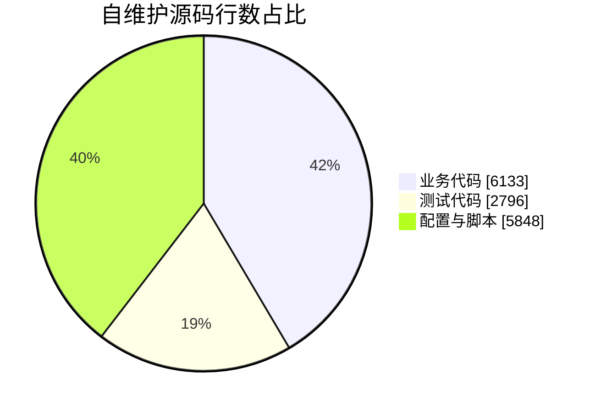

# 知序｜学术服务全端工程


[toc]

---

当前产品为自营虚拟商品商城：分类与详情→下单→支付宝／微信模拟收银台→站方交付→买方确认完成→评价。商品名称、价格、图片、上下架和缺货由后台维护；业务要求以[商城需求与开发评审](../需求/项目需求与开发评审/项目需求与开发评审.md)为准。

## 🔥 <span id="前言">前言</span>

“知序”是暂定品牌，为客户和运营人员提供毕业论文、普刊、编译三项服务的统一工作流。维护者Jobs，当前状态为**在研MVP / 可运行联调版**。已落地前后端和主要闭环；当前固定客户/管理员账户，不等于完整生产运营系统。普通操作者先双击[开始使用](./使用指南/开始使用.html)，或阅读[零基础使用说明](./使用指南/使用说明.md)。

当前规范入口为[项目需求与开发评审](../需求/项目需求与开发评审/项目需求与开发评审.md)（[离线阅读版](../需求/项目需求与开发评审/项目需求与开发评审阅读版.html)）、[测试与分级验收](../测试/测试与分级验收/测试与分级验收.md)、[交付与运维清单](../需求/交付与运维清单/交付与运维清单.md)。采用已确认的Python／Flutter／Go路线；当前范围、Q项及验收在主评审收口，实际执行结果见商城回归。

代码、测试、需求三个资料主目录的一级仅保留 `README.md` 与子目录；文档原稿、同主题阅读版及附件按职责或标题集中，入口由本页导航。

## <span id="section-1">一、当前功能与交付</span> <a href="#前言" style="font-size:17px; color:green;"><b>🔼</b></a> <a href="#🔚" style="font-size:17px; color:green;"><b>🔽</b></a>

| 部分 | 当前能做什么 | 入口与验证边界 |
| --- | --- | --- |
| Go后端 | 三分类商品、后台编辑、订单、双渠道模拟支付、交付、确认、评价及幂等 | [后端](./后端/后端代码/README.md)，商品／订单／权限／并发及真实HTTP回归 |
| Python桌面 | 商品分类与详情、下单、支付、订单确认评价、十语言三主题与连接设置 | [桌面端](./前端/PC端/Python/README.md)，桌面及商城专项回归；成品需按当前源码重建 |
| Flutter用户端 | iOS/Android同源码、用户Web预览、宽窄窗口、真实API及隔离演示 | [移动端](./前端/移动端/Flutter/README.md)，34项；iOS无签名Release构建通过；Android结果见报告 |
| Flutter后台 | 商品新增编辑、上下架缺货、订单开始服务及交付 | [admin-web](./后端/后端代码/admin-web/index.html)，通过Go `/admin/` 访问；不直接双击此index运行 |
| 鸿蒙 | ArkWeb加载同源HTTPS Flutter用户页面 | [鸿蒙端](./前端/移动端/鸿蒙)，宿主源码与生成脚本已交付，HAP/设备验收待完成 |
| 微信小程序 | 本期必交付的微信原生独立客户端，商城分类与商品详情、下单支付、订单及评价 | [微信小程序](./前端/微信小程序/README.md)，仓库逻辑校验；开发者工具、真机与发布分别待验 |
| 分平台部署 | 各系统独立脚本完成配置、SDK准备、构建、前台运行 | [deploy](../部署/README.md)，Mac实际迁移冒烟；其它平台按报告区分检查/编译/实机 |

支付驱动当前为mock，支付宝／微信确认模拟付款后进入待完成，不会扣款。真实商户资料和Key到齐后接正式预支付、验签、回调、对账与退款。商品价格与服务条款由后台配置。

## <span id="section-2">二、运行、构建与测试</span> <a href="#前言" style="font-size:17px; color:green;"><b>🔼</b></a> <a href="#🔚" style="font-size:17px; color:green;"><b>🔽</b></a>

零基础完整流程见[使用说明](./使用指南/使用说明.md)。同时复制根目录并列的 `代码/` 与 `部署/` 到服务器，运行 `部署/` 内对应平台入口；管理员页面和用户Web已随目录带入，服务器不必装Flutter或Node。

开发者在 `后端/后端代码` 运行：

```shell
go run ./cmd/server
python3 ../../../测试/运行测试.py/运行测试.py --group go
go vet ./...
```

移动用户端在 `前端/移动端/Flutter`，后台入口在 `前端/后台管理端/Flutter`；两者各自使用 `lib/main.dart`。后台通过本地路径依赖共用移动端工程的 `zhixu` 包，不复制业务、仓库或主题。Web 构建分别在对应工程执行；桌面 APP／DMG 在 `前端/PC端/Python/dist`，Windows EXE 须在 Windows 本机生成。

工程根的整合保护：

```shell
python3 ../测试/运行测试.py/运行测试.py \
  --group http \
  --group deploy \
  --group mini
```

所有测试使用独立夹具和临时数据。正式数据、真实收付款与对外消息不作为测试输入。[回归报告](../测试/回归测试报告/回归测试报告.md)列出各轮结果与未验收项。

### 2.1、<span id="local-tunnel">本地部署＋内网穿透</span> <a href="#前言" style="font-size:17px; color:green;"><b>🔼</b></a> <a href="#🔚" style="font-size:17px; color:green;"><b>🔽</b></a>

**关闭此运行终端，服务将结束**。本地临时模式依赖当前运行窗口；确认公开前和地址生成后的日志会单独红色加粗提示，纯文本终端及日志保留原文。关闭终端或按 `Ctrl+C` 结束本次后端与隧道，数据和配置保留。

前期少量访问可将根目录并列的 `代码/` 与 `部署/` 留在现有电脑上运行，无需先采购云主机。运行 `部署` 内本系统入口，阅读说明并按回车后，通过 [**fzf**](https://github.com/junegunn/fzf) 选择“本地部署＋内网穿透”或“服务器部署”；方向键选择、回车确认，Esc 取消。脚本复用健康工具，只在缺失时准备当前模式所需依赖。

1、从[部署入口总览](../部署/README.md#section-1)选择当前系统的“快捷入口”并双击；命令行也可运行包内规范脚本。本地模式完成账户预检后，构建并启动 `127.0.0.1:8080`，通过健康检查后启动免费 [**Cloudflare Quick Tunnel**](https://developers.cloudflare.com/tunnel/get-started/quick-tunnels/)，输出本次随机 HTTPS 地址。`DATABASE_URL` 留空使用文件模式，不必先安装 PostgreSQL；首次需设置两个不同的非默认强密码。

2、本项目的网页、API 和文件统一穿透到 `127.0.0.1:8080`；与李林哲项目同机时，另用一个域名和隧道指向其 `127.0.0.1:8098`，各自保留数据目录。保持公网 Host 与浏览器 Origin 匹配，不默认重写为 localhost。固定地址可选 [**cpolar**](https://www.cpolar.com/) 或命名隧道；cpolar 两条隧道由同一客户端进程运行。

3、本地模式保持终端运行，按 Ctrl+C 退出时回收本次启动的隧道与服务，保留数据和账户配置。“服务器部署”沿用服务器启动流程，不启动公网隧道。手机关闭 Wi-Fi，验证登录、真实提交后刷新重读、上传和私有文件授权下载；本地演示回退不算服务器成功。睡眠、断网或重启会影响外部访问。

平台安装、可复制命令、固定域名、停止与排查见[详细部署教程](../部署/README.md#local-tunnel)，离线浏览见[部署阅读版](../部署/README.md#local-tunnel)。当前公网穿透及最低资源档仍未完成实机验收。

## <span id="section-3">三、目录与定位</span> <a href="#前言" style="font-size:17px; color:green;"><b>🔼</b></a> <a href="#🔚" style="font-size:17px; color:green;"><b>🔽</b></a>

```text
代码/
├── 使用指南/                # 普通操作者说明与开始使用页面
├── 工程总览/                # 本README阅读版及独立地图导航
├── 工程资源/                # 文档和工程的共享资源
├── 前端/
│   ├── PC端/Python/
│   ├── 移动端/
│   │   ├── Flutter/            # 跨平台用户端与共享包
│   │   └── 鸿蒙/               # 现有原生在线宿主
│   ├── 后台管理端/Flutter/     # 独立后台入口，依赖共享包
│   └── 微信小程序/
└── 后端/
    ├── 接口契约/api.json
    └── 后端代码/               # Go 源码、配置和运行迁移

../部署/                        # 仓库根目录，各操作系统部署入口

../测试/                        # 各端测试、统一执行器与证据
../需求/                        # 唯一需求、设计、评审及交接资料
```

[技术方案与39项需求追踪](../需求/技术方案与实现范围/技术方案与实现范围.md)说明各项已实现、部分实现与待验边界；[各单元代码地图导航](./工程总览/README.md)通向各端、语言和部署单元的入口与模块。未初始化CodeGraph索引，不把本地索引当必需依赖。

## <span id="section-4">四、模块与业务路由</span> <a href="#前言" style="font-size:17px; color:green;"><b>🔼</b></a> <a href="#🔚" style="font-size:17px; color:green;"><b>🔽</b></a>

具体模块关系在各自独立工程的代码地图维护；跨单元依赖见[工程总览导航](./工程总览/README.md#shared-navigation)。


## <span id="section-5">五、源码规模与功能盘点</span> <a href="#前言" style="font-size:17px; color:green;"><b>🔼</b></a> <a href="#🔚" style="font-size:17px; color:green;"><b>🔽</b></a>

统计日期2026-11-02，口径见[源码统计JSON](../需求/工程资料/源码统计.json)。只统计自维护源码、测试、配置与脚本；排除SDK、依赖、平台自动脚手架、生成物、资源、锁文件和原需求快照，不以文件扩展名数量冒充业务量。

| 类别 | 文件数 | 行数 | 行数占比 |
| --- | --- | --- | --- |
| 业务代码 | 28 | 6133 | 41.5% |
| 测试代码 | 12 | 2796 | 18.9% |
| 配置与脚本 | 46 | 5848 | 39.6% |



前端路由口径：Flutter用户/管理各3个主导航页面，详情属于工作区子视图，弹窗不另计页；Python3个主页面；微信5个独立page；鸿蒙复用Flutter页面、无新增业务页面。不跨实现简单相加成独立产品功能数。后端独立部署单元1个，业务HTTP接口10类，另有健康/管理诊断；RPC/MQ/定时任务/外部支付或通知投递器均0。一个actions接口承载多项状态动作，因此页面/接口比例不适用普通CRUD的机械对比。

| 类目 | 涉及情况与实现 |
| --- | --- |
| 网络/安全 | HTTPS由反代，Bearer内存会话、PBKDF2密码、登录限流；未实现证书绑定/OAuth/微信身份；本地偏好不保存密码或Token |
| 数据 | 文件原子快照或PG单行JSONB事务；客户端隔离演示与真实未知写；当前商品订单模型，容量验收另行执行 |
| 端能力 | 文件选择/授权下载；未接推送、蓝牙、定位、NFC、生物识别或真实支付；鸿蒙文件能力按README边界 |
| 工程 | 中文UI、三态主题、多端源码与分平台脚本；无热更新/埋点/崩溃收集/自动发布流水线 |
| 后端 | 版本锁、幂等收据、事务审计/outbox、退款额度及未知占用；未有真正通知发送、渠道对账或分布式任务队列 |
| 隐私 | 附件私有授权、请求处理授权、日志不记密码；正式隐私清单、数据保留及账号注销流程尚未完整 |

## <span id="section-6">六、依赖与最新稳定基线</span> <a href="#前言" style="font-size:17px; color:green;"><b>🔼</b></a> <a href="#🔚" style="font-size:17px; color:green;"><b>🔽</b></a>

直接运行第三方库5项，均公库、无私库；传递依赖不计入此数量。2026-10-30核对并锁定兼容的最新直接依赖，最新Android工具链按官方资料显式配置；SDK约束中的传递包差异单列于[Flutter依赖状态](./前端/移动端/Flutter/依赖状态.json)，没有强制覆盖为不兼容版本。

| 直接依赖 | 版本 | 来源/许可证 | 使用模块 |
| --- | --- | --- | --- |
| [pgx](https://github.com/jackc/pgx) | 5.11.0 | 公库MIT | Go可选PG存储 |
| [PySide6](https://pypi.org/project/PySide6/6.12.0/) | 6.12.0 | 公库LGPL-3.0及其它官方许可选项 | Python桌面 |
| [http](https://pub.dev/packages/http) | 1.6.0 | 公库BSD-3-Clause | Flutter HTTP |
| [shared_preferences](https://pub.dev/packages/shared_preferences) | 2.5.6 | 公库BSD-3-Clause | Flutter偏好/待核对记录 |
| [file_picker](https://pub.dev/packages/file_picker) | 13.3.0 | 公库MIT | Flutter原生/网页文件 |

工具链：Go1.27.3、Python3.15.2、Flutter3.47.8/Dart3.13.7、本机Xcode27.2；Android AGP9.4.0/Kotlin2.4.21/Gradle9.8.2/API37/NDKr30。开发/打包工具还包括flutter_lints6.0.0、PyInstaller6.22.3（GPL及打包例外）、setuptools84.2.1（MIT），版本与来源见各模块README。桌面按Qt LGPL条件分发，许可原文随包；尚未完成商店签名公证。没有私库凭据和业务密钥。

部署辅助工具另计：fzf0.74.5用于模式选择，cloudflared2026.10.7用于可选本地临时隧道；固定官方资产/架构/SHA256见[工具锁清单](../部署/deploy-tools.lock.tsv)。二者不计入上面的5项业务直接运行库；服务器模式不启动隧道。

## <span id="section-7">七、交付与后续边界</span> <a href="#前言" style="font-size:17px; color:green;"><b>🔼</b></a> <a href="#🔚" style="font-size:17px; color:green;"><b>🔽</b></a>

当前可以联调主要业务，Mac成品和Web可直接体验。正式运营前还需完成真实客户身份、细分员工权限、关系库/对象存储、真实支付与通知、正式HTTPS/运维常驻、品牌协议与各商店签名。Windows、Android、鸿蒙和iPhone Duo具体实机结果以[回归报告](../测试/回归测试报告/回归测试报告.md)为准。没有提交或推送远程仓库。

<a id="🔚" href="#前言" style="font-size:17px; color:green; font-weight:bold;">我是有底线的➤点我回到首页</a>
