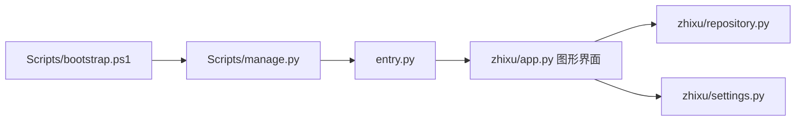

# PC端 · Python代码地图

[toc]

---

## 🔥 前言

本图只定位 Python 桌面独立工程；工程在本单元的 `Zhixu/`，Python 包身份仍为 `src/zhixu`。Windows／MacOS 使用同一份业务源码，分别在目标系统构建。路径均从当前文档相对指向源码；跨单元内容只通过链接引用。

## 一、入口与模块职责 <a href="#前言" style="font-size:17px; color:green;"><b>🔼</b></a> <a href="#🔚" style="font-size:17px; color:green;"><b>🔽</b></a>

| 本单元路径 | 职责 |
| --- | --- |
| [Zhixu/src/entry.py](../Zhixu/src/entry.py) | 冻结程序的入口。 |
| [Zhixu/src/zhixu/app.py](../Zhixu/src/zhixu/app.py) | Python 图形界面、主窗口、服务表单、动作与主题呈现。 |
| [Zhixu/src/zhixu/repository.py](../Zhixu/src/zhixu/repository.py) | 同一后端的 HTTP 请求与演示／未知结果保护。 |
| [Zhixu/src/zhixu/settings.py](../Zhixu/src/zhixu/settings.py) | 连接及主题偏好、用户数据位置。 |
| [Zhixu/Scripts/manage.py](../Zhixu/Scripts/manage.py) | 环境准备、本机打包、产物安全检查及冻结包首屏验证。 |
| [Zhixu/Scripts/bootstrap.ps1](../Zhixu/Scripts/bootstrap.ps1) | Windows 环境准备与运行／打包入口的承接。 |
| [Zhixu/pyproject.toml](../Zhixu/pyproject.toml) | 包身份、依赖声明、命令入口与资源清单。 |

## 二、本单元关系 <a href="#前言" style="font-size:17px; color:green;"><b>🔼</b></a> <a href="#🔚" style="font-size:17px; color:green;"><b>🔽</b></a>

## 三、共享源与外部依赖 <a href="#前言" style="font-size:17px; color:green;"><b>🔼</b></a> <a href="#🔚" style="font-size:17px; color:green;"><b>🔽</b></a>

- [唯一接口契约](../../../../后端/接口契约/api.json)：通过 HTTP 使用 Go API
- [Go 后端地图](../../../../后端/后端代码/代码地图/代码地图.md)：后端实现由后端单元维护

## 四、外置测试与验证边界 <a href="#前言" style="font-size:17px; color:green;"><b>🔼</b></a> <a href="#🔚" style="font-size:17px; color:green;"><b>🔽</b></a>

- [test_gui.py](../../../../../测试/前端/PC端/Python/test_gui.py)：界面、布局及主题
- [test_repository.py](../../../../../测试/前端/PC端/Python/test_repository.py)：HTTP 与状态保护
- [test_packaging.py](../../../../../测试/前端/PC端/Python/test_packaging.py)：产物清理和快捷方式安全夹具
- [test_bootstrap.py](../../../../../测试/前端/PC端/Python/test_bootstrap.py)：Windows 引导器隔离 SDK 夹具
- [verify_package.py](../../../../../测试/前端/PC端/Python/verify_package.py)：冻结 APP 的独立复制与资源验证；不在核心 Scripts 内复制

- [本单元使用说明](../README.md)：运行、构建及当前限制
- [统一测试说明](../../../../../测试/README.md)：各职责的执行入口与证据位置

本次拆图核对文档与源码位置，不代表重新完成构建、设备业务或正式发布验收。已有验证状态保留原记录，未执行的目标不写成通过。

<a id="🔚" href="#前言" style="font-size:17px; color:green; font-weight:bold;">我是有底线的➤点我回到首页</a>
