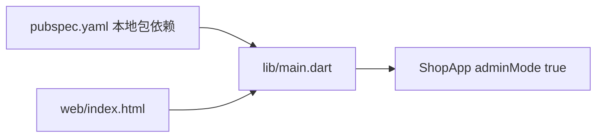

# 后台管理端 · Flutter / Dart代码地图

[toc]

---

## 🔥 前言

本图只定位独立后台 Flutter Web 工程。`lib/main.dart` 以 `adminMode: true` 启动；通过 `pubspec.yaml` 的 `path: ../../移动端/Flutter` 依赖唯一 zhixu 包，不复制数据仓库、主题或页面源码。路径均从当前文档相对指向源码；跨单元内容只通过链接引用。

## 一、入口与模块职责 <a href="#前言" style="font-size:17px; color:green;"><b>🔼</b></a> <a href="#🔚" style="font-size:17px; color:green;"><b>🔽</b></a>

| 本单元路径 | 职责 |
| --- | --- |
| [lib/main.dart](../lib/main.dart) | 管理员入口，配置 adminMode: true。 |
| [pubspec.yaml](../pubspec.yaml) | 后台包身份与移动 Flutter 本地路径依赖。 |
| [analysis_options.yaml](../analysis_options.yaml) | 后台 Dart 分析规则。 |
| [web/index.html](../web/index.html) | 后台 Web 构建用 HTML 壳；不能直接双击当成完整运行产物。 |

## 二、本单元关系 <a href="#前言" style="font-size:17px; color:green;"><b>🔼</b></a> <a href="#🔚" style="font-size:17px; color:green;"><b>🔽</b></a>

## 三、共享源与外部依赖 <a href="#前言" style="font-size:17px; color:green;"><b>🔼</b></a> <a href="#🔚" style="font-size:17px; color:green;"><b>🔽</b></a>

- [移动 Flutter 共享包地图](../../../移动端/Flutter/代码地图/代码地图.md)：共享数据仓库、响应式页面、动作表单与主题的唯一定位源
- [唯一接口契约](../../../../后端/接口契约/api.json)：后台调用同一套 Go API
- [Go 后端地图](../../../../后端/后端代码/代码地图/代码地图.md)：构建产物由 Go 的 /admin/ 静态入口托管，源码壳不是已上线页面

## 四、外置测试与验证边界 <a href="#前言" style="font-size:17px; color:green;"><b>🔼</b></a> <a href="#🔚" style="font-size:17px; color:green;"><b>🔽</b></a>

- [admin_widget_test.dart](../../../../../测试/前端/后台管理端/Flutter/admin_widget_test.dart)：独立后台动作与布局用例
- [shop_test.dart](../../../../../测试/前端/移动端/Flutter/shop_test.dart)：共享商城商品编辑、履约与状态验证

- [本单元使用说明](../README.md)：运行、构建及当前限制
- [统一测试说明](../../../../../测试/README.md)：各职责的执行入口与证据位置

本次拆图核对文档与源码位置，不代表重新完成构建、设备业务或正式发布验收。已有验证状态保留原记录，未执行的目标不写成通过。

<a id="🔚" href="#前言" style="font-size:17px; color:green; font-weight:bold;">我是有底线的➤点我回到首页</a>
