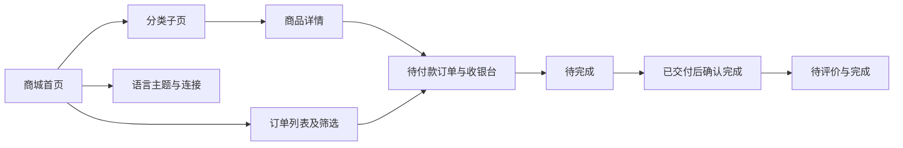

# 微信小程序商城 · 代码地图

[toc]

---

## 🔥 前言

本图定位小程序商城的实际注册入口、请求及页面。路径从当前文档相对指向源码。

## 一、页面与模块 <a href="#前言" style="font-size:17px; color:green;"><b>🔼</b></a> <a href="#🔚" style="font-size:17px; color:green;"><b>🔽</b></a>

| 路径 | 职责 |
| --- | --- |
| [app.js](../app.js)、[app.json](../app.json) | 唯一商城首页、六个页面注册、系统主题监听 |
| [Utils/shop.js](../Utils/shop.js) | 商品／订单、隔离演示、版本和幂等恢复 |
| [Utils/api.js](../Utils/api.js) | HTTP、短超时、身份与会话代次保护 |
| [Utils/ui.js](../Utils/ui.js)、[strings.json](../Utils/strings.json) | 十语言、三主题、价格和视图格式 |
| [Pages/Shop](../Pages/Shop/index.js) | 首页及分类子页，九项商品 |
| [Pages/Product](../Pages/Product/index.js) | 商品详情和下单 |
| [Pages/Orders](../Pages/Orders/index.js) | 四状态筛选、收据核对和原键重试 |
| [Pages/Order](../Pages/Order/index.js) | 订单快照、渠道收银台、确认和评价 |
| [Pages/Login](../Pages/Login/index.js) | 登录、隔离演示和退出 |
| [Pages/Settings](../Pages/Settings/index.js) | 语言、主题、API与超时 |
| [EmptyState](../Components/EmptyState/index.js) | 带重载的本地化空态 |
| [Assets/brand.png](../Assets/brand.png) | 打包品牌图，来自仓库自有 icon.png |

## 二、页面关系 <a href="#前言" style="font-size:17px; color:green;"><b>🔼</b></a> <a href="#🔚" style="font-size:17px; color:green;"><b>🔽</b></a>

## 三、接口与验证 <a href="#前言" style="font-size:17px; color:green;"><b>🔼</b></a> <a href="#🔚" style="font-size:17px; color:green;"><b>🔽</b></a>

- [商城需求](../../../../需求/商城需求与设计/README.md)定义商品状态、交易和履约分轴。
- [后端商城实现](../../../后端/后端代码/internal/platform/shop.go)负责事务、金额、权限和收据。
- [商城逻辑测试](../../../../测试/前端/微信小程序/test_shop.cjs)覆盖真实空态、恢复、并发写、支付与状态；[HTTP保护测试](../../../../测试/前端/微信小程序/test_mini.cjs)继续覆盖请求与隔离边界。
- 仓库检查不替代微信开发者工具编译、真机、体验与发布；操作说明见[工程 README](../README.md)。

<a id="🔚" href="#前言" style="font-size:17px; color:green; font-weight:bold;">我是有底线的➤点我回到首页</a>
