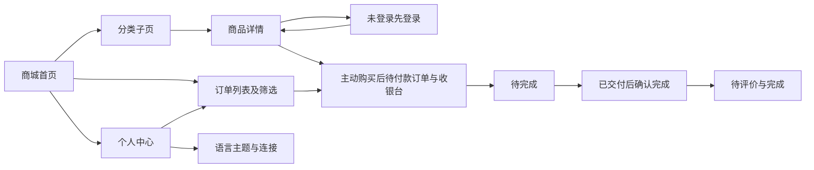

# 微信小程序商城 · 代码地图

[toc]

---

## 🔥 前言

本图定位小程序商城的实际注册入口、请求及页面。路径从当前文档相对指向源码。

## 一、页面与模块 <a href="#前言" style="font-size:17px; color:green;"><b>🔼</b></a> <a href="#🔚" style="font-size:17px; color:green;"><b>🔽</b></a>

| 路径 | 职责 |
| --- | --- |
| [app.js](../app.js)、[app.json](../app.json) | 八个页面、三项图文Tab、系统主题监听 |
| [custom-tab-bar](../custom-tab-bar/index.js) | 首页／我的订单／个人中心，国际化图文导航，普通切换不重置订单筛选 |
| [Utils/shop.js](../Utils/shop.js) | 商品／订单、隔离演示、版本和幂等恢复；轮播成功空配置与请求失败分开缓存 |
| [Utils/api.js](../Utils/api.js) | HTTP、短超时、身份与会话代次保护 |
| [Utils/ui.js](../Utils/ui.js)、[strings.json](../Utils/strings.json) | 十语言、三主题、价格、买卖方状态、持续错误提示及已有真实数据保留判定 |
| [Utils/carousel.js](../Utils/carousel.js) | 原生轮播偏好、单图／多图及前台可见播放判定 |
| [Pages/Shop](../Pages/Shop/index.js) | 轮播、本地种子、运营关闭隐藏、三分类swiper联动、九项商品 |
| [Pages/Profile](../Pages/Profile/index.js) | 用户名、头像、买卖方四订单状态入口 |
| [Pages/Web](../Pages/Web/index.js) | 受域名限制的web-view与复制链接回退 |
| [Pages/Product](../Pages/Product/index.js) | 商品详情、购买输入与登录返回，主动确认后下单 |
| [Pages/Orders](../Pages/Orders/index.js) | 四状态筛选保留、收据核对、原键重试及私有数据隔离 |
| [Pages/Order](../Pages/Order/index.js) | 订单快照、渠道收银台、确认和评价；需求草稿同账号恢复，商户只读对应状态 |
| [Pages/Login](../Pages/Login/index.js) | 登录回原任务、失败保留表单及显式Demo配置的实际凭据逐字段复制 |
| [Pages/Settings](../Pages/Settings/index.js) | 语言、主题、API与超时 |
| [EmptyState](../Components/EmptyState/index.js) | 带重载的本地化空态 |
| [Assets/brand.png](../Assets/brand.png) | 打包品牌图，来自仓库自有 icon.png |

## 二、页面关系 <a href="#前言" style="font-size:17px; color:green;"><b>🔼</b></a> <a href="#🔚" style="font-size:17px; color:green;"><b>🔽</b></a>

## 三、接口与验证 <a href="#前言" style="font-size:17px; color:green;"><b>🔼</b></a> <a href="#🔚" style="font-size:17px; color:green;"><b>🔽</b></a>

- [商城需求](../../../../需求/商城需求与设计/README.md)定义商品状态、交易和履约分轴。
- [后端商城实现](../../../后端/后端代码/internal/platform/shop.go)负责事务、金额、权限和收据。
- [商城逻辑测试](../../../../测试/前端/微信小程序/test_shop.cjs)57项覆盖真实空态、恢复、并发写、支付、登录返回、失败草稿、账号隔离、筛选、卖方状态和轮播主动关闭；[HTTP保护测试](../../../../测试/前端/微信小程序/test_mini.cjs)20项覆盖请求与隔离边界，总计77项。
- 仓库检查不替代微信开发者工具编译、真机、体验与发布；操作说明见[工程 README](../README.md)。

<a id="🔚" href="#前言" style="font-size:17px; color:green; font-weight:bold;">我是有底线的➤点我回到首页</a>
