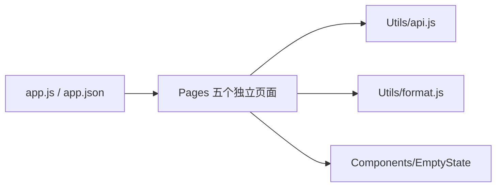

# 微信小程序 · JavaScript / WXML / WXSS代码地图

[toc]

---

## 🔥 前言

本图定位微信官方原生客户端。JavaScript、WXML、WXSS 与 JSON 配置归本工程维护；网页或其它端的结果不替代开发者工具、真机与发布验收。路径均从当前文档相对指向源码；跨单元内容只通过链接引用。

## 一、入口与模块职责 <a href="#前言" style="font-size:17px; color:green;"><b>🔼</b></a> <a href="#🔚" style="font-size:17px; color:green;"><b>🔽</b></a>

| 本单元路径 | 职责 |
| --- | --- |
| [app.js](../app.js) | 小程序启动与全局入口。 |
| [app.json](../app.json) | 五个页面注册及全局配置。 |
| [Utils/api.js](../Utils/api.js) | 小程序 HTTP、会话及幂等保护。 |
| [Utils/format.js](../Utils/format.js) | 页面显示格式与文案辅助。 |
| [Pages/Home/index.js](../Pages/Home/index.js) | 首页与三项服务。 |
| [Pages/Login/index.js](../Pages/Login/index.js) | 登录。 |
| [Pages/Create/index.js](../Pages/Create/index.js) | 新建需求。 |
| [Pages/Workspace/index.js](../Pages/Workspace/index.js) | 需求／订单列表。 |
| [Pages/Detail/index.js](../Pages/Detail/index.js) | 需求详情及阶段动作。 |
| [Components/EmptyState/index.js](../Components/EmptyState/index.js) | 列表空态与重载入口组件。 |

## 二、本单元关系 <a href="#前言" style="font-size:17px; color:green;"><b>🔼</b></a> <a href="#🔚" style="font-size:17px; color:green;"><b>🔽</b></a>

## 三、共享源与外部依赖 <a href="#前言" style="font-size:17px; color:green;"><b>🔼</b></a> <a href="#🔚" style="font-size:17px; color:green;"><b>🔽</b></a>

- [唯一接口契约](../../../后端/接口契约/api.json)：共用 Go API，页面不保存另一份人工合同
- [Go 后端地图](../../../后端/后端代码/代码地图/代码地图.md)：后端身份、需求和文件行为由 Go 单元维护

## 四、外置测试与验证边界 <a href="#前言" style="font-size:17px; color:green;"><b>🔼</b></a> <a href="#🔚" style="font-size:17px; color:green;"><b>🔽</b></a>

- [test_mini.cjs](../../../../测试/前端/微信小程序/test_mini.cjs)：小程序仓库逻辑与合同保护

- [本单元使用说明](../README.md)：运行、构建及当前限制
- [统一测试说明](../../../../测试/README.md)：各职责的执行入口与证据位置

本次拆图核对文档与源码位置，不代表重新完成构建、设备业务或正式发布验收。已有验证状态保留原记录，未执行的目标不写成通过。

<a id="🔚" href="#前言" style="font-size:17px; color:green; font-weight:bold;">我是有底线的➤点我回到首页</a>
