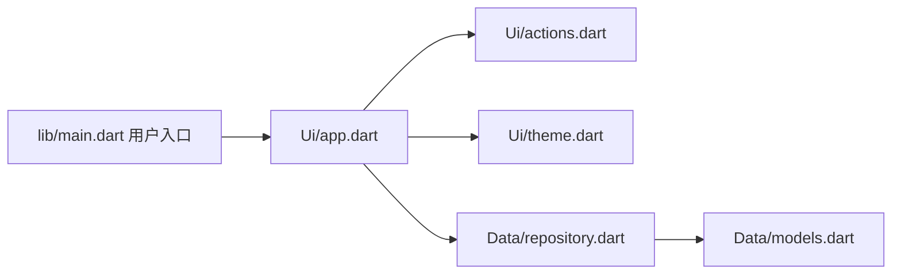

# 移动端 · Flutter / Dart代码地图

[toc]

---

## 🔥 前言

本图定位 Flutter 移动用户端与本工程承载的共享 zhixu 包；Dart 业务在 `lib/`。`ios/`、`android/`、`web/` 是本工程平台壳，不是另建的业务实现。路径均从当前文档相对指向源码；跨单元内容只通过链接引用。

## 一、入口与模块职责 <a href="#前言" style="font-size:17px; color:green;"><b>🔼</b></a> <a href="#🔚" style="font-size:17px; color:green;"><b>🔽</b></a>

| 本单元路径 | 职责 |
| --- | --- |
| [lib/main.dart](../lib/main.dart) | 用户端入口。 |
| [lib/Data/repository.dart](../lib/Data/repository.dart) | API、身份、样例隔离、未知提交与原键核对。 |
| [lib/Data/models.dart](../lib/Data/models.dart) | 客户端数据模型。 |
| [lib/Ui/app.dart](../lib/Ui/app.dart) | 响应式页面与用户／管理员模式的共用界面。 |
| [lib/Ui/actions.dart](../lib/Ui/actions.dart) | 角色／阶段动作表单。 |
| [lib/Ui/theme.dart](../lib/Ui/theme.dart) | 主副文字、背景与主题。 |
| [pubspec.yaml](../pubspec.yaml) | zhixu 包名、依赖与平台资源配置。 |
| [Tool/prepare_harmony.py](../Tool/prepare_harmony.py) | 为独立鸿蒙宿主准备用户 Web 与端点配置；不代表已构建 HAP。 |

## 二、本单元关系 <a href="#前言" style="font-size:17px; color:green;"><b>🔼</b></a> <a href="#🔚" style="font-size:17px; color:green;"><b>🔽</b></a>

## 三、共享源与外部依赖 <a href="#前言" style="font-size:17px; color:green;"><b>🔼</b></a> <a href="#🔚" style="font-size:17px; color:green;"><b>🔽</b></a>

- [后台 Flutter 地图](../../../后台管理端/Flutter/代码地图/代码地图.md)：后台通过 path 包依赖复用本工程的数据、主题和界面，独立入口由后台维护
- [鸿蒙宿主地图](../../鸿蒙/代码地图/代码地图.md)：宿主通过 HTTPS 加载本工程的用户 Web
- [唯一接口契约](../../../../后端/接口契约/api.json)：与其它客户端共用同一个 Go API
- [Go 后端地图](../../../../后端/后端代码/代码地图/代码地图.md)：由 Go 服务托管用户 Web 和 API

## 四、外置测试与验证边界 <a href="#前言" style="font-size:17px; color:green;"><b>🔼</b></a> <a href="#🔚" style="font-size:17px; color:green;"><b>🔽</b></a>

- [repository_test.dart](../../../../../测试/前端/移动端/Flutter/repository_test.dart)：数据仓库行为
- [widget_test.dart](../../../../../测试/前端/移动端/Flutter/widget_test.dart)：用户界面
- [RunnerTests.swift](../../../../../测试/前端/移动端/Flutter/iOS/RunnerTests.swift)：外置 iOS 测试 Target 源码

- [本单元使用说明](../README.md)：运行、构建及当前限制
- [统一测试说明](../../../../../测试/README.md)：各职责的执行入口与证据位置

本次拆图核对文档与源码位置，不代表重新完成构建、设备业务或正式发布验收。已有验证状态保留原记录，未执行的目标不写成通过。

<a id="🔚" href="#前言" style="font-size:17px; color:green; font-weight:bold;">我是有底线的➤点我回到首页</a>
