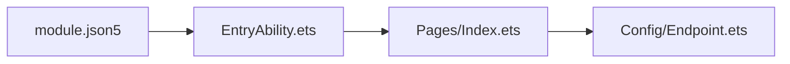

# 移动端 · 鸿蒙 ArkTS / ArkWeb代码地图

[toc]

---

## 🔥 前言

本图定位独立 HarmonyOS ArkTS／ArkWeb 在线宿主。它通过同源 HTTPS 加载 Flutter 用户 Web，不是 Flutter OH 引擎；离线首启、真实文件能力和目标设备验收边界见本单元说明。路径均从当前文档相对指向源码；跨单元内容只通过链接引用。

## 一、入口与模块职责 <a href="#前言" style="font-size:17px; color:green;"><b>🔼</b></a> <a href="#🔚" style="font-size:17px; color:green;"><b>🔽</b></a>

| 本单元路径 | 职责 |
| --- | --- |
| [entry/src/main/ets/Entryability/EntryAbility.ets](../entry/src/main/ets/Entryability/EntryAbility.ets) | UIAbility 启动并加载 Pages/Index。 |
| [entry/src/main/ets/Pages/Index.ets](../entry/src/main/ets/Pages/Index.ets) | 鸿蒙 HTTPS Web 宿主与失败重试。 |
| [entry/src/main/ets/Config/Endpoint.ets](../entry/src/main/ets/Config/Endpoint.ets) | 宿主访问端点与安全配置。 |
| [entry/src/main/module.json5](../entry/src/main/module.json5) | 模块、能力及资源声明。 |
| [build-profile.json5](../build-profile.json5) | 本工程构建配置。 |
| [hvigorfile.ts](../hvigorfile.ts) | Hvigor 构建入口。 |

## 二、本单元关系 <a href="#前言" style="font-size:17px; color:green;"><b>🔼</b></a> <a href="#🔚" style="font-size:17px; color:green;"><b>🔽</b></a>

## 三、共享源与外部依赖 <a href="#前言" style="font-size:17px; color:green;"><b>🔼</b></a> <a href="#🔚" style="font-size:17px; color:green;"><b>🔽</b></a>

- [移动 Flutter 地图](../../Flutter/代码地图/代码地图.md)：用户页面及准备工具归 Flutter 单元维护；本宿主仅引用
- [宿主准备工具](../../Flutter/Tool/prepare_harmony.py)：按目标参数准备 Web／端点，不能把配置检查写成签名或真机通过
- [Go 后端地图](../../../../后端/后端代码/代码地图/代码地图.md)：HTTPS 页面使用同源 Go API 与文件服务

## 四、外置测试与验证边界 <a href="#前言" style="font-size:17px; color:green;"><b>🔼</b></a> <a href="#🔚" style="font-size:17px; color:green;"><b>🔽</b></a>

- [test_prepare_harmony.py](../../../../../测试/前端/移动端/鸿蒙/test_prepare_harmony.py)：宿主准备工具、端点与合同检查

- [本单元使用说明](../README.md)：运行、构建及当前限制
- [统一测试说明](../../../../../测试/README.md)：各职责的执行入口与证据位置

本次拆图核对文档与源码位置，不代表重新完成构建、设备业务或正式发布验收。已有验证状态保留原记录，未执行的目标不写成通过。

<a id="🔚" href="#前言" style="font-size:17px; color:green; font-weight:bold;">我是有底线的➤点我回到首页</a>
