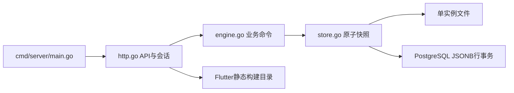
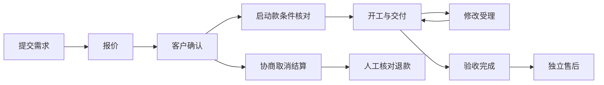

# 学术服务后端


[toc]

---

## 🔥 <span id="前言">前言</span>

以 [**Go**](https://go.dev/) 实现的可运行 MVP，为毕业论文、普刊、编译三个服务入口提供统一 API。维护者 Jobs。当前适用于产品演示与功能联调；真实客户入驻、细分员工权限、真实支付和完整关系数据库迁移仍需继续完成。零基础操作者先看上级工程使用说明，再运行同级代码层的 `../../../部署` 内对应系统入口。

## 一、<span id="capability">当前功能</span> <a href="#前言" style="font-size:17px; color:green;"><b>🔼</b></a> <a href="#🔚" style="font-size:17px; color:green;"><b>🔽</b></a>

| 模块 | 当前行为 |
| --- | --- |
| 服务与需求 | 固定三分类、按服务校验表单、本人需求、补充资料、未成交撤回、消息 |
| 版本报价 | 人工报价、有效期、材料与服务快照、撤回、拒绝、一需求一订单 |
| 履约 | 按已核实启动款开工、多个暂停原因分别关闭、文件交付、草稿、按组最新正式版验收 |
| 修改 | 反馈绑定交付、受理轮次、同轮只计一次、免计0次、额度校验、售后独立计数 |
| 变更与取消 | 客户确认后生效的范围/应收/交期变更、未完成阶段取消协商、最终结算保留原价 |
| 资金 | 人工核实收款台账、退款申请/批准/待核对/成功/失败、原收款额度限制、凭据去重 |
| 售后 | 终态订单另开售后、文件另追加、原完成时间不变、退款占用与结算差额未清不关闭售后 |
| 文件 | 每次上传新对象，单文件8MB、每单最多50份/合计64MB；列表只返回元数据，下载验证本人或管理员 |
| 一致性 | 版本冲突409，幂等键及摘要长期保存，业务/审计/待发送通知同一存储事务 |
| 安全 | 密码PBKDF2、随机会话、8小时失效、登录每IP每分钟10次、大小限制、明确跨域来源 |
| 页面托管 | `/admin/` 与 `/client/` 托管部署时带入的 Flutter Web 构建产物，扩展名为空的路由回退入口 |

本版本固定 `admin` 与 `customer` 两个生产身份。开发模式额外提供 `customer2` 便于验证账号隔离；还没有真实微信登录、注册、员工分派、短信或推送通道。`GET /api/v1/admin/outbox` 可查待发送通知，`delivery_enabled=false` 表示尚未向外部发送，不以台账存在冒充已送达。

所有资金动作均为**人工核验台账**。服务器不会自动向银行/微信发起付款或退款；管理员须先核实真实凭据，再登记结果。退款申请、批准、待核对均不计入已退款；已批准/待核对占用原收款额度。未知结果核对原流水后使用确认成功或核对失败入口，不以超时直接换号重退。

## 二、<span id="run">启动与配置</span> <a href="#前言" style="font-size:17px; color:green;"><b>🔼</b></a> <a href="#🔚" style="font-size:17px; color:green;"><b>🔽</b></a>

**后端最低机器配置：** 正常部署脚本包含源码编译，准备 64 位 2 核 / vCPU、4 GiB 可用内存、20 GiB 空闲 SSD；MacOS / Windows 图形机器整机至少 8 GiB 内存并满足可用余量。只运行匹配系统 / 架构的预编译程序、少量数据文件演示，可按 2 核 / 2 GiB 可用内存 / 10 GiB 空闲 SSD 预算；该预算不能用于正常脚本编译。以上为工程估算，未做下限硬件压测或生产容量验收。 系统版本、网络、数据库同机与扩容边界见[部署最低机器配置](../../../部署/README.md#minimum-machine)。

需要 Go 1.27.3。以下在本目录执行；双击部署入口会负责准备本地环境，开发命令不自动下载或配置数据库。

```shell
go mod download
go run ./cmd/server
```

开发默认地址 `http://127.0.0.1:8080`，管理员 `admin / demo-admin-change-me`，客户 `customer / demo-customer`。这两个值仅供本机开发；生产模式拒绝默认密码。查看健康状态访问 `/healthz`。文件及附件在 `DATA_DIR/state.json` 内，不能把开发数据拷到正式服务当客户记录。

| 环境变量 | 默认值 | 用途 |
| --- | --- | --- |
| `APP_ENV` | `development` | 仅接受development/test/production |
| `LISTEN_ADDR` | `127.0.0.1:8080` | API与页面共同监听；外部访问需配置合法地址与HTTPS反向代理 |
| `DATA_DIR` | `./data` | 文件模式持久化目录；相对启动工作目录 |
| `ADMIN_PASSWORD` | 开发样例值 | 生产必须明确设置，通常至少12字符；本地调试开关生效时至少4字符，均禁止默认值 |
| `DEMO_CUSTOMER_PASSWORD` | 开发样例值 | 固定customer身份密码；长度要求同管理员，禁止默认值且必须与管理员不同 |
| `LOCAL_DEBUG_PASSWORDS` | 未设置 | 精确设为 `1` 且生产监听数字IP回环地址时，密码最小长度为4字符；其它情况生产仍要求12字符 |
| `DATABASE_URL` | 空 | 空为单进程文件模式；填写连接串则使用PostgreSQL聚合事务存储 |
| `ADMIN_STATIC_DIR` | `./admin-web` | 管理后台构建产物目录 |
| `CLIENT_STATIC_DIR` | `./client-web` | 用户端Web构建产物目录 |
| `CORS_ORIGINS` | 空 | 空为同源；允许其它来源时逗号分隔精确origin，生产仅HTTPS |

服务直接读取进程环境，**不自动执行/加载 `.env`**；[配置示例](.env.example) 是字段说明。部署入口使用自身配置并注入环境。反向代理须保留原始 Host。同源HTTPS以及本机loopback HTTP可用；生产公共域名需要HTTPS。CORS是浏览器来源约束，所有私有接口仍单独校验Bearer会话。

[**MacOS**](https://www.apple.com/macos/) 部署入口的“本地部署＋内网穿透”仅给当前进程设置 `LOCAL_DEBUG_PASSWORDS=1`，监听 `127.0.0.1` 时允许4字符密码；“服务器部署”清除此开关并要求12字符。后端也支持数字回环地址 `::1`；`localhost` 等主机名及非回环地址不放宽长度。长度按Unicode字符计数；开关不改变 `APP_ENV=production`、生产账号和CORS限制，也不写入部署配置。

退出时按 `Ctrl+C`，服务完成优雅关闭后删除本实例的 `.server-lock`；同一数据目录不能启动多个文件模式实例。MacOS 文件模式还会在整个运行期间持有 `DATA_DIR` 下 `.server-guard` 的系统文件锁；进程退出后系统释放锁，guard 文件保留，不要手工删除它。

MacOS 再次启动遇到 `.server-lock` 时，只有记录的 `pid`、`started` 格式有效、系统确认该 PID 已不存在，且文件身份与内容复核一致，才先保存同目录的 `.server-lock.stale-*.bak`（0600权限），再回收旧标记并启动。活进程、权限不足、损坏记录、符号链接或无法确认的锁会保留并报错；先核对错误与原实例，不要删锁强行启动。其它系统保留原有排他标记方式，意外退出遗锁须先确认旧进程已停止并备份数据目录，再由维护者处理。各系统均不要删除 `state.json` 或让两个实例共用它。

## 三、<span id="api">接口与动作</span> <a href="#前言" style="font-size:17px; color:green;"><b>🔼</b></a> <a href="#🔚" style="font-size:17px; color:green;"><b>🔽</b></a>

前缀 `/api/v1`。JSON字段以[唯一接口契约](../接口契约/api.json)及本目录 `internal/platform/model.go` 为准。私有接口使用 `Authorization: Bearer <token>`。创建、动作、上传必须提供8至120字符的 `Idempotency-Key`；动作/上传同时携带看到的 `expected_version`。金额为人民币分整数，时间为RFC3339，日期为YYYY-MM-DD。

| 方法与路径 | 用途 |
| --- | --- |
| `POST /auth/login` | account/password换取会话 |
| `POST /auth/logout` | 撤销当前会话，可重复调用 |
| `GET /services` | 公开三项服务 |
| `GET /workspace` | 当前身份、服务与可见需求 |
| `POST /cases` | 创建需求，返回case |
| `GET /cases/{id}` | 本人或管理员详情 |
| `POST /cases/{id}/actions` | 执行带版本业务动作 |
| `POST /cases/{id}/attachments` | multipart：file、expected_version |
| `GET /cases/{id}/attachments/{id}` | 验证身份后下载原件 |
| `GET /operations/{key}` | 只查询当前身份该提交标识的已提交结果 |

`GET /operations/{key}` 返回 `operation.status=succeeded`、`case_id`、`action`、`created_at` 及**最新**case。404表示尚未找到已提交记录，不能证明仍在途的请求已失败。响应丢失时保留原key和完整原正文，查询后可由用户主动以原key重试；后端先查幂等收据，再校验当前版本。同key异文返回409，绝不能另起新key自动重做资金动作。

| 身份 | 动作与必填参数（另加action/expected_version） |
| --- | --- |
| 双方 | `message(text)` |
| 客户 | `supplement(text)`、`withdraw_request(text)`、`accept_quote(quote_id)`、`decline_quote(text)` |
| 客户 | `revision(text,delivery_id)`、`accept_delivery(delivery_id)`、`after_sale(text)` |
| 客户 | `confirm_cancel`、`reject_cancel`、`confirm_change(change_id)`、`reject_change(change_id)` |
| 管理员 | `need_material(text)`、`withdraw_quote(text)` |
| 管理员 | `quote(amount_minor,prepay_minor,scope,expires_at,revision_limit)` |
| 管理员 | `record_payment(amount_minor,reference)`、`start` |
| 管理员 | `pause(text,hold_id)`、`resume(hold_id)`；省略hold_id的暂停由服务器生成编号 |
| 管理员 | `deliver(text,attachment_ids,after_sale_id可选,draft可选)` |
| 管理员 | `accept_revision(feedback_id,round_id,count_units)`；count_units只能0或1 |
| 管理员 | `cancel(text,settlement_minor)`、`propose_change(amount_minor,scope,deadline可选,prepay_minor可选)` |
| 管理员 | `refund(amount_minor,payment_id)`只创建申请；`approve_refund(refund_id)`占用额度 |
| 管理员 | `mark_refund_unknown(refund_id)`保留占用；`confirm_refund(refund_id,reference)`登记已核实成功 |
| 管理员 | `reject_refund(refund_id,text)`、`fail_refund(refund_id,text)`；后者拒绝未知结果 |
| 管理员 | `resolve_refund_failed(refund_id,reference,text)`仅对unknown登记原流水已核实失败并释放额度 |
| 管理员 | `close_after_sale(after_sale_id,text)` |

`scope`是完整约定文本，运营须写清服务/不含项目、交付文件、周期基准、修改与取消退款规则。服务细则和收费没有预设成真实价格。售后修改额度继承已接受报价的约定额度，单独计数；更复杂的单独售后协议尚未实现。

401重新登录，403身份无权限，409刷新并核对版本/当前状态，422检查输入。5xx/超时按未知提交处理，不能显示“操作成功”。错误结构为 `{"error":{"code":"...","message":"..."}}`。

## 四、<span id="storage">存储、备份与关系模型</span> <a href="#前言" style="font-size:17px; color:green;"><b>🔼</b></a> <a href="#🔚" style="font-size:17px; color:green;"><b>🔽</b></a>

默认文件模式在锁内复制业务状态，成功后把业务、附件字节、幂等摘要、审计和outbox作为同一快照写入临时文件，fsync后原子替换，失败不发布内存状态。备份须先停止服务，再复制整个data目录与有效部署配置；恢复先保留当前数据的副本。目录/文件权限默认0700/0600；文件未加密，正式机器需自行配置磁盘与备份访问权限。

可选 [**PostgreSQL**](https://www.postgresql.org/) 模式使用[运行存储DDL](./Migrations/001_runtime.sql)的 `academic_runtime_state` 单行JSONB聚合，在数据库事务中 `SELECT ... FOR UPDATE` 重新读当前状态再提交，因此多个服务进程之间共享幂等与版本锁。服务启动自动创建这张MVP运行表，不会执行[参考29表关系DDL](../../../需求/数据库设计/数据库结构.sql)。

**原需求29表关系设计尚未逐表接入业务。** 当前没有关系表投影、RLS、外部对象存储、后台清理或生产迁移工具；不能把参考DDL建表通过理解为本版本已经使用那些表。PG聚合和文件快照也没有自动互转，切换 `DATABASE_URL` 会访问另一份数据源；切换前需制定并验证迁移方案，不能直接改配置当作迁移。

所有业务与文件聚合保存在一份状态，适合当前功能联调；历史增长会放大内存、写入和备份成本，未做压力容量验收。服务上下架与历史售单保护已在业务层实现并测试，但尚无公开运营入口。更完整的服务发布、期刊外部进展、员工授权/撤派需要后续界面及接口。

## 五、<span id="verification">验证方式</span> <a href="#前言" style="font-size:17px; color:green;"><b>🔼</b></a> <a href="#🔚" style="font-size:17px; color:green;"><b>🔽</b></a>

```shell
python3 ../../../测试/运行测试.py/运行测试.py --group go
go vet ./...
```

默认测试使用隔离临时目录和内存，不会改部署数据；PostgreSQL集成用例缺少 `TEST_DATABASE_URL` 时明确跳过。真实原生PG验证应先建立**专用空数据库**，再把它的连接串作为 `TEST_DATABASE_URL` 运行测试。该用例会建立运行表并写入测试需求；数据库非空会拒绝，以免混用正式数据。

```shell
TEST_DATABASE_URL='postgres://tester@127.0.0.1:5432/academic_test?sslmode=disable' \
  python3 ../../../测试/运行测试.py/运行测试.py --group go
```

已包含三服务校验、重报价/过期/材料版本、并发接受、稳定幂等、暂停、资金守恒、轮次、草稿/售后分组、取消结算、权限、附件、重启、坏快照和HTTP安全测试。MacOS 的外置锁测试另覆盖真实子进程互斥、强制退出后的遗锁恢复与数据保留、活旧进程和不明锁拒绝、guard 文件保留。实际本轮结果及验证限制见 外层 `测试/后端/证据/` 和[回归报告](../../../测试/回归测试报告/回归测试报告.md)。跨平台交叉编译仅验证编译链，不等于对应系统实际启动或真实设备验收。

## 六、<span id="architecture">源码与规模</span> <a href="#前言" style="font-size:17px; color:green;"><b>🔼</b></a> <a href="#🔚" style="font-size:17px; color:green;"><b>🔽</b></a>

入口 `cmd/server/main.go`；协议/登录/私有文件网关在 `internal/platform/http.go`；状态转换在 `engine.go`；类型与公开数据裁剪在 `model.go`；两种事务存储在 `store.go`。独立部署单元1个，业务HTTP接口10类（同方法+路径模板计一类，不计健康/静态/管理诊断；2026-10-30，按ServeHTTP分支核对）。RPC/MQ/定时任务/外部支付或通知集成均0。状态机覆盖需求、报价、订单、反馈、变更、取消、退款和售后；收款仅人工核实成功事实。

直接第三方运行依赖1项：[**pgx**](https://github.com/jackc/pgx) v5.11.0（MIT，公库，PG存储使用）。传递依赖由 `go.mod/go.sum` 固定，含puddle/v2 v2.2.3、x/sync v0.24.0、x/text v0.43.0；工具链Go1.27.3，版本核对日期2026-10-30。最新稳定版的选择依据官方Go下载页、pgx模块信息和本轮模块更新解析结果；后续升级应重新跑完整回归。





## 七、<span id="local-tunnel">本地部署＋内网穿透</span> <a href="#前言" style="font-size:17px; color:green;"><b>🔼</b></a> <a href="#🔚" style="font-size:17px; color:green;"><b>🔽</b></a>

**关闭此运行终端，服务将结束**。本地临时模式依赖当前运行窗口；确认公开前和地址生成后的日志会单独红色加粗提示，纯文本终端及日志保留原文。关闭终端或按 `Ctrl+C` 结束本次后端与隧道，数据和配置保留。

前期少量联调可复用现有电脑，不必先租云主机。选择一台常开主机，复制根目录的 `代码/` 与 `部署/` 并保留原相对层级；默认 `127.0.0.1:8080` 与文件模式即可运行学术服务，维修项目使用另一个 `127.0.0.1:8098`。隧道由同一主机发起连接，回环监听可以保留。

1、在本说明所在目录按主机类型运行一个入口，阅读确认后通过fzf选“本地部署＋内网穿透”或“服务器部署”；Esc、空选或选择器错误不启动业务。初次设置两组不同的非默认密码，数据库连接串留空：

| 系统 | 本地启动命令 |
| --- | --- |
| MacOS | `zsh '../../../部署/MacOS/【MacOS】部署.command/【MacOS】部署.command'` |
| Windows PowerShell | `..\..\..\部署\Windows\【Windows】部署.cmd\【Windows】部署.cmd` |
| Ubuntu示例 | `bash '../../../部署/Ubuntu/【Linux】部署.sh/【Linux】部署.sh'` |
| 其它Linux / FreeBSD | 选择部署目录中与本系统同名的入口，不套用其它系统的包管理器 |

2、本地模式按锁清单自动准备缺少的工程内fzf/Go/cloudflared（官方固定资产+SHA256，健康现有工具复用，不改全局PATH）；确认公网后先启动后端，健康成功再生成Cloudflare Quick免费随机HTTPS。无需账号/域名/付费；45秒无地址即回收本次进程并显示排查入口。保持窗口，另开终端访问 `http://127.0.0.1:8080/healthz`，并确认 `/client/`、`/admin/` 的真实API可用。网页显示本地演示只表示UI可体验，不能证明部署成功。

自动Quick通过本次工程内空YAML显式指定 --config，保留个人cloudflared配置，实际子进程隔离TUNNEL_*且不污染父环境；fzf探针和菜单局部隔离默认选项。

3、若大陆网络不可达或需要固定地址，先Ctrl+C停止自动本地模式，重新选择服务器部署，再按本平台原生包安装 [**cpolar**](https://www.cpolar.com/download)，或使用 [**Cloudflare Tunnel**](https://developers.cloudflare.com/tunnel/downloads/) 备选。Mac/Windows/常规Linux/Alpine/FreeBSD的包、架构、CLI和常驻方式分别见[各平台本地穿透步骤](../../../部署/README.md#local-tunnel-start)，不要直接复制其它系统的安装命令。

4、同机两个项目在一份私有配置里定义 `academic → 127.0.0.1:8080` 和 `repair → 127.0.0.1:8098`；使用一个cpolar进程显式运行这两个名字，避免基础版进程额度冲突，也不顺带启动SSH样例。Token存工程外，不粘贴到日志/截图/仓库。免费随机地址适合验通；[官方价格](https://www.cpolar.com/pricing)当前基础版99元/年含3个保留子域名、8条隧道，数量上覆盖同机两个项目；专业版149元/年支持自定义域名等，费用和带宽不作永久承诺。

5、每项目一个HTTPS主机名整站转发，保留公网 `Host`；本项目浏览器Origin必须匹配Host或明确允许来源。学术浏览器打开 `https://实际域名/client/`、`/admin/`，桌面/移动客户端使用 `https://实际域名/api/v1`，手机不能填电脑的127.0.0.1。不要把页面、API和附件拆到不同随机域名。

6、让手机关闭Wi-Fi走移动网络，检查公网健康、客户创建合成需求后刷新重读、管理端同编号、未登录私有请求拒绝以及附件权限。当前单文件8MB；低带宽隧道与应用上传上限都需核对。正式小程序的域名/AppID等发布条件另验。

7、电脑睡眠、合盖、断电或宽带中断会影响访问。首次仅前台运行，不默认改变电源策略或注册服务。自动本地模式Ctrl+C同时回收本次后端和隧道；手动模式先停隧道再停后端。用外部新请求确认入口失效，再备份 `data` 和有效配置；缓存演示页面仍显示不能证明隧道在线。固定域名不用时在后台撤销对应路由。

详细私有YAML、平台命令、固定子域名与Cloudflare备选、日志/停止/排查见[各平台本地穿透步骤](../../../部署/README.md#local-tunnel)。这些是操作说明，当前未安装或建立公网隧道，也未完成双项目同机/公网读写/容量验收。

## 一、<span id="code-map">本单元代码地图</span> <a href="#前言" style="font-size:17px; color:green;"><b>🔼</b></a> <a href="#🔚" style="font-size:17px; color:green;"><b>🔽</b></a>

定位入口见[代码地图目录](代码地图/README.md)，包含本工程的主地图与离线阅读版；共享源只通过原归属引用。


<a id="🔚" href="#前言" style="font-size:17px; color:green; font-weight:bold;">我是有底线的➤点我回到首页</a>
