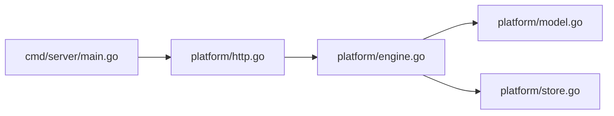

# 后端 · Go代码地图

[toc]

---

## 🔥 前言

本图只定位 Go 服务实现。接口契约在本实现的外层同级维护；测试源码统一外置，通过运行器临时 overlay 进入 Go 包上下文，不复制回核心代码。路径均从当前文档相对指向源码；跨单元内容只通过链接引用。

## 一、入口与模块职责 <a href="#前言" style="font-size:17px; color:green;"><b>🔼</b></a> <a href="#🔚" style="font-size:17px; color:green;"><b>🔽</b></a>

| 本单元路径 | 职责 |
| --- | --- |
| [cmd/server/main.go](../cmd/server/main.go) | 配置、存储启动、HTTP 服务、优雅退出。 |
| [internal/platform/http.go](../internal/platform/http.go) | 登录／会话／限流／CORS、接口与静态 SPA／私有附件。 |
| [internal/platform/engine.go](../internal/platform/engine.go) | 需求、报价、订单、退款、交付、修改、取消及售后原子动作。 |
| [internal/platform/model.go](../internal/platform/model.go) | 领域类型、快照、公开视图、状态汇总。 |
| [internal/platform/store.go](../internal/platform/store.go) | 文件原子替换与实例锁、可选 [**PostgreSQL**](https://www.postgresql.org/) 聚合事务。 |
| [Migrations/001_runtime.sql](../Migrations/001_runtime.sql) | 运行聚合存储的 DDL；不等于需求设计中的完整关系表已上线。 |
| [go.mod](../go.mod) | Go 工具链与模块依赖声明。 |

## 二、本单元关系 <a href="#前言" style="font-size:17px; color:green;"><b>🔼</b></a> <a href="#🔚" style="font-size:17px; color:green;"><b>🔽</b></a>

## 三、共享源与外部依赖 <a href="#前言" style="font-size:17px; color:green;"><b>🔼</b></a> <a href="#🔚" style="font-size:17px; color:green;"><b>🔽</b></a>

- [唯一接口契约](../../接口契约/api.json)：所有客户端共用，集中维护
- [分系统部署导航](../../../../部署/README.md)：分发时保持根目录的代码与部署并列，后端留在代码/后端/后端代码；各系统脚本在自身单元维护
- [后台 Web 构建地图](../../../前端/后台管理端/Flutter/代码地图/代码地图.md)：Go 托管 /admin/ 构建产物；不接管后台源码
- [用户 Web 构建地图](../../../前端/移动端/Flutter/代码地图/代码地图.md)：Go 托管 /client/ 构建产物；不接管 Flutter 源码

## 四、外置测试与验证边界 <a href="#前言" style="font-size:17px; color:green;"><b>🔼</b></a> <a href="#🔚" style="font-size:17px; color:green;"><b>🔽</b></a>

- [engine_test.go](../../../../测试/后端/engine_test.go)：原混合地图的状态、资金、并发及存储测试定位；物理源码已在外层
- [http_test.go](../../../../测试/后端/http_test.go)：HTTP 保护测试
- [test_http.py](../../../../测试/后端/接口/test_http.py)：通过真实服务子进程跑整单闭环

- [本单元使用说明](../README.md)：运行、构建及当前限制
- [统一测试说明](../../../../测试/README.md)：各职责的执行入口与证据位置

地图核对文档与源码位置，不代表完成构建、设备业务或正式发布验收。已有验证状态保留原记录，未执行的目标不写成通过。

<a id="🔚" href="#前言" style="font-size:17px; color:green; font-weight:bold;">我是有底线的➤点我回到首页</a>
