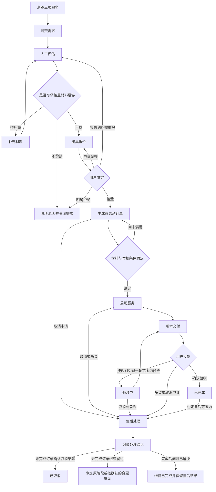
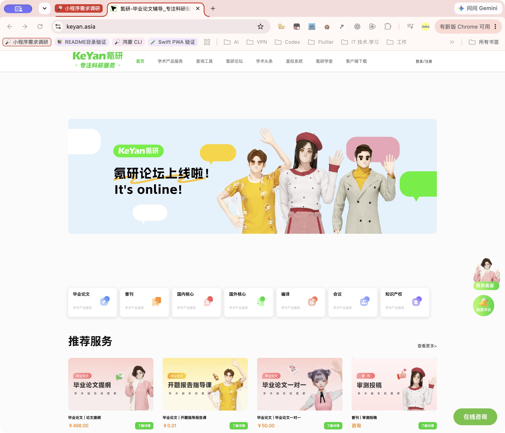
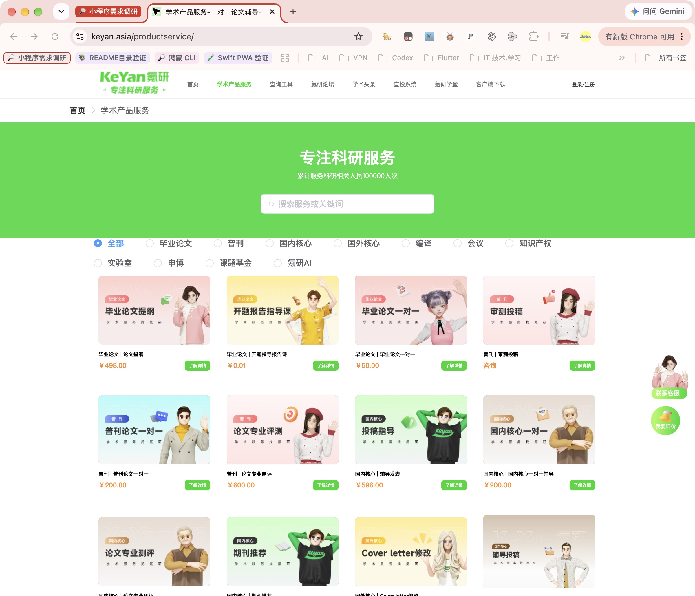

# 学术服务小程序需求分析

[toc]

---

## 🔥 前言

以 [**氪研学术**](https://www.keyan.asia/) 为业务与体验参考，规划一个只经营“毕业论文、普刊、编译”三项服务的小程序。核心体验是：用户快速看懂服务、方便提交需求、明确知道价格与交付进度。

**建议首期采用“三项服务 + 人工报价 + 订单进度 + 文件交付”的轻量闭环。对外网站不作为首期前置条件，内部运营后台需要保留。** 借鉴对方的信息组织和服务入口，品牌、视觉、文案与页面构图独立设计。

| 文档信息 | 内容 |
| --- | --- |
| 版本 | V0.3，需求回归修订稿，供业务讨论、原型及后续开发使用 |
| 日期 | 2026年10月30日，北京时间 |
| 已确认输入 | 用户本轮描述，见第一章 |
| 调研对象 | 对方公开官网首页、学术产品服务页；两张实际截图附后 |
| 本轮交付 | 需求分析、范围建议、页面清单、业务流程、验收条件、待确认事项、需求回归报告与数据库设计 |
| 当前阶段 | 尚未设计最终界面、开发软件或评估正式工期；建议项尚未成为用户确认的开发合同 |

阅读顺序：先看[已确认范围](#confirmed)、[首期范围](#scope)和[待确认事项](#decisions)，再看[三项服务](#services)、[页面清单](#pages)与[验收条件](#acceptance)。本稿同时包含[需求回归结论](#regression)与[数据库设计总览](#database)；字段字典及建表语句见配套文件。

## 一、已确认需求与分析假设 <a href="#前言" style="font-size:17px; color:green;"><b>🔼</b></a> <a href="#🔚" style="font-size:17px; color:green;"><b>🔽</b></a>

### 1.1、用户已明确的要求 <a href="#前言" style="font-size:17px; color:green;"><b>🔼</b></a> <a href="#🔚" style="font-size:17px; color:green;"><b>🔽</b></a>

| 编号 | 确认内容 | 对产品的影响 |
| --- | --- | --- |
| C01 | 主体必须是小程序 | 用户端按小程序使用方式设计，不把电脑网站缩小后直接搬进去 |
| C02 | 有没有网站不影响 | 对外官网可后置；小程序业务不依赖用户先访问官网 |
| C03 | 只提供毕业论文、普刊、编译 | 首页与服务分类只有三个业务入口 |
| C04 | 整体感觉像参考网站，简洁、明确 | 分类、说明、价格表达和下一步动作清楚，减少无关内容 |
| C05 | 高度参考对方做法，同时避免外观雷同 | 提取可见产品逻辑，独立设计自身品牌及表达方式 |
| C06 | 先做需求分析，文档放桌面独立文件夹 | 本轮止于需求交付，不自行启动开发、发布或采购 |
| C07 | 需求分析还要进行回归与数据库设计 | 对需求作交叉回归、修正缺口，并交付数据模型、约束及隔离验证结果 |

### 1.2、尚未确认的分析假设 <a href="#前言" style="font-size:17px; color:green;"><b>🔼</b></a> <a href="#🔚" style="font-size:17px; color:green;"><b>🔽</b></a>

- **平台假设：** 暂按 [**微信小程序**](https://mp.weixin.qq.com/) 分析；用户尚未限定平台。
- **经营方式假设：** 单一运营方提供服务，人工评估与交付；不是多商家平台。
- **服务含义假设：** 毕业论文按辅导、稿件反馈与编辑支持分析；普刊按稿件编辑、选刊及投稿支持分析；编译暂按学术翻译与润色分析。具体项目以实际经营内容确认为准。
- **成交方式假设：** 定制需求先评估再报价，用户确认后形成服务订单；是否小程序内付款独立决策。
- **视觉假设：** 清爽、专业、低信息负担；本稿提出视觉原则，不代表已选定最终设计。

后续章节除 C01—C07 与标明的竞品观察事实外，均为**建议需求**。没有把对方的后台、支付或交付方式当成已证实的模板。编写及隔离验证数据库设计不代表批准将其部署到生产环境。

## 二、对方网站观察与本项目取舍 <a href="#前言" style="font-size:17px; color:green;"><b>🔼</b></a> <a href="#🔚" style="font-size:17px; color:green;"><b>🔽</b></a>

### 2.1、已核查的公开页面 <a href="#前言" style="font-size:17px; color:green;"><b>🔼</b></a> <a href="#🔚" style="font-size:17px; color:green;"><b>🔽</b></a>

| 步骤 | 页面与证据 | 实际观察 | 体验判断与本项目取舍 |
| --- | --- | --- | --- |
| 1 | [官网首页](https://www.keyan.asia/)，[截图01](./参考截图/01-官网首页.jpg) | 浅色背景、独立服务卡片、推广主视觉、明显的绿色动作入口；除目标三类外还有多个业务和内容栏目 | 入口明确，但整体范围大于本项目。提取服务卡片与清楚动作，去掉无关栏目与大面积推广占屏 |
| 2 | [学术产品服务页](https://www.keyan.asia/productService/)，[截图02](./参考截图/02-服务总览.jpg) | 分类、搜索、产品卡片并列；卡片呈现名称、金额或咨询标识、详情入口 | 便于浏览。小程序改成三个分类与纵向内容，避免把电脑端多列卡片等比缩小 |
| 3 | 服务页公开文本及浏览器可访问树 | 毕业论文与普刊下有不同子服务；编译下列有学术翻译、学术润色 | 说明三类业务可继续细分。本项目子服务应按自己的真实交付能力配置，不能由竞品目录直接推定 |
| 4 | 服务详情及后续成交 | 本轮未稳定进入、未完成登录、咨询提交、支付或交付 | **未核实。** 以下业务流程为本项目方案，不声称与对方后台一致 |

观察日期均为2026年10月30日。搜索读取的服务页曾只显示空列表，实际浏览器中能看到产品；因此“没有更多”不能作为对方没有服务的证据。分类筛选结果未可靠验证，不能据此判定对方功能正常或故障。

### 2.2、借鉴什么，重新设计什么 <a href="#前言" style="font-size:17px; color:green;"><b>🔼</b></a> <a href="#🔚" style="font-size:17px; color:green;"><b>🔽</b></a>

| 维度 | 可保留的产品原则 | 本项目的具体改法 |
| --- | --- | --- |
| 信息结构 | 先分类，再看服务，再行动 | 首页直接突出三类业务；不放核心期刊、会议、知识产权等入口 |
| 卡片表达 | 名称、说明、价格方式、动作集中呈现 | 采用文字优先的纵向卡片，自有图标和比例；不使用对方人物海报 |
| 转化入口 | 容易找到详情与咨询 | 详情底部保留“联系客服”和主按钮“提交需求”，避免多个悬浮球争抢注意力 |
| 价格表达 | 标价与咨询报价可以区分 | 依据自身服务配置“明确单价／评估后报价”，不沿用对方金额或低价引流方案 |
| 品牌表现 | 整体干净、有明确主色 | 名称、标志、主色、图形、排版与文案重新设计，不能只替换名称和颜色 |
| 信任内容 | 用户需要知道谁提供服务 | 使用自己的主体、团队、服务说明及真实案例；没有已授权资料时不展示对应模块 |

对方截图仅作为本需求文档的内部调研证据，不作为小程序宣传素材。业务类别的通用名称可以用于描述服务，整段营销文案、标志、人物插画、评价和客户数据另行原创或取得授权。

### 2.3、可用性观察的范围 <a href="#前言" style="font-size:17px; color:green;"><b>🔼</b></a> <a href="#🔚" style="font-size:17px; color:green;"><b>🔽</b></a>

两张截图能支持对页面层级、卡片及可见入口的判断。部分辅助文字较浅，彩色推广区较多；这些是本项目应检查文字对比和信息密度的提示，未测量对方对比度，也未验证键盘、读屏及手机适配。此处属于公开页面观察，不是完整可访问性审计。

## 三、产品定位与用户目标 <a href="#前言" style="font-size:17px; color:green;"><b>🔼</b></a> <a href="#🔚" style="font-size:17px; color:green;"><b>🔽</b></a>

产品定位：一个提供三类学术支持服务的轻量小程序，帮助用户把“我有一个需求”变成“服务范围、价格、周期、进度、交付物都能查到的一笔服务”。

| 用户／角色 | 主要目标 | 产品需要解决的问题 |
| --- | --- | --- |
| 毕业论文用户 | 知道当前阶段可获得什么支持 | 服务范围模糊、材料不知道如何准备、交付标准不明确 |
| 普刊用户 | 了解稿件支持及投稿相关服务 | 平台处理进度与期刊外部反馈混淆、收费项目不清楚 |
| 编译用户 | 把已有稿件翻译或润色到约定标准 | 字数、语种、术语、修改范围和交期不统一 |
| 客服／运营 | 接收需求、确认范围、跟进订单 | 只靠聊天记录容易丢单、重复询问和遗漏变更 |
| 服务人员 | 获取授权材料并按版本交付 | 材料混乱、交付版本不明、修改要求缺少上下文 |
| 管理员 | 管理内容、权限与服务记录 | 谁改了报价或状态不可追溯，敏感材料访问过宽 |

同一人可以兼任多种运营角色，但系统中的权限与操作记录应区分。

## 四、首期范围与后续范围 <a href="#前言" style="font-size:17px; color:green;"><b>🔼</b></a> <a href="#🔚" style="font-size:17px; color:green;"><b>🔽</b></a>

### 4.1、首期建议必须完成 <a href="#前言" style="font-size:17px; color:green;"><b>🔼</b></a> <a href="#🔚" style="font-size:17px; color:green;"><b>🔽</b></a>

| 编号 | 功能 | 最小交付范围 |
| --- | --- | --- |
| F01 | 三项服务展示 | 首页入口、服务分类、子服务列表及详情；内容可在后台维护 |
| F02 | 账号与本人数据 | 浏览免登录，提交需求及查看本人订单时登录；拒绝非必要授权不阻断浏览 |
| F03 | 需求提交 | 按业务切换字段，必要材料上传，提交回执与需求编号 |
| F04 | 咨询与补充材料 | 客服入口、人工跟进、补充材料及关键沟通记录；不自建聊天系统 |
| F05 | 报价与确认 | 人工出具完整报价，用户接受、拒绝或申请调整，保留版本 |
| F06 | 服务订单 | 报价确认后转订单，展示阶段、下一步动作、约定交期和处理记录 |
| F07 | 交付与修改 | 文件版本、交付说明、反馈、约定范围内修改与确认验收 |
| F08 | 取消与售后 | 申请入口、原因、处理进度、结论；退款执行方式随付款方案确定 |
| F09 | 基础内容 | 主体与联系方式、服务规则、隐私说明、常见问题 |
| F10 | 内部运营后台 | 处理 F01—F09 所需的内容、需求、报价、订单、附件与权限管理 |

### 4.2、付款能力单独决策 <a href="#前言" style="font-size:17px; color:green;"><b>🔼</b></a> <a href="#🔚" style="font-size:17px; color:green;"><b>🔽</b></a>

**推荐的需求基线：先确认报价与交付闭环，在线支付作为待确认的独立工作包。** 这不是认定用户放弃在线支付，而是避免在主体、定价和收款能力都未知时把它误写成已确定范围。

| 方案 | 适用条件 | 用户体验与后台要求 |
| --- | --- | --- |
| A：人工确认成交 | 首期暂不接小程序内支付，且经营方式及平台要求允许 | 报价中明确收款安排；系统仅记录经核验的收款结果与凭据。未核验时显示“待核实”，不显示支付成功 |
| B：小程序内支付 | 确认首期交易闭环，完成对应商户及平台能力接入 | 复用报价接受后生成的服务订单，按应付阶段创建支付单；增加服务端支付确认、支付取消、退款、对账及异常处理，不重复生成服务订单；客户端返回不能独自作为到账依据 |

若不能确认允许的收款方式，则保持“咨询／需求跟进”，不能用私下转账提示替代尚未确认的交易方案。报价接受只代表同意服务方案，付款条件满足且材料齐备后再启动服务。

微信支付接入涉及账号认证、商户权限、AppID 绑定；交易类小程序还需按适用规范处理订单管理。上线方案以届时后台可申请能力为准。[微信支付官方接入准备](https://pay.wechatpay.cn/doc/v3/merchant/4015459512)

### 4.3、首期不主动扩展 <a href="#前言" style="font-size:17px; color:green;"><b>🔼</b></a> <a href="#🔚" style="font-size:17px; color:green;"><b>🔽</b></a>

不纳入首期建议范围：独立对外官网、论坛社区、学术资讯频道、查询工具库、核心期刊业务、会议和知识产权、课程直播、自建即时聊天、专家入驻、会员积分、分销返佣、复杂营销、自动选刊数据库。

内部后台即使使用网页，也是小程序的运营工具，与可选的宣传官网是两件事。后端服务、附件存储与管理能力仍然需要，不会因为“不要网站”就消失。

## 五、三项服务的需求定义 <a href="#前言" style="font-size:17px; color:green;"><b>🔼</b></a> <a href="#🔚" style="font-size:17px; color:green;"><b>🔽</b></a>

### 5.1、毕业论文 <a href="#前言" style="font-size:17px; color:green;"><b>🔼</b></a> <a href="#🔚" style="font-size:17px; color:green;"><b>🔽</b></a>

入口名称保留“毕业论文”。建议详情解释为具体的辅导与编辑支持，避免用户只看一个大类却不知道实际购买内容。

| 项目 | 建议定义 |
| --- | --- |
| 可选服务方向 | 选题与结构辅导、开题反馈、已有稿件评阅、语言与格式编辑、答辩材料反馈；最终上架项由业务确认 |
| 提交时必填 | 专业方向、学历层次、当前阶段、需求类型、希望完成日期、需求说明、可联系渠道 |
| 条件必填 | 选择稿件评阅／编辑时提供现有稿件；选择格式编辑时提供学校格式要求 |
| 可选信息 | 题目、字数范围、模板、导师反馈、希望沟通时间；不默认收集身份证或学号 |
| 报价依据 | 服务范围、材料现状、工作量、时限、沟通及修改安排 |
| 交付物 | 按项目确认：建议清单、批注稿、编辑稿、沟通记录、格式检查清单等 |
| 完成依据 | 约定支持内容与文件交付完毕，按约修改并由用户验收 |

本稿不将代替学生完成考核、虚构数据或保证答辩通过列为需求。服务菜单需明确“做什么、交什么”，不能用“全包”代替具体标准；实际经营边界仍需在[决策 D02](#decisions)中确认。

### 5.2、普刊 <a href="#前言" style="font-size:17px; color:green;"><b>🔼</b></a> <a href="#🔚" style="font-size:17px; color:green;"><b>🔽</b></a>

| 项目 | 建议定义 |
| --- | --- |
| 可选服务方向 | 稿件评估、编辑支持、期刊适配建议、投稿材料检查、投稿流程协助；最终上架项由业务确认 |
| 提交时必填 | 学科方向、稿件状态、需求类型、期望时间、需求说明、可联系渠道 |
| 条件必填 | 评估／编辑时上传稿件；已有明确目标期刊时填写期刊名称和已知要求 |
| 可选信息 | 题目、摘要、字数、目标期刊、用途、已收到的编辑意见 |
| 报价依据 | 稿件工作量、支持项目、目标要求、服务次数、时限；第三方费用单列 |
| 交付物 | 按项目确认：评估意见、编辑稿、选刊建议及依据、投稿材料清单、协助记录 |
| 完成依据 | 约定平台服务交付达成；若约定持续跟踪，写明跟踪范围与结束条件 |

**平台内部状态与期刊外部状态分开。** “服务中”不能自动显示成“期刊审稿中”；录用、出刊等反馈只在有真实来源时登记，并标注来源与日期。平台服务费和可能发生的期刊费用分别列明，谁收取、何时支付、是否包含在总价内均需确认。不默认承诺录用、刊期、数据库收录或无限次改投。

### 5.3、编译 <a href="#前言" style="font-size:17px; color:green;"><b>🔼</b></a> <a href="#🔚" style="font-size:17px; color:green;"><b>🔽</b></a>

竞品公开目录将编译细分为学术翻译与学术润色，因此本稿暂以此理解用户指定的“编译”。**本项目实际是否包含两项、支持哪些语种与领域，仍待确认。**

| 项目 | 建议定义 |
| --- | --- |
| 可选服务方向 | 学术翻译、语言润色；服务选项使用通俗解释，减少“编译”一词的理解歧义 |
| 提交时必填 | 服务类型、学科、源语言／目标语言或稿件语言、估计字数、希望完成日期、联系渠道 |
| 条件必填 | 正式评估报价前需要稿件；翻译需明确源语言与目标语言，润色无需填写不相关的目标语言 |
| 可选信息 | 术语表、格式保留要求、用途、期刊风格要求、图表／参考文献是否处理 |
| 报价依据 | 计费字数口径、语种、专业难度、服务深度、加急与修改范围 |
| 交付物 | 译文／润色稿、必要时对照稿或修订记录、术语说明；以报价单确认内容为准 |
| 完成依据 | 文件与格式满足约定要求，按约完成术语及语言修改并验收 |

字数由用户估计只用于初步咨询，正式报价应由运营核定，说明图表、参考文献、空格及重复文本如何计数。不得用一个未确认的统一单价覆盖全部语种、学科和服务深度。

## 六、小程序信息架构与页面清单 <a href="#前言" style="font-size:17px; color:green;"><b>🔼</b></a> <a href="#🔚" style="font-size:17px; color:green;"><b>🔽</b></a>

建议底部导航为**首页／订单／我的**。“订单”页面内部区分“我的需求”和“服务订单”，避免提交咨询就被当成已成交。三项服务直接放首页，不为三个分类额外增加复杂导航。

| 页面编号 | 页面 | 主要内容 | 主要动作 |
| --- | --- | --- | --- |
| P01 | 首页 | 自有品牌一句话说明、三个服务入口、简短流程、常见问题与客服 | 选择服务 |
| P02 | 服务列表 | 三分类切换、该类子服务、简介、计价方式 | 查看详情；仅有一项时可直接进入详情 |
| P03 | 服务详情 | 适用对象、服务范围、材料、交付物、费用方式、周期说明、修改规则 | 提交需求；辅助动作联系客服 |
| P04 | 需求表单 | 业务字段、条件必填、附件、必要授权说明 | 提交需求 |
| P05 | 提交回执／需求详情 | 编号、已提交内容、当前状态、补材料入口、报价记录 | 补充材料／查看报价／撤回未成交需求 |
| P06 | 报价详情 | 范围、费用、周期、交付物、修改及收款安排、有效期 | 接受／拒绝／申请调整 |
| P07 | 订单列表 | 我的需求与服务订单切换、状态、更新时间、完整空态 | 打开详情／重新加载 |
| P08 | 服务订单详情 | 固化的报价及变更、服务进度与暂停标记、待办、交付版本、剩余修改轮次、应收实收退款及核查状态 | 按状态提供付款、取消申请、变更／取消结算确认、反馈修改、验收及售后；已完成订单不提供取消；A方案无小程序支付按钮 |
| P09 | 我的 | 账号、联系渠道、客服、常见问题、协议与隐私入口 | 管理联系信息／查看规则 |
| P10 | 售后详情 | 申请原因、关联订单、证据、处理状态、返修版本、取消结算及退款安排 | 补充说明／确认处理或结算方案／查看结果 |
| P11 | 基础说明模板 | 主体、联系方式、常见问题、协议、隐私、服务规则 | 阅读与返回 |
| P12 | 支付与结果，条件项 | 仅方案 B：本阶段待付金额、本次支付状态、异常恢复 | 结果未知先查询核实；确认原支付未付或已关闭后才按应付安排继续支付，不因客户端超时直接创建新支付尝试 |

页面编号用于需求定位，不代表最终一定是12个独立路由；回执、报价和售后可以按原型合理复用组件。

### 6.1、首页内容顺序建议 <a href="#前言" style="font-size:17px; color:green;"><b>🔼</b></a> <a href="#🔚" style="font-size:17px; color:green;"><b>🔽</b></a>

1、品牌与一句话价值说明，避免大海报先占满屏幕。

2、毕业论文、普刊、编译三个明确入口；卡片各有一句解释和一致的下一步动作。

3、简要服务流程：提交需求、评估报价、提供服务、交付验收。

4、少量高频问题和客服入口；真实案例有授权且确有必要时再加，不为填充页面编造团队或评价。

在常见手机尺寸、正常字体下，用户不滚动或仅短距离滚动即可发现全部三项服务。具体卡片比例和字号在原型阶段验证，本稿不伪造已完成的界面效果图。

## 七、业务流程与状态规则 <a href="#前言" style="font-size:17px; color:green;"><b>🔼</b></a> <a href="#🔚" style="font-size:17px; color:green;"><b>🔽</b></a>

### 7.1、从需求到交付的主流程 <a href="#前言" style="font-size:17px; color:green;"><b>🔼</b></a> <a href="#🔚" style="font-size:17px; color:green;"><b>🔽</b></a>

| 步骤 | 谁负责 | 输入与输出 |
| --- | --- | --- |
| 1 浏览服务 | 用户 | 看清服务范围，选择类别或子服务 |
| 2 提交需求 | 用户 | 提交业务字段，系统返回需求编号 |
| 3 人工评估 | 客服／服务人员 | 判断能否承接；缺材料则要求补充，无法承接则说明并关闭需求 |
| 4 出具报价 | 客服 | 明确范围、费用、交期、交付物与修改规则 |
| 5 确认方案 | 用户 | 接受报价后生成待启动订单；拒绝、过期或修改报价不视为成交；报价过期仅失效该版本，可申请重新评估 |
| 6 启动服务 | 运营 | 确认材料与约定的付款条件均满足，记录启动日期及到期日期 |
| 7 交付与反馈 | 服务人员／用户 | 上传版本文件，用户验收或提交本次修改意见 |
| 8 修改或完成 | 服务人员／用户 | 范围内修改再次交付；验收后完成；未完成订单（待启动、服务中、待验收、修改中）可按规则申请取消，完成后仅进入约定售后 |

以下 [**Mermaid**](https://mermaid.js.org) 源码保留用于后续原型和技术文档复用，阅读版同时保留上表，无需依赖图形渲染理解流程。

### 7.2、需求、订单与资金分别记录 <a href="#前言" style="font-size:17px; color:green;"><b>🔼</b></a> <a href="#🔚" style="font-size:17px; color:green;"><b>🔽</b></a>

| 对象 | 建议状态 | 核心转换规则 |
| --- | --- | --- |
| 需求单 | 待评估、待补充、待确认报价、已转订单、已关闭 | 提交进入待评估；补材料后重新评估；接受有效报价仅转一次订单；报价到期仅失效该版本，需重报时回待评估；明确拒绝、撤回或不承接时记录原因并关闭 |
| 服务订单 | 待启动、服务中、待验收、修改中、已完成、已取消 | 启动条件满足才服务中；正式交付进入待验收；范围内、额度允许且经受理的一轮修改进入修改中；用户确认才完成；取消须有处理结果 |
| 收款记录／收款汇总 | 单笔待核实、待支付、结果未知／核查中、成功、确认失败、已关闭；汇总未收款、部分收款、已满足及超收提示 | A/B均可查看实际核验结果；分期允许多笔收款，未知不等于失败，不允许无判断地再次付款 |
| 退款记录／退款汇总 | 单笔申请、已批准、处理中、结果未知、成功、已拒绝、确认失败、已撤销；汇总展示已退及占用金额 | unknown继续占额度；失败不能抹去其他笔已退金额，批准不等于退款到账；未知仅查询不换号重退 |
| 售后单 | 待处理、处理中、已解决、已关闭 | 原因、证据、处理意见及执行结果全程留痕；退款执行失败时不得标已解决 |

售后是独立记录，不覆盖原订单的交付历史。涉及服务暂停时，订单显示“售后处理中”的提示，并记录暂停／继续及交期变更；不凭一条售后申请自动取消服务或退款。未完成订单可按处理结论继续原阶段、确认范围变更或取消。**完成后发生的售后修改挂在售后单下，新增交付版本和反馈，原订单保持已完成；已取消订单不被支付或售后回调重新启动。** 资金结果独立记录。

未在约定时间回复验收时先提醒，不默认把沉默视为学校通过或期刊录用。是否设置平台服务的自动完成规则另行确认；首期建议用户明确确认完成。

## 八、报价、变更、取消和售后 <a href="#前言" style="font-size:17px; color:green;"><b>🔼</b></a> <a href="#🔚" style="font-size:17px; color:green;"><b>🔽</b></a>

| 编号 | 规则 | 系统表现 |
| --- | --- | --- |
| R01 | 报价完整 | 正式报价固定本方具体子服务发布版本及材料版本；项目、服务范围、不含内容、金额与币种、第三方费用、周期起算条件、交付物、修改次数与期限、付款安排、有效期、取消退款规则必须能查看 |
| R02 | 接受时锁定版本 | 保存报价版本、用户确认时间及服务规则版本；报价被更新时旧链接不可接受 |
| R03 | 范围变化再次确认 | 用户新增内容或重大改稿时出具变更单；金额、交期及修改范围经再次确认后生效 |
| R04 | 启动条件可解释 | 订单显示“等待什么”：资料、约定款项或排期确认；不只显示模糊的“处理中” |
| R05 | 周期有基准 | 明确工作日／自然日、开始事件、到期日期；补材料与暂停影响须记录，不能静默延后 |
| R06 | 取消分阶段 | 未接受报价可撤回需求；已转订单按约定规则审核取消；启动后说明已完成工作与可退金额依据 |
| R07 | 退款有执行证据 | 审批通过与退款完成分开；保留金额、渠道、凭据及结果，方案 B 由服务端确认支付渠道结果 |
| R08 | 修改有上下文 | 每次反馈关联交付版本；说明范围内修改、超范围新增和剩余约定次数，不默认为无限修改 |
| R09 | 售后可追溯 | 用户可查申请、处理人、时间及结论；拒绝申请也须给出原因，不静默移除记录 |
| R10 | 联系可回退 | 客服不可用时保留需求提交或留言入口及工作时间说明；不承诺未经确认的全天候响应 |
| R11 | 接受报价原子化 | 校验本人、当前报价版本、有效期和需求状态；接受记录、报价快照及转订单同事务完成。一需求只生成一笔服务订单；接受与重报价并发时只允许一个基于最新状态的结果生效 |
| R12 | 付款尝试与服务分离 | 一服务订单可以有多次付款尝试或约定分期；付款取消／关闭只影响该笔支付。支付超时、重复或迟到回调先核验渠道结果，不复开已取消／已完成的服务订单；多收款进入对账与售后处理 |
| R13 | 退款金额守恒 | 所有金额使用币种和最小货币单位整数；每笔退款关联原收款。同一币种下，累计退款成功金额与已批准占用额度之和不超过已核实实收；以事务锁定原收款并校验，失败后释放占用再重试 |
| R14 | 完成后售后独立 | 完成后返修记录在售后下，文件继续追加版本；保留原完成时间与验收证据，不倒改历史订单为服务中 |
| R15 | 材料与授权不串单 | 附件绑定需求／订单／交付／售后时校验归属；转单继承必要资料，员工撤派后撤销相应访问。替换文件生成新对象与新版本，已引用文件不原位覆盖；临时上传失效与业务留存分开清理 |
| R16 | 演示数据隔离 | 本地样例、真实数据与未知提交结果分别记录；缓存按账号与数据来源隔离，登出或换号清除上个账号的可见数据。恢复接口不自动上传演示写入，不混合替换真实订单的单个字段 |
| R17 | 状态、通知和审计一致 | 关键写入校验当前状态与版本号，并记录动作人、前后状态和发生时间；业务写入与待发送通知同事务登记，通知失败可重试，不能因此重复报价、订单或退款 |
| R18 | 已售版本稳定 | 下架停止新需求并失效未接受报价；未成交需求保留资料，重新承接需恢复可售并重新报价；已成交订单仍可按接受时版本查询和履约，条款更新不追改历史 |
| R19 | 提交结果可追踪 | 创建需求保留稳定提交标识与内容摘要；响应缓存过期后仍能返回原需求，同键异内容拒绝。结果未知或处理中记录不能仅按过期时间清理 |
| R20 | 暂停与恢复可判定 | 暂停是独立履约标记，保留原阶段、原因、开始时间及恢复条件；暂停期间停止新履约推进，恢复须有依据。多个暂停原因全部解除后才恢复，交期按已确认规则或变更单处理 |
| R21 | 修改按受理轮次计数 | 报价固化计次口径与额度；按受理的一轮范围内修改计数。同轮补充、重复请求及未受理／拒绝请求不重复扣次；超范围或额度用尽先评估，不直接改状态或收费 |
| R22 | 取消先明确最终结算 | 未完成订单取消结论须固定最终应收、已完成工作／减免依据、确认人及退款或尾款安排；经确认的结算变更与取消同事务生效，保留原成交价，终态不自动催付 |
| R23 | 有效交付按业务分组 | 主服务按订单判断，售后按订单＋售后任务判断各自最新正式交付；草稿不取代已发布版本。旧版只读，不能让另一个售后任务的新版本阻断本任务验收 |

R11的重复接受应返回已生成订单，而不是报错后要求重新提交；幂等键同时绑定操作者、动作与内容摘要，同一键携带不同内容须拒绝。已转单需求不得再出用于首次转单的报价，后续调整走变更单。

R13的收款、退款与占用额从已核验记录聚合，不由手动编辑汇总状态代替。变更确认前原应收有效；确认后记录金额调整，原成交价和已收记录不覆盖。追加、降价后重新计算应付与可退；多收不能自动消失。人工核验同一收款凭据也需防止重复入账。

退款结果未知时继续占用可退额度，先查询核实，不能把网络超时当作已失败而释放额度或更换业务号重新退款。

资金展示使用同一币种、同一订单的已核验记录：实收为成功收款合计；实退为成功退款合计；退款占用为approved／processing／unknown合计；净实收＝实收－实退；启动可用款＝净实收－退款占用。当前待结算差额按有效应收与净实收计算，实际应付节点仍由已确认分期安排决定；多收单列，不抹除历史。启动还须满足材料、排期及未暂停，不因资金状态回调自动推进终态订单。

R20中，创建售后不自动暂停，也不自动顺延。暂停期间允许查询、沟通、补料、核查资金、提出变更及处理售后；阻止启动、新的主服务交付和主服务完成。经同意的售后返修按该售后方案执行。恢复记录原暂停标识、条件满足依据及结束时间；未确认的新交期不覆盖原日期，连续暂停不得重复计时。

R21中，每轮受理记录轮次标识、关联交付／反馈、适用规则和计次数。普通扣次轮为1、按规则免计轮为0；按轮次去重后累计计次数，不把免计轮当作一次已用额度。未发布下一正式版本前，同轮追加意见合并到原轮次；最后一轮额度的并发请求在订单锁下判定。主服务与各售后任务分别使用各自已约定的额度，不能互相扣次。次数、期限以及哪些纠正不消耗额度仍由报价规则明确，不代填数值。

R22的验收示例（非服务报价）：原价1000元、已收300元，取消时双方确认最终应收100元、应退200元。系统保留原价1000元，生效应收改为100元；退款成功后净实收100元、待结算差额为0，不能继续提示900元待付。退款未成功前显示200元处理中或待查，售后不提前结案。若结算存在争议，不静默改价；已取消／已完成仅保留已确认结算处理入口，不自动新建支付或恢复履约。

R18的“保留查询”不等于继续销售：服务下架时停止新需求并使未接受报价失效；未成交需求保留，重新承接前需恢复可售并重新报价。已成交订单继续按已接受快照履约，不受目录上下架影响。下架与接受报价冲突时由事务顺序决定，先接受的订单保留，先下架的报价不得再接受。

具体金额、定金比例、修改次数、验收期限和退款公式由业务确认，本稿不代填数字。若业务选择无需预付款或分期，R04 按实际报价约定判断，不硬编码成“全额付款才启动”。

## 九、内部后台的最小需求 <a href="#前言" style="font-size:17px; color:green;"><b>🔼</b></a> <a href="#🔚" style="font-size:17px; color:green;"><b>🔽</b></a>

| 模块 | 最小能力 | 主要角色 |
| --- | --- | --- |
| 服务内容 | 三分类固定；子服务、说明、排序、上下架与计价方式配置 | 管理员／运营 |
| 需求管理 | 查看、筛选、联系记录、补资料、指派、关闭及原因 | 客服／运营 |
| 报价管理 | 创建、修改版本、发送、有效期、接受记录及变更单 | 有报价权限的人员 |
| 订单管理 | 启动条件、负责人、交期、状态、备注、版本交付 | 运营／被指派服务人员 |
| 文件管理 | 业务归属、上传者、版本、下载权限和失效控制 | 按订单授权 |
| 售后管理 | 申请、证据、沟通、处理意见、执行结果 | 客服／管理员 |
| 资金记录 | 方案 A 核验记录；方案 B 支付、退款及对账 | 财务权限人员 |
| 配置与权限 | 主体、客服、规则文本、账号角色、操作日志 | 管理员 |

服务人员默认只看被分配订单及必要附件；客服看自己负责或获授权的数据；财务权限不自动包含全部稿件访问权。修改报价、交期、状态、退款和文件权限记录操作人与时间。

首期不要求额外建设专家端或独立员工小程序。后台需要在常见电脑浏览器可用，是否支持手机处理可作为后续明确项。

## 十、简洁明确与差异化的设计要求 <a href="#前言" style="font-size:17px; color:green;"><b>🔼</b></a> <a href="#🔚" style="font-size:17px; color:green;"><b>🔽</b></a>

| 维度 | 建议要求 | 检查方式 |
| --- | --- | --- |
| 第一眼 | 能识别三项服务及平台提供什么支持 | 首屏短测：用户能找到对应业务，无需阅读长介绍 |
| 信息量 | 每页一个主要动作，服务详情先给范围与交付 | 详情按钮层级清楚，避免咨询、购买、预约同时抢主位 |
| 自有品牌 | 新名称、标志、图标、文案、卡片构图和主视觉 | 与参考截图并排检查，不能出现对方品牌、人物素材或同版式海报 |
| 配色 | 白／浅灰背景、深色正文、一个自有强调色；具体颜色待品牌与设计选定 | 主次清楚，不能只靠颜色识别状态，不沿用竞品醒目绿色组合与整套构图 |
| 移动端 | 窄屏优先、纵向浏览、底部动作适配安全区域 | 表单键盘不遮挡提交，长标题不截断关键内容 |
| 易读易点 | 主次文字清楚、可点击区域充足、错误定位明确 | 检查小屏、大字体、弱网、触控与读屏标签；不以截图代替可访问性实测 |
| 信任 | 展示真实主体、可执行的服务规则与联系方式 | 不展示无依据的客户数量、机构合作、保证通过或虚构好评 |

候选文案仅用于表达方向：“三类服务，按需获得支持”“选清服务，进度可查”。品牌名称和最终宣传文案待确认，不从对方页面改几个字后直接上架。

素材制作阶段按用户既有规则先查 [**iconfont**](https://www.iconfont.cn/)，不合适时查官方或可追溯来源；使用本地打包素材并记录来源。参考截图与文档封面不属于产品运行素材。

## 十一、材料、数据与隐私需求 <a href="#前言" style="font-size:17px; color:green;"><b>🔼</b></a> <a href="#🔚" style="font-size:17px; color:green;"><b>🔽</b></a>

| 数据对象 | 需要保留的业务信息 |
| --- | --- |
| 服务 | 三分类、子服务、范围、交付物、计价方式、规则版本、上下架状态 |
| 用户 | 登录标识、必要联系信息、授权记录；昵称头像非必要不强制 |
| 需求 | 编号、所属用户、类型、字段、附件、状态、处理人、来源及时间 |
| 报价 | 版本、范围、费用、币种、周期、修改规则、有效期、确认记录 |
| 订单 | 已确认报价快照、状态、负责人、交期、启动条件、关键事件 |
| 文件 | 归属、用途、版本、上传者、时间、格式、大小与访问授权 |
| 售后／资金 | 申请原因、证据、处理结论；按付款方案记录金额、渠道与核验结果 |

上传前说明用途与可访问人员范围。稿件可能包含未公开研究、个人信息或第三方材料，用户仅提交履约所需内容；运营不将稿件自动转成公开案例或训练素材。

文件格式、大小、数量、保留期限、删除流程与备份策略应在开发前确认。删除申请需要区分可删除附件与需保留的交易／争议记录，并告知处理结果；本稿不虚构统一保存年限。附件不可通过可猜测的公开地址任意下载；下载与重新登录均校验访问权限。对象存储保存文件内容，数据库保存对象标识、业务绑定、版本与授权信息；不把文件本体、支付密钥或微信会话密钥混进业务表。删除、保留及备份恢复必须继承已确认的撤权／删除结果，不以恢复备份重新公开已撤回材料。

## 十二、接口、异常与本地演示要求 <a href="#前言" style="font-size:17px; color:green;"><b>🔼</b></a> <a href="#🔚" style="font-size:17px; color:green;"><b>🔽</b></a>

沿用 Jobs 已确认的全端规则：**服务端优先，本地演示回退。** 页面进入、刷新及用户写操作照常请求业务接口；首屏可先显示本地样例，成功后用服务端响应替换，失败、超时或解析失败时继续演示本地数据。

| 场景 | 必需行为 |
| --- | --- |
| 演示环境接口不可用 | 使用短且可配置的超时；本地继续提交样例需求、报价、交付与反馈，并明显标识“本地演示，未实际提交” |
| 接口恢复 | 后续成功响应自动显示真实数据；不要求用户切模式；本地样例不自动上传成真实订单 |
| 换号及登出 | 缓存绑定用户与数据来源；清除原账号可见稿件、订单及联系信息，不能先绘制上一账号的真实数据 |
| 真实写入结果未知 | 不把网络超时直接当成失败再重复创建；通过请求标识查询或安全重试，避免重复需求／订单 |
| 付款、上传、交付回退 | 可以演示样例状态，但不能伪装实际到账、文件已上传或真实交付；服务端真实结果和演示状态分开 |
| 动态列表为空 | 服务、需求、订单、交付记录等各有完整空态、说明及重新加载入口；成功返回空数组应显示真实空态，不被假数据填满 |
| 真实空态后刷新失败 | 保留该账号上次成功的真实空态与重试提示；本地演示仍可继续，但应在清楚标识的独立演示上下文中呈现，不冒充本人真实订单 |
| 登录失效／无权／对象不存在 | 不作为接口宕机触发假成功；立即停止展示对应受保护内容，重新登录或返回列表，不用旧缓存绕过撤权 |
| 失败可恢复 | 保留表单内容，提供重试；上传失败显示到具体文件，不丢失其他已上传材料 |
| 图片不可用 | 优先使用本地打包素材；若后续明确采用网络图，则先显示本地品牌图，异步成功后替换，失败保留本地兜底 |
| 状态变化 | 服务端校验允许的状态转换；用户看见发生时间与下一步，不能只靠客户端改状态 |

部署说明必须区分演示数据与真实业务数据，写明接口回退、空态、图片兜底和无服务器预览方式。生产环境中的失败操作不能显示普通的“提交成功”，本地演示结果使用不同提示。

## 十三、上线前提与实施工作包 <a href="#前言" style="font-size:17px; color:green;"><b>🔼</b></a> <a href="#🔚" style="font-size:17px; color:green;"><b>🔽</b></a>

### 13.1、业务与平台准备 <a href="#前言" style="font-size:17px; color:green;"><b>🔼</b></a> <a href="#🔚" style="font-size:17px; color:green;"><b>🔽</b></a>

- 品牌名称、标志、运营主体及真实联系方式。
- 三项服务准确边界、上架菜单、报价方式、周期和修改售后规则。
- 小程序平台账号、实际可申请类目与主体能力核验；根据上线地与平台要求准备所需资料，不承诺当然过审。
- 后端部署、接口与文件服务地址、附件访问控制、备份和日志方案；可无宣传官网，但仍需这些运行条件。
- 如选择在线支付，完成商户接入与必要的订单管理适配，验证实际到账、退款及异常恢复。
- 按实际采集信息形成隐私说明与授权交互，完成手机真机的附件选择、上传、下载及文档打开验证。

微信开发文档中的[隐私能力说明](https://developers.weixin.qq.com/miniprogram/dev/framework/user-privacy/miniprogram-intro.html)和[文件选择接口](https://developers.weixin.qq.com/miniprogram/dev/api/media/file/wx.chooseMessageFile.html)列为开发核验入口；本轮未能打开其正文，未据此写入具体版本、限制或权限结论。

### 13.2、实施顺序建议 <a href="#前言" style="font-size:17px; color:green;"><b>🔼</b></a> <a href="#🔚" style="font-size:17px; color:green;"><b>🔽</b></a>

| 阶段 | 工作 | 完成标志 |
| --- | --- | --- |
| A 需求定稿 | 确认 D01—D09 的关键业务选项，补充真实服务菜单 | 范围、服务、收款、文件和交付口径可执行 |
| B 原型与视觉 | 首页、服务详情、需求表单、报价、订单五个核心界面优先 | 手机流程能走通，独立品牌风格可检查 |
| C 核心开发 | 小程序、运营后台、接口、附件、权限和演示回退 | 三项服务各有完整样例及真实接口链路 |
| D 交易工作包 | 仅选择在线支付时加入支付、退款、对账与平台适配 | 资金状态可核验，失败与重复回调处理正确 |
| E 验收上线 | 业务用例、真实设备、权限、恢复、内容和平台提审 | 验收项通过，材料与运营规则齐备 |

工期和费用应在平台、服务子项、支付方案、文件处理与运营角色确认后评估；当前不报缺乏依据的固定天数或金额。

## 十四、验收条件 <a href="#前言" style="font-size:17px; color:green;"><b>🔼</b></a> <a href="#🔚" style="font-size:17px; color:green;"><b>🔽</b></a>

以下是未来软件验收要求。文档回归与数据库隔离探针的实际结果单列于[回归报告](./需求回归报告.md)，不代表这些软件验收项已经通过。

| 编号 | 验收场景 | 通过条件 | 关联 |
| --- | --- | --- | --- |
| T01 | 首页范围 | 可找到毕业论文、普刊、编译，未混入其他业务 | C03、F01 |
| T02 | 简洁与原创表达 | 手机可清楚辨认入口；无对方标志、人物海报、整段文案及虚构资质 | C04、C05 |
| T03 | 游客浏览 | 未登录能浏览服务，拒绝非必要授权仍可继续浏览 | F02 |
| T04 | 三类表单 | 每类字段匹配业务，条件必填与错误提示正确 | F03 |
| T05 | 上传恢复 | 显示进度及失败文件，可重试，表单不丢失 | F03 |
| T06 | 重复与超时 | 重复点击与结果未知重试不生成重复有效需求／订单 | F03、R02 |
| T07 | 提交与补充 | 返回编号；后台可见；补资料后能继续评估 | F03、F04 |
| T08 | 完整报价 | 用户能查看 R01 所列要素，接受或调整有记录 | F05、R01 |
| T09 | 报价一致性 | 过期／旧版不可接受，转单与报价版本一致且仅转一次 | F05、R02 |
| T10 | 启动与进度 | 条件未满足不能启动；下一步及交期清楚 | F06、R04、R05 |
| T11 | 普刊状态 | 平台进度与外部期刊反馈分开，外部反馈有来源日期 | F06 |
| T12 | 交付与修改 | 每次文件有版本与时间，反馈关联具体版本 | F07、R08 |
| T13 | 需求变更 | 变更金额或交期需重新确认，原记录可查 | R03 |
| T14 | 取消与售后 | 阶段规则正确，处理及拒绝原因可查，结果不伪造 | F08、R06—R09 |
| T15 | 资金真实 | A：核验前不标到账；B：服务端确认到账／退款，异常可查询 | 付款方案、R07 |
| T16 | 空态与恢复 | 所有动态列表有空态及重载；真实空结果不被演示数据覆盖 | 第十二章 |
| T17 | 演示回退 | 断网可演示，显著区分未真实提交／付款／上传；恢复后成功响应替换数据 | 第十二章 |
| T18 | 本人权限 | 不同用户不能查看对方需求、订单或文件，改编号和链接也无效 | F02、第十一章 |
| T19 | 员工权限 | 被指派员工只能访问授权业务；改价、改交期、退款留日志 | F10 |
| T20 | 真机与可读性 | 小屏、大字体、键盘、上传下载及文档打开可用，关键信息无裁切 | 第十章 |
| T21 | 后台闭环 | 运营能独立完成接单、报价、更新、交付及售后，不依赖开发人员改数据 | F10 |
| T22 | 端到端 | 三项服务各走通提交、报价、转单、交付、修改与验收；补资料、撤回、拒绝报价、网络失败有用例 | F01—F10 |
| T23 | 并发接受与重报价 | 并发请求仅生成一订单；被替换或到期的版本不能转单，异常回滚无半完成记录 | R11 |
| T24 | 迟到或重复收款结果 | 渠道交易去重；取消付款不取消服务单；终态订单不被复开，实际到账进入对账 | R12 |
| T25 | 退款聚合 | 多笔退款成功、处理中及失败混合时汇总正确；重复审批／回调不重复扣减，可退额不得为负 | R13 |
| T26 | 完成后返修 | 售后返修新增版本，保留原完成与验收证据；不能改变原订单终态 | R14 |
| T27 | 文件归属及撤派 | 绑定他人文件被拒；撤派后旧员工不可继续下载；替换材料不覆盖旧交付引用 | R15 |
| T28 | 演示与账号隔离 | 换号不闪现旧账号数据；恢复接口不自动补发样例，真实空态保留 | R16 |
| T29 | 业务与通知重试 | 状态版本冲突安全拒绝；提交成功通知失败仍只有一笔业务记录，通知可补发 | R17 |
| T30 | 下架与历史条款 | 新需求不能选已下架服务；已存在订单按接受时的版本继续履约 | R18 |
| T31 | 阶段动作一致 | 未成交需求可撤回，转单后使用取消申请；完成后仅约定售后，A/B付款入口符合配置 | P05、P08、P12、R06 |
| T32 | 验收与取消冲突 | 并发验收／取消只允许基于当前状态及版本的一个结果成功，另一方刷新；终态保留历史 | R14、R17 |
| T33 | 响应缓存过期后的重试 | 需求已创建但响应丢失，清理响应缓存后同提交键仍返回原需求；不同正文不能复用该键 | R19、T06 |
| T34 | 修改中取消 | 修改中可进入取消／争议流程，批准前不直接取消；拒绝后保留原轮次继续修改 | R06、R22、主流程 |
| T35 | 未知资金结果与动作 | P08的A/B资金状态均可查；B未知结果先查询，不误显失败或直接再付；退款未知不换号重退 | R12、R13、P08、P12 |
| T36 | 暂停、恢复与交期 | 多个暂停原因、连续暂停／恢复不重复计时；条件未满足不推进履约；原交期与确认后的交期均可追溯 | R20、R05 |
| T37 | 修改轮次与额度 | 同轮多条意见只扣一次；重复或被拒请求不扣；末次额度并发不多扣，超范围先评估 | R21、R08 |
| T38 | 取消结算 | 原价1000、收300、结算100、退200的样例中，取消后不再提示900待付；原价、结算、退款与差额可追溯 | R22、R13 |
| T39 | 交付分组与草稿 | 两个并行售后各自可验收最新正式版本；新草稿不使原正式版本失效；同组新正式版发布后旧版只读 | R23、R14 |

## 十五、待确认事项与建议默认值 <a href="#前言" style="font-size:17px; color:green;"><b>🔼</b></a> <a href="#🔚" style="font-size:17px; color:green;"><b>🔽</b></a>

**不影响本轮文档交付；D01—D09 影响原型定稿和开发估算。** 未回复不等于确认，以下默认值仅用于继续分析。

| 编号 | 需要明确什么 | 当前建议／待补材料 | 影响 |
| --- | --- | --- | --- |
| D01 | 哪种小程序 | 暂按微信小程序；若另有平台，需要调整平台能力与审核准备 | 平台与技术路径 |
| D02 | 三项服务具体经营内容 | 确认毕业论文与普刊的可售子项；编译是否就是翻译＋润色 | 字段、文案、交付与范围 |
| D03 | 自有品牌与主体 | 名称、标志、运营主体、客服渠道；当前未提供，不虚构 | 设计、账号与信任信息 |
| D04 | 定价方式 | 优先人工评估后报价；有标准服务再配置明确价格 | 详情页与报价流程 |
| D05 | 首期是否在线支付 | 从第四章 A／B 选定；在线支付另计工作包 | 开发范围、主体与资金流程 |
| D06 | 收款和费用边界 | 全款／分期、启动条件、第三方费用与开票需求 | 启动、退款与财务 |
| D07 | 周期与售后标准 | 响应时间、周期起算、修改次数、反馈期限、取消退款规则 | 可承诺文案与验收 |
| D08 | 运营方式 | 谁接待、报价、服务、交付和处理争议；是否需要外部老师参与 | 后台角色、权限、工作量 |
| D09 | 材料与保存 | 常用格式、大小、数量、保留期限、删除与备份需求 | 文件方案与隐私 |
| D10 | 展示素材 | 只使用真实且可授权的团队、案例和评价，无资料则不设模块 | 首页内容与素材工作量 |
| D11 | 规模与预算 | 初期预计咨询量、并行订单、上线期望与预算范围 | 容量、计划及报价 |
| D12 | 对外官网 | 暂不建设，需要推广承接时再独立提出 | 不阻塞小程序核心流程 |

## 十六、参考截图与来源 <a href="#前言" style="font-size:17px; color:green;"><b>🔼</b></a> <a href="#🔚" style="font-size:17px; color:green;"><b>🔽</b></a>

### 16.1、截图01　官网首页 <a href="#前言" style="font-size:17px; color:green;"><b>🔼</b></a> <a href="#🔚" style="font-size:17px; color:green;"><b>🔽</b></a>

来源：[官网首页](https://www.keyan.asia/)。本轮浏览器实际截取并检查，包含导航、推广区、服务入口及推荐服务。截图是电脑网页，不代表其小程序样式。

### 16.2、截图02　服务总览 <a href="#前言" style="font-size:17px; color:green;"><b>🔼</b></a> <a href="#🔚" style="font-size:17px; color:green;"><b>🔽</b></a>

来源：[学术产品服务页](https://www.keyan.asia/productService/)。本轮浏览器实际截取并检查，展示分类、搜索及服务卡片；截图没有覆盖页面全部内容。

### 16.3、来源边界与复核清单 <a href="#前言" style="font-size:17px; color:green;"><b>🔼</b></a> <a href="#🔚" style="font-size:17px; color:green;"><b>🔽</b></a>

| 来源 | 用于支持什么 | 不用于推断什么 |
| --- | --- | --- |
| 官网公开页面及本地截图 | 公开导航、可见分类、产品卡片、价格表达和品牌呈现 | 不验证对方成交量、服务质量、真实收费、登录后能力或后台实现 |
| 服务页公开文本与可访问树 | 编译下列有翻译、润色等产品，三类业务可有子项 | 不等于确认本项目全部照此经营 |
| 微信支付官方接入准备，页面更新时间2026年10月16日 | 在线支付需要单独处理账号、商户、绑定及适用的订单要求 | 不代表本项目主体已获权限或一定能通过平台审核 |
| 用户本轮及补充说明 | C01—C07 的需求基线 | 不代表已批准本稿其他建议或工程预算 |

后续若需要“他们每一步怎么做”的逐页对标，应继续核查三项服务详情、咨询入口及有授权的登录后路径；目前不能把未进入的支付与交付链路写成已复刻。此项不影响本轮需求分析交付。

## 十七、需求回归与整改结果 <a href="#前言" style="font-size:17px; color:green;"><b>🔼</b></a> <a href="#🔚" style="font-size:17px; color:green;"><b>🔽</b></a>

回归范围覆盖已确认要求、服务定义、页面、流程、状态、资金、文件、权限、接口回退与验收映射。回归结果必须落实到对应需求正文与验收条目；仅在报告罗列问题不算闭环。

| 发现的缺口 | 需求中的处理位置 | 回归检查 |
| --- | --- | --- |
| 同时接受与更新报价可能重复转单 | R11，T23 | 锁定当前报价、接受与转单同事务、一需求一订单 |
| 付款状态变化可能错误驱动服务状态 | R12，T24 | 付款尝试独立，重复／迟到支付结果不能复开订单 |
| 收退款状态混杂与重复退款 | 第7.2节、R13，T25 | 收款与退款分轴显示，成功金额与占用额守恒 |
| 完成后返修可能修改原完成历史 | 第7.2节、R14，T26 | 售后交付追加版本，原订单保持终态 |
| 文件跨单或原位覆盖、撤派后仍有访问 | 第十一章、R15，T27 | 业务绑定校验、不可覆盖版本与即时撤权 |
| 本地样例与换号缓存可能串用 | 第十二章、R16，T28 | 账号及来源隔离，未知写入先查询，样例不自动上传 |
| 业务落库与通知可能相互影响 | R17，T29 | 状态版本校验、事务内登记事件、通知重试不重做业务 |
| 服务下架或条款更新影响历史履约 | R18，T30 | 接受时固化服务与规则版本，下架只停止新增 |
| 响应缓存过期后可能重复创建需求 | R19，T33 | 提交标识与摘要随业务记录保留，结果未知不按TTL清理 |
| 修改中取消在流程图遗漏 | 第7.1节、T34 | 修改中与其他未完成阶段使用相同的取消审核入口 |
| unknown资金状态与页面未对齐 | 第7.2节、P08、P12、T35 | A/B均显示核验状态，未知先查询而不是直接再付 |
| 暂停缺恢复和计时合同 | R20、T36 | 独立暂停标记、动作限制、条件恢复与交期留痕 |
| 剩余修改次数无扣减单位 | R21、T37 | 受理轮次、合并补充与幂等扣次，主服务／售后额度分开 |
| 取消后仍可能按原价催付 | R22、T38 | 确认最终结算应收，保留原价及退款事实，终态不自动催付 |
| 订单最大交付号误伤并行售后 | R23、T39 | 按主服务／各售后分组取最新正式版本，排除草稿 |

完整问题台账、追踪矩阵、执行证据及未执行项见[需求回归报告](./需求回归报告.md)。本阶段“文档已闭环”“数据库约束探针已执行”“真实业务尚未验收”分别记录，不能相互替代。

## 十八、数据库设计总览 <a href="#前言" style="font-size:17px; color:green;"><b>🔼</b></a> <a href="#🔚" style="font-size:17px; color:green;"><b>🔽</b></a>

数据库采用29张表的关系模型：账号与授权、服务与规则版本、需求与报价、订单与变更、文件与交付、售后与资金分别保存并关联。详细设计见[数据库设计](./数据库设计.md)，可执行空库建表语句见[数据库结构](./数据库结构.sql)，57项隔离探针结果见[数据库验证结果](./数据库验证结果.json)。

工程方案暂按 [**PostgreSQL**](https://www.postgresql.org/) 设计，**属于本稿建议，不代表用户已选定技术栈。** 本轮在 PGlite 0.5.13 的隔离 PostgreSQL 18.6 引擎中执行建表与约束探针，不接触现有业务数据库；真实部署前仍需在最终原生数据库版本上执行迁移、并发、权限和备份恢复验收。

| 业务领域 | 设计要求 | 关联需求 |
| --- | --- | --- |
| 账号与权限 | 用户与登录身份分离，员工角色及业务授权独立；不能只靠知道记录编号取得访问权 | F02、F10、T18、T19 |
| 服务与条款 | 固定三分类；子服务与规则保留版本；历史订单保留已接受版本 | C03、F01、R18 |
| 需求与报价 | 需求保留材料版本；报价版本、有效期与接受证据可追溯 | F03—F05、R01、R11 |
| 订单与变更 | 一需求一订单，价格、交期与范围变更经确认后生效，状态事件保留历史 | F06、R03、R17 |
| 文件与交付 | 文件对象与业务绑定分离；不可原位覆盖；交付及反馈绑定正确订单版本 | F07、R14、R15 |
| 期刊外部信息 | 与平台服务状态分开，记录真实来源及时间 | 第5.2节、T11 |
| 售后与资金 | 售后状态、收款和退款独立；退款关联原收款并限制累计额度 | F08、R12、R13 |
| 审计与幂等 | 重要写入留痕；同一业务命令重复执行有唯一性及恢复路径 | R11、R17、T06、T29 |

金额按币种最小单位整数存储，时间采用带时区时间戳。主键、外键、唯一与检查约束负责单行／关系完整性；跨行金额累计、当前报价有效性、状态转换、员工权限和文件删除执行由明确的事务及服务规则负责，不能假称一个外键就能完成授权或防止所有并发问题。

<a id="🔚" href="#前言" style="font-size:17px; color:green; font-weight:bold;">我是有底线的➤点我回到首页</a>
