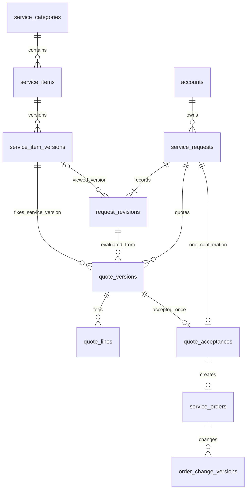
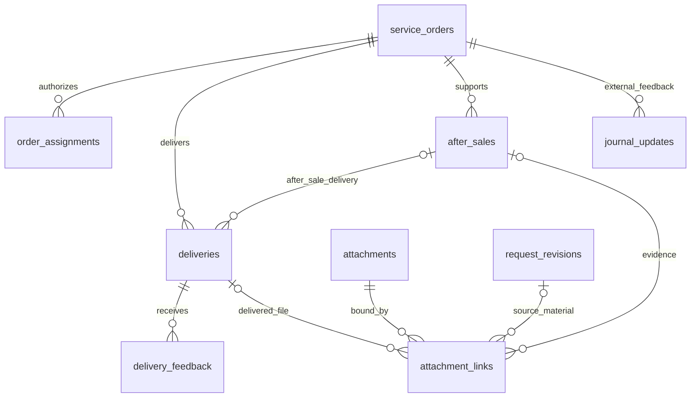
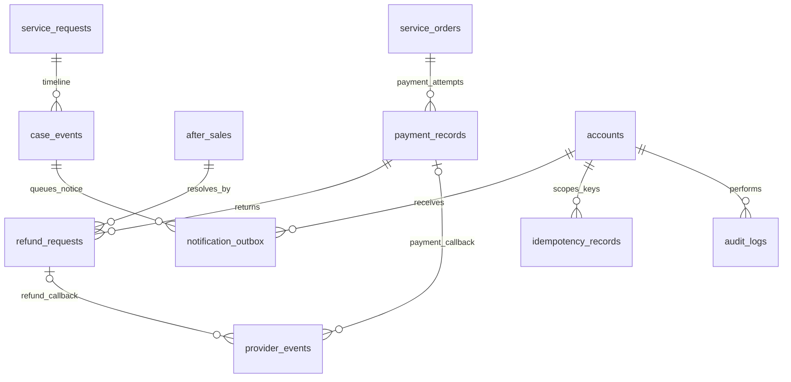

# 学术服务小程序数据库设计

[toc]

---

## 🔥 前言

本设计承接[需求分析 V0.3](./学术服务小程序需求分析.md)，为毕业论文、普刊、编译三项服务规划数据结构。需求回归和数据库设计不代表业务软件已经开发或部署。

**采用29张表支撑“需求→报价确认→服务订单→交付→售后”的关系，收款和退款独立记录。** 附[完整建表文件](./数据库结构.sql)，包含主外键、唯一约束、检查约束、索引和三类服务初始化，不包含真实客户或支付数据。

| 项目 | 当前设计基线 |
| --- | --- |
| 版本／日期 | V0.3／2026年10月30日，北京时间；DDL沿用V0.2结构，新增执行合同不增加表或字段 |
| 数据库建议 | [**PostgreSQL**](https://www.postgresql.org/) 18语法；工程建议，用户尚未确认最终数据库产品及部署版本 |
| 范围 | 单一运营主体，小程序客户与内部员工；没有多商家、分销或专家市场 |
| 金额 | `BIGINT`，最小币种单位，`currency`明确币种；人民币按分存储，禁止浮点金额 |
| 时间 | 事件使用`TIMESTAMPTZ`，纯日期愿望使用`DATE`；服务端判定，界面按北京时间显示 |
| 文件 | 私有对象存储保存内容，数据库保存元数据、归属、版本和审计 |
| 交付状态 | 表结构与事务合同已设计；验证结果以[回归报告](./需求回归报告.md)记载为准，不把隔离探针等同生产验收 |

## 一、数据边界与分域 <a href="#前言" style="font-size:17px; color:green;"><b>🔼</b></a> <a href="#🔚" style="font-size:17px; color:green;"><b>🔽</b></a>

| 分域 | 表 | 负责的业务 |
| --- | --- | --- |
| 身份与授权，3张 | `accounts`、`auth_identities`、`staff_roles` | 账号、应用内微信身份和最小员工角色 |
| 服务与规则，5张 | `service_categories`、`service_items`、`service_item_versions`、`policy_versions`、`user_consents` | 三固定分类、子服务版本、文本版本和用户授权事件 |
| 需求与成交，6张 | `service_requests`、`request_revisions`、`quote_versions`、`quote_lines`、`quote_acceptances`、`service_orders` | 需求版本、报价版本、确认凭据与服务订单 |
| 履约与售后，8张 | `order_assignments`、`order_change_versions`、`attachments`、`attachment_links`、`deliveries`、`delivery_feedback`、`journal_updates`、`after_sales` | 员工分配、变更、文件、交付、外部期刊反馈和售后任务 |
| 收款与退款，3张 | `payment_records`、`refund_requests`、`provider_events` | 多次付款尝试、退款执行和回调去重 |
| 事件与防重复，4张 | `case_events`、`notification_outbox`、`idempotency_records`、`audit_logs` | 用户进度、通知待发与重试、写操作幂等、内部敏感操作审计 |

“需要几张表”是存储职责划分，不等于首屏增加29个功能。支付方案B未选定时，在线回调表可以保留空结构，不能展示尚未开通的支付入口。A方案仅使用经核实的人工记录；系统不凭客户上传一张截图就认定收款。

## 二、分域关系图 <a href="#前言" style="font-size:17px; color:green;"><b>🔼</b></a> <a href="#🔚" style="font-size:17px; color:green;"><b>🔽</b></a>

以下 [**Mermaid**](https://mermaid.js.org) 图展示核心关系；完整物理外键以SQL为准。`0..1`表示可选，`1..N`表示多条；不把没有物理外键的审计目标标成强关联。

### 2.1、需求、报价和订单 <a href="#前言" style="font-size:17px; color:green;"><b>🔼</b></a> <a href="#🔚" style="font-size:17px; color:green;"><b>🔽</b></a>

物理外键不能强制每个需求至少有一个材料版本；提交事务必须同时创建主记录与首版本。`service_requests.current_quote_id`只允许指向本需求报价，但“是否是当前可接受版本、是否到期、服务是否可售”还需成交事务核验。

### 2.2、交付、文件和售后 <a href="#前言" style="font-size:17px; color:green;"><b>🔼</b></a> <a href="#🔚" style="font-size:17px; color:green;"><b>🔽</b></a>

`attachment_links`三种宿主严格三选一，复合外键同时匹配需求与客户。已完成订单需要返修时，创建售后任务与`kind='after_sale'`的新交付，不回写主订单历史为“修改中”。主服务未完成的范围内修改仍使用主服务交付与状态。

### 2.3、资金记录与事件 <a href="#前言" style="font-size:17px; color:green;"><b>🔼</b></a> <a href="#🔚" style="font-size:17px; color:green;"><b>🔽</b></a>

一个渠道事件只能指向收款或退款之一。收款成功、退款执行、售后解决分别有来源和时刻；不使用一个字段轮流覆盖三种事实。

## 三、字段与版本约定 <a href="#前言" style="font-size:17px; color:green;"><b>🔼</b></a> <a href="#🔚" style="font-size:17px; color:green;"><b>🔽</b></a>

- 内部主键使用`BIGINT GENERATED BY DEFAULT AS IDENTITY`，允许测试夹具显式ID；对外需求、订单和售后使用稳定业务编号。业务编号仍须权限校验，不能当作访问凭证。
- `created_at`、`updated_at`默认值只负责首次插入，后续更新须由服务层显式更新；本DDL没有自动更新时间触发器。
- `version`用于服务端条件更新和冲突检测；不能只在前端递增后相信客户端值。持有行锁的事务更新主行时递增版本。
- 服务文本、需求版本、正式报价、确认快照、发布交付文件、授权事件及审计采用追加留痕。原始成交条款与当前有效条款分开；确认变更只更新后者。
- 业务状态使用`VARCHAR + CHECK`，便于迁移时显式审查新增状态；未指定状态不可直接写入。
- 数据库金额没有浮点值。订单、收款、退款使用复合外键约束币种一致，汇总使用足够精度的整型／`numeric`，不将金额转换为浮点。
- 数据库不保存密码、支付密钥、微信`session_key`、原始Token、稿件文件内容或长期公开下载链接。身份与联系方式使用加密／HMAC匹配方案，密钥由独立密钥设施管理，正式方案需在部署前落实。
- 正式、测试、演示使用独立数据库与对象存储命名空间；客户端本地演示数据不写入正式表。不能仅靠一个可由客户端篡改的`is_demo`字段隔离。

时间和时区的行为按PostgreSQL官方类型说明处理；`TIMESTAMPTZ`保存时刻，不保存用户最初输入的时区名称。需要解释“按哪种日历起算”的服务条款仍须保存在报价／订单快照中。[日期与时间类型](https://www.postgresql.org/docs/current/datatype-datetime.html)

## 四、完整字段字典 <a href="#前言" style="font-size:17px; color:green;"><b>🔼</b></a> <a href="#🔚" style="font-size:17px; color:green;"><b>🔽</b></a>

字段字典与本交付SQL逐列一致。“声明”保留类型、空值、默认值和列级约束；复合外键、表级检查及索引另见[完整DDL](./数据库结构.sql)和第五章。除字典标明的默认值外，不替业务填入未确认的价格、期限或修改次数。

### 4.1、accounts <a href="#前言" style="font-size:17px; color:green;"><b>🔼</b></a> <a href="#🔚" style="font-size:17px; color:green;"><b>🔽</b></a>

统一账号；客户、员工与系统操作者的身份根。

| 字段 | 声明 | 说明 |
| --- | --- | --- |
| `id` | `BIGINT GENERATED BY DEFAULT AS IDENTITY PRIMARY KEY` | 内部主键；接口可使用业务编号避免暴露连续ID |
| `kind` | `VARCHAR(12) NOT NULL CHECK (kind IN ('customer','staff','system'))` | 账号类型 |
| `display_name` | `VARCHAR(100)` | 可选显示名 |
| `contact_ciphertext` | `TEXT` | 联系方式密文；密钥不在数据库 |
| `status` | `VARCHAR(12) NOT NULL DEFAULT 'active' CHECK (status IN ('active','suspended','closed'))` | 有效状态 |
| `created_at` | `TIMESTAMPTZ NOT NULL DEFAULT CURRENT_TIMESTAMP` | 创建时间 |
| `updated_at` | `TIMESTAMPTZ NOT NULL DEFAULT CURRENT_TIMESTAMP` | 最近变更时间 |
| `closed_at` | `TIMESTAMPTZ` | 注销时间；不级联销毁交易历史 |
| `version` | `INTEGER NOT NULL DEFAULT 1 CHECK (version > 0)` | 乐观锁版本 |

### 4.2、auth_identities <a href="#前言" style="font-size:17px; color:green;"><b>🔼</b></a> <a href="#🔚" style="font-size:17px; color:green;"><b>🔽</b></a>

微信等认证身份；不得保存session_key、Token或明文密码。

| 字段 | 声明 | 说明 |
| --- | --- | --- |
| `id` | `BIGINT GENERATED BY DEFAULT AS IDENTITY PRIMARY KEY` | 身份记录主键 |
| `account_id` | `BIGINT NOT NULL REFERENCES accounts(id)` | 所属账号 |
| `provider` | `VARCHAR(24) NOT NULL CHECK (provider IN ('wechat','staff_identity'))` | 认证来源 |
| `app_id` | `VARCHAR(100) NOT NULL` | 应用标识；微信OpenID按应用隔离 |
| `subject_ciphertext` | `TEXT NOT NULL` | 外部身份标识密文 |
| `subject_hash` | `CHAR(64) NOT NULL CHECK (subject_hash ~ '^[0-9a-f]{64}$')` | 用于唯一匹配的受控HMAC摘要 |
| `created_at` | `TIMESTAMPTZ NOT NULL DEFAULT CURRENT_TIMESTAMP` | 绑定时间 |
| `revoked_at` | `TIMESTAMPTZ` | 撤销时间 |

### 4.3、staff_roles <a href="#前言" style="font-size:17px; color:green;"><b>🔼</b></a> <a href="#🔚" style="font-size:17px; color:green;"><b>🔽</b></a>

员工角色；最小RBAC，订单数据范围还需授权校验。

| 字段 | 声明 | 说明 |
| --- | --- | --- |
| `account_id` | `BIGINT NOT NULL REFERENCES accounts(id)` | 员工账号；服务端验证kind=staff |
| `role_code` | `VARCHAR(20) NOT NULL CHECK (role_code IN ('admin','operator','service_agent','finance'))` | 固定最小角色 |
| `granted_by` | `BIGINT NOT NULL REFERENCES accounts(id)` | 授权管理员 |
| `granted_at` | `TIMESTAMPTZ NOT NULL DEFAULT CURRENT_TIMESTAMP` | 授权时间 |
| `revoked_at` | `TIMESTAMPTZ` | 撤权时间；恢复授权更新本行并记审计 |

### 4.4、service_categories <a href="#前言" style="font-size:17px; color:green;"><b>🔼</b></a> <a href="#🔚" style="font-size:17px; color:green;"><b>🔽</b></a>

固定且仅三类；修改服务范围须改需求和迁移。

| 字段 | 声明 | 说明 |
| --- | --- | --- |
| `code` | `VARCHAR(16) PRIMARY KEY CHECK (code IN ('graduation','journal','editing'))` | 分类业务代码 |
| `name` | `VARCHAR(20) NOT NULL` | 中文名称 |
| `sort_order` | `INTEGER NOT NULL CHECK (sort_order > 0)` | 展示顺序 |

### 4.5、service_items <a href="#前言" style="font-size:17px; color:green;"><b>🔼</b></a> <a href="#🔚" style="font-size:17px; color:green;"><b>🔽</b></a>

子服务目录；不虚构未确认的可售菜单。

| 字段 | 声明 | 说明 |
| --- | --- | --- |
| `id` | `BIGINT GENERATED BY DEFAULT AS IDENTITY PRIMARY KEY` | 子服务主键 |
| `category_code` | `VARCHAR(16) NOT NULL REFERENCES service_categories(code)` | 所属固定分类 |
| `item_code` | `VARCHAR(60) NOT NULL UNIQUE` | 稳定业务代码 |
| `status` | `VARCHAR(16) NOT NULL DEFAULT 'offline' CHECK (status IN ('offline','online','archived'))` | 上下架状态 |
| `sort_order` | `INTEGER NOT NULL DEFAULT 0` | 类内排序 |
| `created_at` | `TIMESTAMPTZ NOT NULL DEFAULT CURRENT_TIMESTAMP` | 创建时间 |
| `updated_at` | `TIMESTAMPTZ NOT NULL DEFAULT CURRENT_TIMESTAMP` | 最近变更时间 |

### 4.6、service_item_versions <a href="#前言" style="font-size:17px; color:green;"><b>🔼</b></a> <a href="#🔚" style="font-size:17px; color:green;"><b>🔽</b></a>

子服务发布版本；发布后内容不可原位覆盖。

| 字段 | 声明 | 说明 |
| --- | --- | --- |
| `id` | `BIGINT GENERATED BY DEFAULT AS IDENTITY PRIMARY KEY` | 版本主键 |
| `service_item_id` | `BIGINT NOT NULL REFERENCES service_items(id)` | 所属子服务 |
| `version_no` | `INTEGER NOT NULL CHECK (version_no > 0)` | 类内版本序号 |
| `title` | `VARCHAR(120) NOT NULL CHECK (length(trim(title)) > 0)` | 版本标题 |
| `content_json` | `JSONB NOT NULL CHECK (jsonb_typeof(content_json)='object')` | 范围、交付、材料和规则的结构化内容 |
| `form_schema_json` | `JSONB NOT NULL CHECK (jsonb_typeof(form_schema_json)='object')` | 业务表单字段及条件必填定义 |
| `pricing_mode` | `VARCHAR(20) NOT NULL CHECK (pricing_mode IN ('manual_quote','fixed_price'))` | 定价表达方式 |
| `fixed_price_minor` | `BIGINT CHECK (fixed_price_minor >= 0)` | 固定价格最小币种单位；人工报价为空 |
| `currency` | `CHAR(3) NOT NULL DEFAULT 'CNY' CHECK (currency ~ '^[A-Z]{3}$')` | 币种 |
| `published_at` | `TIMESTAMPTZ NOT NULL DEFAULT CURRENT_TIMESTAMP` | 发布时间 |
| `published_by` | `BIGINT NOT NULL REFERENCES accounts(id)` | 发布员工 |

### 4.7、policy_versions <a href="#前言" style="font-size:17px; color:green;"><b>🔼</b></a> <a href="#🔚" style="font-size:17px; color:green;"><b>🔽</b></a>

协议、隐私和服务规则的不可变发布版本。

| 字段 | 声明 | 说明 |
| --- | --- | --- |
| `id` | `BIGINT GENERATED BY DEFAULT AS IDENTITY PRIMARY KEY` | 文本版本主键 |
| `policy_code` | `VARCHAR(60) NOT NULL` | privacy、terms、service_rules等稳定代码 |
| `version_no` | `INTEGER NOT NULL CHECK (version_no > 0)` | 文本版本序号 |
| `content_text` | `TEXT NOT NULL CHECK (length(trim(content_text)) > 0)` | 真实发布正文 |
| `content_hash` | `CHAR(64) NOT NULL CHECK (content_hash ~ '^[0-9a-f]{64}$')` | 发布正文SHA-256 |
| `published_at` | `TIMESTAMPTZ NOT NULL DEFAULT CURRENT_TIMESTAMP` | 发布时间 |
| `published_by` | `BIGINT NOT NULL REFERENCES accounts(id)` | 发布人员 |

### 4.8、user_consents <a href="#前言" style="font-size:17px; color:green;"><b>🔼</b></a> <a href="#🔚" style="font-size:17px; color:green;"><b>🔽</b></a>

用户对指定文本版本的授权或撤回事件。

| 字段 | 声明 | 说明 |
| --- | --- | --- |
| `id` | `BIGINT GENERATED BY DEFAULT AS IDENTITY PRIMARY KEY` | 事件主键 |
| `account_id` | `BIGINT NOT NULL REFERENCES accounts(id)` | 操作用户 |
| `policy_version_id` | `BIGINT NOT NULL REFERENCES policy_versions(id)` | 看到的真实版本 |
| `action` | `VARCHAR(12) NOT NULL CHECK (action IN ('accepted','revoked'))` | 授权或撤回 |
| `purpose_code` | `VARCHAR(60) NOT NULL` | 对应信息处理用途 |
| `occurred_at` | `TIMESTAMPTZ NOT NULL DEFAULT CURRENT_TIMESTAMP` | 事件时间 |
| `client_request_id` | `VARCHAR(100) NOT NULL` | 防重复事件标识 |

### 4.9、service_requests <a href="#前言" style="font-size:17px; color:green;"><b>🔼</b></a> <a href="#🔚" style="font-size:17px; color:green;"><b>🔽</b></a>

需求单主记录；主行锁串行化补材料、重报价与接受报价。

| 字段 | 声明 | 说明 |
| --- | --- | --- |
| `id` | `BIGINT GENERATED BY DEFAULT AS IDENTITY PRIMARY KEY` | 需求主键 |
| `request_no` | `VARCHAR(40) NOT NULL UNIQUE` | 面向用户的不可猜测业务编号 |
| `owner_id` | `BIGINT NOT NULL REFERENCES accounts(id)` | 客户账号 |
| `submit_key` | `VARCHAR(120) NOT NULL` | 客户端稳定提交键，幂等缓存清理后仍可查原需求 |
| `submit_hash` | `CHAR(64) NOT NULL CHECK (submit_hash ~ '^[0-9a-f]{64}$')` | 首次提交正文规范化摘要，同键异摘要由服务拒绝 |
| `category_code` | `VARCHAR(16) NOT NULL REFERENCES service_categories(code)` | 固定服务分类 |
| `service_item_id` | `BIGINT` | 可选子服务；只选大类也能咨询 |
| `status` | `VARCHAR(24) NOT NULL DEFAULT 'pending_review' CHECK (status IN ('pending_review','awaiting_material','awaiting_quote_accept','converted','closed'))` | 需求状态 |
| `current_quote_id` | `BIGINT` | 当前对用户有效的报价版本；外键在报价表后补充 |
| `assigned_staff_id` | `BIGINT REFERENCES accounts(id)` | 转单前负责客服；转单后按订单授权 |
| `close_reason` | `TEXT` | 关闭原因 |
| `created_at` | `TIMESTAMPTZ NOT NULL DEFAULT CURRENT_TIMESTAMP` | 提交时间 |
| `updated_at` | `TIMESTAMPTZ NOT NULL DEFAULT CURRENT_TIMESTAMP` | 更新时间 |
| `closed_at` | `TIMESTAMPTZ` | 关闭时间 |
| `version` | `INTEGER NOT NULL DEFAULT 1 CHECK (version > 0)` | 并发更新版本 |

### 4.10、request_revisions <a href="#前言" style="font-size:17px; color:green;"><b>🔼</b></a> <a href="#🔚" style="font-size:17px; color:green;"><b>🔽</b></a>

每次正式提交或补充形成新版本，不覆盖原始需求。

| 字段 | 声明 | 说明 |
| --- | --- | --- |
| `id` | `BIGINT GENERATED BY DEFAULT AS IDENTITY PRIMARY KEY` | 材料版本主键 |
| `request_id` | `BIGINT NOT NULL` | 所属需求 |
| `owner_id` | `BIGINT NOT NULL` | 客户账号；冗余字段用于复合外键隔离 |
| `revision_no` | `INTEGER NOT NULL CHECK (revision_no > 0)` | 版本序号 |
| `schema_version` | `INTEGER NOT NULL CHECK (schema_version > 0)` | 本次JSON字段协议版本 |
| `service_item_id` | `BIGINT` | 大类咨询可空；选择子服务时记录当时子服务 |
| `service_item_version_id` | `BIGINT` | 与子服务同时存在的发布版本 |
| `form_json` | `JSONB NOT NULL CHECK (jsonb_typeof(form_json)='object')` | 三类表单的结构化快照 |
| `summary` | `TEXT NOT NULL CHECK (length(trim(summary)) > 0)` | 本次需求说明 |
| `desired_date` | `DATE` | 希望完成日期；不是交付承诺 |
| `created_by` | `BIGINT NOT NULL REFERENCES accounts(id)` | 提交者或经授权代录员工 |
| `created_at` | `TIMESTAMPTZ NOT NULL DEFAULT CURRENT_TIMESTAMP` | 提交时间 |

### 4.11、quote_versions <a href="#前言" style="font-size:17px; color:green;"><b>🔼</b></a> <a href="#🔚" style="font-size:17px; color:green;"><b>🔽</b></a>

完整报价发布版本；旧版、过期和并发接受由事务核验。

| 字段 | 声明 | 说明 |
| --- | --- | --- |
| `id` | `BIGINT GENERATED BY DEFAULT AS IDENTITY PRIMARY KEY` | 报价版本主键 |
| `request_id` | `BIGINT NOT NULL` | 所属需求 |
| `owner_id` | `BIGINT NOT NULL` | 客户账号 |
| `request_revision_id` | `BIGINT NOT NULL` | 报价评估使用的材料版本 |
| `category_code` | `VARCHAR(16) NOT NULL` | 正式报价所属固定分类，必须匹配需求和子服务 |
| `service_item_id` | `BIGINT NOT NULL` | 正式报价必须选择本方真实子服务 |
| `service_item_version_id` | `BIGINT NOT NULL` | 固定发布版本，快照中保留该引用 |
| `version_no` | `INTEGER NOT NULL CHECK (version_no > 0)` | 需求内报价序号 |
| `status` | `VARCHAR(16) NOT NULL DEFAULT 'offered' CHECK (status IN ('offered','superseded','accepted','declined','expired'))` | 报价生命周期 |
| `total_minor` | `BIGINT NOT NULL CHECK (total_minor >= 0)` | 用户向平台应付总额；外部直接收费不计入 |
| `currency` | `CHAR(3) NOT NULL DEFAULT 'CNY' CHECK (currency ~ '^[A-Z]{3}$')` | 币种 |
| `start_required_minor` | `BIGINT NOT NULL CHECK (start_required_minor >= 0 AND start_required_minor <= total_minor)` | 启动所需已核实收款阈值，可为零 |
| `terms_json` | `JSONB NOT NULL CHECK (jsonb_typeof(terms_json)='object')` | 范围、排除、交付、周期、修改、取消退款及付款安排 |
| `policy_version_id` | `BIGINT NOT NULL REFERENCES policy_versions(id)` | 报价适用服务规则版本 |
| `content_hash` | `CHAR(64) NOT NULL CHECK (content_hash ~ '^[0-9a-f]{64}$')` | 完整报价及费用行规范化哈希 |
| `valid_until` | `TIMESTAMPTZ NOT NULL` | 接受截止时刻；不使用now()做跨时间CHECK |
| `created_by` | `BIGINT NOT NULL REFERENCES accounts(id)` | 报价发布者 |
| `created_at` | `TIMESTAMPTZ NOT NULL DEFAULT CURRENT_TIMESTAMP` | 发布时间 |

### 4.12、quote_lines <a href="#前言" style="font-size:17px; color:green;"><b>🔼</b></a> <a href="#🔚" style="font-size:17px; color:green;"><b>🔽</b></a>

费用明细；平台收费与第三方直接收费明确分列。

| 字段 | 声明 | 说明 |
| --- | --- | --- |
| `id` | `BIGINT GENERATED BY DEFAULT AS IDENTITY PRIMARY KEY` | 明细主键 |
| `quote_id` | `BIGINT NOT NULL REFERENCES quote_versions(id)` | 报价版本 |
| `line_no` | `INTEGER NOT NULL CHECK (line_no > 0)` | 明细序号 |
| `description` | `TEXT NOT NULL CHECK (length(trim(description)) > 0)` | 费用说明 |
| `payee_kind` | `VARCHAR(16) NOT NULL CHECK (payee_kind IN ('platform','third_party'))` | 收款方类型 |
| `included_in_total` | `BOOLEAN NOT NULL` | 是否包含在平台应付总额 |
| `amount_minor` | `BIGINT NOT NULL CHECK (amount_minor >= 0)` | 同报价币种最小单位金额 |
| `payee_note` | `TEXT` | 第三方名称及缴费方式说明，不含账户秘密 |

### 4.13、quote_acceptances <a href="#前言" style="font-size:17px; color:green;"><b>🔼</b></a> <a href="#🔚" style="font-size:17px; color:green;"><b>🔽</b></a>

接受凭证；一需求只允许一次正式接受并转一订单。

| 字段 | 声明 | 说明 |
| --- | --- | --- |
| `id` | `BIGINT GENERATED BY DEFAULT AS IDENTITY PRIMARY KEY` | 确认主键 |
| `request_id` | `BIGINT NOT NULL UNIQUE` | 一需求只转一单 |
| `owner_id` | `BIGINT NOT NULL` | 必须为需求本人 |
| `quote_id` | `BIGINT NOT NULL UNIQUE` | 被接受报价版本 |
| `currency` | `CHAR(3) NOT NULL CHECK (currency ~ '^[A-Z]{3}$')` | 冻结币种 |
| `quote_hash` | `CHAR(64) NOT NULL CHECK (quote_hash ~ '^[0-9a-f]{64}$')` | 客户确认时看到的完整报价哈希 |
| `accepted_snapshot` | `JSONB NOT NULL CHECK (jsonb_typeof(accepted_snapshot)='object')` | 全报价、费用行、规则和材料版本快照 |
| `accepted_at` | `TIMESTAMPTZ NOT NULL DEFAULT CURRENT_TIMESTAMP` | 服务端确认时间 |

### 4.14、service_orders <a href="#前言" style="font-size:17px; color:green;"><b>🔼</b></a> <a href="#🔚" style="font-size:17px; color:green;"><b>🔽</b></a>

服务订单；支付尝试关闭不改变服务订单取消状态。

| 字段 | 声明 | 说明 |
| --- | --- | --- |
| `id` | `BIGINT GENERATED BY DEFAULT AS IDENTITY PRIMARY KEY` | 订单主键 |
| `order_no` | `VARCHAR(40) NOT NULL UNIQUE` | 面向用户业务编号 |
| `request_id` | `BIGINT NOT NULL UNIQUE` | 唯一来源需求 |
| `owner_id` | `BIGINT NOT NULL` | 客户账号 |
| `acceptance_id` | `BIGINT NOT NULL UNIQUE` | 唯一报价确认凭证 |
| `currency` | `CHAR(3) NOT NULL CHECK (currency ~ '^[A-Z]{3}$')` | 订单币种，收款后不可变更 |
| `total_minor` | `BIGINT NOT NULL CHECK (total_minor >= 0)` | 当前有效平台应付总额 |
| `start_required_minor` | `BIGINT NOT NULL CHECK (start_required_minor >= 0 AND start_required_minor <= total_minor)` | 当前有效启动收款阈值 |
| `initial_terms_json` | `JSONB NOT NULL CHECK (jsonb_typeof(initial_terms_json)='object')` | 原始成交快照，禁止覆盖 |
| `effective_terms_json` | `JSONB NOT NULL CHECK (jsonb_typeof(effective_terms_json)='object')` | 当前有效条款；经确认变更后事务更新 |
| `status` | `VARCHAR(24) NOT NULL DEFAULT 'pending_start' CHECK (status IN ('pending_start','in_service','awaiting_acceptance','revising','completed','cancelled'))` | 服务状态 |
| `material_ready` | `BOOLEAN NOT NULL DEFAULT FALSE` | 材料是否齐备；由服务端核验 |
| `scheduled_at` | `TIMESTAMPTZ` | 排期确认时刻 |
| `started_at` | `TIMESTAMPTZ` | 实际启动时刻 |
| `due_at` | `TIMESTAMPTZ` | 双方约定的到期时刻 |
| `completed_at` | `TIMESTAMPTZ` | 主服务完成时刻；售后不抹除 |
| `cancelled_at` | `TIMESTAMPTZ` | 取消生效时刻 |
| `current_change_id` | `BIGINT` | 当前生效变更版本，外键后补 |
| `created_at` | `TIMESTAMPTZ NOT NULL DEFAULT CURRENT_TIMESTAMP` | 建单时间 |
| `updated_at` | `TIMESTAMPTZ NOT NULL DEFAULT CURRENT_TIMESTAMP` | 更新时间 |
| `version` | `INTEGER NOT NULL DEFAULT 1 CHECK (version > 0)` | 状态及条款乐观锁 |

### 4.15、order_assignments <a href="#前言" style="font-size:17px; color:green;"><b>🔼</b></a> <a href="#🔚" style="font-size:17px; color:green;"><b>🔽</b></a>

员工按订单授权；撤回即失去材料访问权。

| 字段 | 声明 | 说明 |
| --- | --- | --- |
| `id` | `BIGINT GENERATED BY DEFAULT AS IDENTITY PRIMARY KEY` | 分配记录主键 |
| `order_id` | `BIGINT NOT NULL REFERENCES service_orders(id)` | 授权订单 |
| `staff_id` | `BIGINT NOT NULL REFERENCES accounts(id)` | 员工账号 |
| `scope_code` | `VARCHAR(20) NOT NULL CHECK (scope_code IN ('case_manage','service_files','finance'))` | 订单内数据及操作范围 |
| `assigned_by` | `BIGINT NOT NULL REFERENCES accounts(id)` | 授权者 |
| `assigned_at` | `TIMESTAMPTZ NOT NULL DEFAULT CURRENT_TIMESTAMP` | 授权时间 |
| `revoked_at` | `TIMESTAMPTZ` | 撤回时间；不删除历史 |

### 4.16、order_change_versions <a href="#前言" style="font-size:17px; color:green;"><b>🔼</b></a> <a href="#🔚" style="font-size:17px; color:green;"><b>🔽</b></a>

订单范围和交期变更提案；接受后才生效。

| 字段 | 声明 | 说明 |
| --- | --- | --- |
| `id` | `BIGINT GENERATED BY DEFAULT AS IDENTITY PRIMARY KEY` | 变更主键 |
| `order_id` | `BIGINT NOT NULL REFERENCES service_orders(id)` | 所属订单 |
| `version_no` | `INTEGER NOT NULL CHECK (version_no > 0)` | 订单内变更序号 |
| `based_on_order_version` | `INTEGER NOT NULL CHECK (based_on_order_version > 0)` | 提案基于订单版本 |
| `status` | `VARCHAR(16) NOT NULL DEFAULT 'proposed' CHECK (status IN ('proposed','accepted','rejected','expired'))` | 提案状态 |
| `reason` | `TEXT NOT NULL` | 变更原因 |
| `proposed_terms_json` | `JSONB NOT NULL CHECK (jsonb_typeof(proposed_terms_json)='object')` | 变更后的完整条款及费用快照 |
| `total_minor` | `BIGINT NOT NULL CHECK (total_minor >= 0)` | 新平台应付总额 |
| `start_required_minor` | `BIGINT NOT NULL CHECK (start_required_minor >= 0 AND start_required_minor <= total_minor)` | 新启动阈值 |
| `due_at` | `TIMESTAMPTZ` | 新交期 |
| `proposed_by` | `BIGINT NOT NULL REFERENCES accounts(id)` | 提案人员 |
| `created_at` | `TIMESTAMPTZ NOT NULL DEFAULT CURRENT_TIMESTAMP` | 提案时间 |
| `valid_until` | `TIMESTAMPTZ NOT NULL` | 确认有效期 |
| `accepted_by` | `BIGINT REFERENCES accounts(id)` | 实际确认客户；应用验证是订单本人 |
| `accepted_at` | `TIMESTAMPTZ` | 确认时间 |

### 4.17、attachments <a href="#前言" style="font-size:17px; color:green;"><b>🔼</b></a> <a href="#🔚" style="font-size:17px; color:green;"><b>🔽</b></a>

私有对象存储元数据；文件内容不存数据库。

| 字段 | 声明 | 说明 |
| --- | --- | --- |
| `id` | `BIGINT GENERATED BY DEFAULT AS IDENTITY PRIMARY KEY` | 文件版本主键 |
| `request_id` | `BIGINT` | 暂存上传可为空；绑定业务前必须归属需求 |
| `owner_id` | `BIGINT NOT NULL REFERENCES accounts(id)` | 业务客户，非上传员工 |
| `uploaded_by` | `BIGINT NOT NULL REFERENCES accounts(id)` | 实际上传者 |
| `storage_key` | `TEXT NOT NULL UNIQUE` | 私有存储对象键，不是公开URL |
| `original_name` | `VARCHAR(255) NOT NULL` | 原始文件名，展示前转义 |
| `media_type` | `VARCHAR(120) NOT NULL` | 实测文件媒体类型 |
| `byte_size` | `BIGINT NOT NULL CHECK (byte_size > 0)` | 文件大小 |
| `sha256` | `CHAR(64) NOT NULL CHECK (sha256 ~ '^[0-9a-f]{64}$')` | 内容摘要 |
| `status` | `VARCHAR(20) NOT NULL DEFAULT 'staging' CHECK (status IN ('staging','available','quarantined','pending_delete','deleted'))` | 上传、扫描和删除状态 |
| `created_at` | `TIMESTAMPTZ NOT NULL DEFAULT CURRENT_TIMESTAMP` | 上传时间 |
| `expires_at` | `TIMESTAMPTZ` | 依确认的保留策略生成失效时刻 |
| `deleted_at` | `TIMESTAMPTZ` | 物理对象删除完成时间 |

### 4.18、after_sales <a href="#前言" style="font-size:17px; color:green;"><b>🔼</b></a> <a href="#🔚" style="font-size:17px; color:green;"><b>🔽</b></a>

售后任务；服务状态和资金执行各自记录。

| 字段 | 声明 | 说明 |
| --- | --- | --- |
| `id` | `BIGINT GENERATED BY DEFAULT AS IDENTITY PRIMARY KEY` | 售后主键 |
| `after_sale_no` | `VARCHAR(40) NOT NULL UNIQUE` | 用户可查业务编号 |
| `order_id` | `BIGINT NOT NULL` | 关联订单 |
| `request_id` | `BIGINT NOT NULL` | 关联来源需求 |
| `owner_id` | `BIGINT NOT NULL` | 申请客户 |
| `kind` | `VARCHAR(20) NOT NULL CHECK (kind IN ('cancel','revision','refund','dispute'))` | 申请类型 |
| `reason` | `TEXT NOT NULL CHECK (length(trim(reason)) > 0)` | 申请原因 |
| `status` | `VARCHAR(16) NOT NULL DEFAULT 'pending' CHECK (status IN ('pending','processing','resolved','closed'))` | 处理状态 |
| `resolution_json` | `JSONB` | 处理范围、结论和执行条件，不含原稿正文 |
| `assigned_staff_id` | `BIGINT REFERENCES accounts(id)` | 处理负责人 |
| `created_at` | `TIMESTAMPTZ NOT NULL DEFAULT CURRENT_TIMESTAMP` | 申请时间 |
| `resolved_at` | `TIMESTAMPTZ` | 实际解决时间 |
| `version` | `INTEGER NOT NULL DEFAULT 1 CHECK (version > 0)` | 并发更新版本 |

### 4.19、deliveries <a href="#前言" style="font-size:17px; color:green;"><b>🔼</b></a> <a href="#🔚" style="font-size:17px; color:green;"><b>🔽</b></a>

交付批次；完成后的修订必须归属售后任务。

| 字段 | 声明 | 说明 |
| --- | --- | --- |
| `id` | `BIGINT GENERATED BY DEFAULT AS IDENTITY PRIMARY KEY` | 交付主键 |
| `order_id` | `BIGINT NOT NULL` | 所属订单 |
| `request_id` | `BIGINT NOT NULL` | 来源需求 |
| `owner_id` | `BIGINT NOT NULL` | 客户 |
| `delivery_no` | `INTEGER NOT NULL CHECK (delivery_no > 0)` | 订单内版本序号 |
| `kind` | `VARCHAR(16) NOT NULL CHECK (kind IN ('main','after_sale'))` | 主服务或售后交付 |
| `after_sale_id` | `BIGINT` | 售后交付必须关联任务 |
| `status` | `VARCHAR(20) NOT NULL DEFAULT 'draft' CHECK (status IN ('draft','released','accepted','needs_revision'))` | 交付状态 |
| `release_note` | `TEXT NOT NULL` | 本次交付说明 |
| `created_by` | `BIGINT NOT NULL REFERENCES accounts(id)` | 交付人员 |
| `created_at` | `TIMESTAMPTZ NOT NULL DEFAULT CURRENT_TIMESTAMP` | 建立版本时间 |
| `released_at` | `TIMESTAMPTZ` | 正式交付时间；正式交付后文件及说明不可原位改写 |

### 4.20、attachment_links <a href="#前言" style="font-size:17px; color:green;"><b>🔼</b></a> <a href="#🔚" style="font-size:17px; color:green;"><b>🔽</b></a>

附件归属；三种受控宿主，不采用无外键的任意多态ID。

| 字段 | 声明 | 说明 |
| --- | --- | --- |
| `id` | `BIGINT GENERATED BY DEFAULT AS IDENTITY PRIMARY KEY` | 绑定主键 |
| `attachment_id` | `BIGINT NOT NULL` | 文件版本 |
| `request_id` | `BIGINT NOT NULL` | 业务需求 |
| `owner_id` | `BIGINT NOT NULL` | 业务客户 |
| `request_revision_id` | `BIGINT` | 需求材料宿主 |
| `delivery_id` | `BIGINT` | 交付版本宿主 |
| `after_sale_id` | `BIGINT` | 售后证据宿主 |
| `created_at` | `TIMESTAMPTZ NOT NULL DEFAULT CURRENT_TIMESTAMP` | 绑定时间 |

### 4.21、delivery_feedback <a href="#前言" style="font-size:17px; color:green;"><b>🔼</b></a> <a href="#🔚" style="font-size:17px; color:green;"><b>🔽</b></a>

客户对具体交付版本的反馈；验收和修改请求均保留事件。

| 字段 | 声明 | 说明 |
| --- | --- | --- |
| `id` | `BIGINT GENERATED BY DEFAULT AS IDENTITY PRIMARY KEY` | 反馈主键 |
| `order_id` | `BIGINT NOT NULL` | 所属订单 |
| `delivery_id` | `BIGINT NOT NULL` | 对应交付版本 |
| `author_id` | `BIGINT NOT NULL` | 必须是订单本人 |
| `action` | `VARCHAR(20) NOT NULL CHECK (action IN ('accept','request_revision'))` | 验收或修改请求 |
| `comment_text` | `TEXT` | 修改描述或验收说明 |
| `created_at` | `TIMESTAMPTZ NOT NULL DEFAULT CURRENT_TIMESTAMP` | 反馈时间 |
| `client_request_id` | `VARCHAR(100) NOT NULL` | 防重复反馈标识 |

### 4.22、journal_updates <a href="#前言" style="font-size:17px; color:green;"><b>🔼</b></a> <a href="#🔚" style="font-size:17px; color:green;"><b>🔽</b></a>

普刊外部反馈；不能由内部服务状态自动推导。

| 字段 | 声明 | 说明 |
| --- | --- | --- |
| `id` | `BIGINT GENERATED BY DEFAULT AS IDENTITY PRIMARY KEY` | 外部反馈主键 |
| `order_id` | `BIGINT NOT NULL REFERENCES service_orders(id)` | 所属普刊订单；分类由服务端核验 |
| `status_label` | `VARCHAR(100) NOT NULL` | 实际外部反馈描述 |
| `source_note` | `TEXT NOT NULL CHECK (length(trim(source_note)) > 0)` | 来源说明 |
| `occurred_at` | `TIMESTAMPTZ NOT NULL` | 外部反馈发生时刻 |
| `recorded_by` | `BIGINT NOT NULL REFERENCES accounts(id)` | 记录人员 |
| `recorded_at` | `TIMESTAMPTZ NOT NULL DEFAULT CURRENT_TIMESTAMP` | 录入时间 |
| `correction_of_id` | `BIGINT` | 更正时指向同订单原记录，不覆盖旧证据 |

### 4.23、payment_records <a href="#前言" style="font-size:17px; color:green;"><b>🔼</b></a> <a href="#🔚" style="font-size:17px; color:green;"><b>🔽</b></a>

单次收款意图或人工核验；一服务单可有多次尝试与分期。

| 字段 | 声明 | 说明 |
| --- | --- | --- |
| `id` | `BIGINT GENERATED BY DEFAULT AS IDENTITY PRIMARY KEY` | 收款记录主键 |
| `payment_no` | `VARCHAR(60) NOT NULL UNIQUE` | 平台收款业务号 |
| `order_id` | `BIGINT NOT NULL` | 所属服务订单 |
| `request_id` | `BIGINT NOT NULL` | 来源需求 |
| `owner_id` | `BIGINT NOT NULL` | 客户 |
| `provider` | `VARCHAR(16) NOT NULL CHECK (provider IN ('manual','wechat'))` | A人工或B在线渠道 |
| `merchant_scope` | `VARCHAR(100) NOT NULL` | 核验机构或商户作用域；不含密钥 |
| `provider_transaction_id` | `VARCHAR(120)` | 在线渠道交易号或人工核验的真实到账参考号，不使用图片摘要代替 |
| `currency` | `CHAR(3) NOT NULL CHECK (currency ~ '^[A-Z]{3}$')` | 必须匹配订单币种 |
| `amount_minor` | `BIGINT NOT NULL CHECK (amount_minor > 0)` | 本次拟收／实际核验金额 |
| `status` | `VARCHAR(24) NOT NULL CHECK (status IN ('pending_verification','pending','succeeded','failed','closed','unknown'))` | 单次收款状态；unknown须查证 |
| `verified_by` | `BIGINT REFERENCES accounts(id)` | 人工核验财务人员 |
| `evidence_attachment_id` | `BIGINT` | 人工到账证据元数据 |
| `succeeded_at` | `TIMESTAMPTZ` | 真实到账确认时刻 |
| `closed_at` | `TIMESTAMPTZ` | 本次支付尝试关闭时间，不等于服务单取消 |
| `created_at` | `TIMESTAMPTZ NOT NULL DEFAULT CURRENT_TIMESTAMP` | 建立时间 |
| `updated_at` | `TIMESTAMPTZ NOT NULL DEFAULT CURRENT_TIMESTAMP` | 更新时间 |
| `version` | `INTEGER NOT NULL DEFAULT 1 CHECK (version > 0)` | 并发处理版本 |

### 4.24、refund_requests <a href="#前言" style="font-size:17px; color:green;"><b>🔼</b></a> <a href="#🔚" style="font-size:17px; color:green;"><b>🔽</b></a>

退款审批与实际执行；占额合计必须在收款行锁下计算。

| 字段 | 声明 | 说明 |
| --- | --- | --- |
| `id` | `BIGINT GENERATED BY DEFAULT AS IDENTITY PRIMARY KEY` | 退款主键 |
| `refund_no` | `VARCHAR(60) NOT NULL UNIQUE` | 平台退款业务号，重试复用 |
| `payment_id` | `BIGINT NOT NULL` | 指向真实原收款 |
| `order_id` | `BIGINT NOT NULL` | 所属服务订单 |
| `after_sale_id` | `BIGINT NOT NULL` | 对应售后任务 |
| `provider` | `VARCHAR(16) NOT NULL CHECK (provider IN ('manual','wechat'))` | 必须继承原收款渠道 |
| `merchant_scope` | `VARCHAR(100) NOT NULL` | 必须继承原收款核验机构或商户作用域 |
| `currency` | `CHAR(3) NOT NULL CHECK (currency ~ '^[A-Z]{3}$')` | 与原收款一致 |
| `amount_minor` | `BIGINT NOT NULL CHECK (amount_minor > 0)` | 申请退款额 |
| `status` | `VARCHAR(16) NOT NULL DEFAULT 'requested' CHECK (status IN ('requested','approved','processing','unknown','succeeded','rejected','failed','cancelled'))` | 退款流程状态 |
| `reason` | `TEXT NOT NULL` | 退款依据 |
| `provider_refund_id` | `VARCHAR(120)` | 渠道退款号或人工核实的真实退款参考号 |
| `approved_by` | `BIGINT REFERENCES accounts(id)` | 审批人员 |
| `approved_at` | `TIMESTAMPTZ` | 审批时刻 |
| `executed_by` | `BIGINT REFERENCES accounts(id)` | 人工退款执行核验者 |
| `result_note` | `TEXT` | 脱敏结果或人工退款凭据说明 |
| `succeeded_at` | `TIMESTAMPTZ` | 退款到账确认时间 |
| `created_at` | `TIMESTAMPTZ NOT NULL DEFAULT CURRENT_TIMESTAMP` | 建立时间 |
| `updated_at` | `TIMESTAMPTZ NOT NULL DEFAULT CURRENT_TIMESTAMP` | 更新时间 |
| `version` | `INTEGER NOT NULL DEFAULT 1 CHECK (version > 0)` | 并发更新版本 |

### 4.25、provider_events <a href="#前言" style="font-size:17px; color:green;"><b>🔼</b></a> <a href="#🔚" style="font-size:17px; color:green;"><b>🔽</b></a>

渠道回调幂等及处理记录；保留脱敏摘要，不保留认证秘密。

| 字段 | 声明 | 说明 |
| --- | --- | --- |
| `id` | `BIGINT GENERATED BY DEFAULT AS IDENTITY PRIMARY KEY` | 回调记录主键 |
| `provider` | `VARCHAR(16) NOT NULL CHECK (provider='wechat')` | 已设计的在线渠道 |
| `merchant_scope` | `VARCHAR(100) NOT NULL` | 商户作用域 |
| `event_key` | `VARCHAR(160) NOT NULL` | 渠道事件唯一标识 |
| `payment_id` | `BIGINT REFERENCES payment_records(id)` | 收款事件目标 |
| `refund_id` | `BIGINT REFERENCES refund_requests(id)` | 退款事件目标 |
| `body_hash` | `CHAR(64) NOT NULL CHECK (body_hash ~ '^[0-9a-f]{64}$')` | 原消息规范化摘要，用于冲突诊断 |
| `verified` | `BOOLEAN NOT NULL DEFAULT FALSE` | 已完成渠道验签及业务核验 |
| `safe_summary` | `JSONB NOT NULL CHECK (jsonb_typeof(safe_summary)='object')` | 最小脱敏摘要 |
| `state` | `VARCHAR(16) NOT NULL DEFAULT 'received' CHECK (state IN ('received','processed','rejected','retry'))` | 处理状态 |
| `received_at` | `TIMESTAMPTZ NOT NULL DEFAULT CURRENT_TIMESTAMP` | 收到时刻 |
| `processed_at` | `TIMESTAMPTZ` | 已落账时刻 |

### 4.26、case_events <a href="#前言" style="font-size:17px; color:green;"><b>🔼</b></a> <a href="#🔚" style="font-size:17px; color:green;"><b>🔽</b></a>

需求、订单和售后业务事件；与状态更新在同一事务追加。

| 字段 | 声明 | 说明 |
| --- | --- | --- |
| `id` | `BIGINT GENERATED BY DEFAULT AS IDENTITY PRIMARY KEY` | 事件主键 |
| `request_id` | `BIGINT NOT NULL` | 来源需求 |
| `owner_id` | `BIGINT NOT NULL` | 客户账号 |
| `order_id` | `BIGINT` | 可选订单；报价前事件为空 |
| `after_sale_id` | `BIGINT` | 可选售后任务 |
| `event_type` | `VARCHAR(80) NOT NULL` | 例如quote.accepted或order.started |
| `from_state` | `VARCHAR(30)` | 变更前状态 |
| `to_state` | `VARCHAR(30)` | 变更后状态 |
| `actor_id` | `BIGINT NOT NULL REFERENCES accounts(id)` | 客户、员工或系统操作者 |
| `visible_to_customer` | `BOOLEAN NOT NULL DEFAULT FALSE` | 是否可在用户进度中展示 |
| `safe_detail` | `JSONB NOT NULL DEFAULT '{}'::JSONB CHECK (jsonb_typeof(safe_detail)='object')` | 脱敏事件详情 |
| `occurred_at` | `TIMESTAMPTZ NOT NULL DEFAULT CURRENT_TIMESTAMP` | 事件时刻 |

### 4.27、notification_outbox <a href="#前言" style="font-size:17px; color:green;"><b>🔼</b></a> <a href="#🔚" style="font-size:17px; color:green;"><b>🔽</b></a>

通知待发记录；与业务事件同事务创建，重试不重放业务。

| 字段 | 声明 | 说明 |
| --- | --- | --- |
| `id` | `BIGINT GENERATED BY DEFAULT AS IDENTITY PRIMARY KEY` | 待发主键 |
| `event_id` | `BIGINT NOT NULL REFERENCES case_events(id)` | 已提交的业务事件 |
| `recipient_id` | `BIGINT NOT NULL REFERENCES accounts(id)` | 经业务授权的接收账号 |
| `channel` | `VARCHAR(24) NOT NULL CHECK (channel IN ('in_app','wechat_subscription'))` | 站内或经开通授权的订阅消息 |
| `status` | `VARCHAR(16) NOT NULL DEFAULT 'pending' CHECK (status IN ('pending','delivering','sent','retry','dead','cancelled'))` | 投递状态 |
| `safe_payload` | `JSONB NOT NULL DEFAULT '{}'::JSONB CHECK (jsonb_typeof(safe_payload)='object')` | 必要业务编号与通知模板参数，不含稿件和秘密 |
| `attempt_count` | `INTEGER NOT NULL DEFAULT 0 CHECK (attempt_count >= 0)` | 已尝试次数 |
| `next_attempt_at` | `TIMESTAMPTZ NOT NULL DEFAULT CURRENT_TIMESTAMP` | 下次允许执行时刻 |
| `lease_until` | `TIMESTAMPTZ` | 工作器租约，避免同时领取同一任务 |
| `last_error_code` | `VARCHAR(100)` | 脱敏失败代码 |
| `created_at` | `TIMESTAMPTZ NOT NULL DEFAULT CURRENT_TIMESTAMP` | 登记时刻 |
| `sent_at` | `TIMESTAMPTZ` | 渠道确认发送成功的时刻 |

### 4.28、idempotency_records <a href="#前言" style="font-size:17px; color:green;"><b>🔼</b></a> <a href="#🔚" style="font-size:17px; color:green;"><b>🔽</b></a>

写操作幂等；绑定身份、动作、请求摘要，不能跨用户复用结果。

| 字段 | 声明 | 说明 |
| --- | --- | --- |
| `id` | `BIGINT GENERATED BY DEFAULT AS IDENTITY PRIMARY KEY` | 幂等记录主键 |
| `actor_id` | `BIGINT NOT NULL REFERENCES accounts(id)` | 已认证操作者 |
| `operation` | `VARCHAR(80) NOT NULL` | 业务动作 |
| `idempotency_key` | `VARCHAR(120) NOT NULL` | 客户端请求标识 |
| `request_hash` | `CHAR(64) NOT NULL CHECK (request_hash ~ '^[0-9a-f]{64}$')` | 规范化请求摘要 |
| `status` | `VARCHAR(16) NOT NULL DEFAULT 'processing' CHECK (status IN ('processing','completed','failed'))` | 处理状态 |
| `result_reference` | `JSONB` | 业务编号及安全响应摘要；不含文件临时链接 |
| `created_at` | `TIMESTAMPTZ NOT NULL DEFAULT CURRENT_TIMESTAMP` | 建立时间 |
| `expires_at` | `TIMESTAMPTZ NOT NULL` | 按确认策略清理，不影响业务唯一约束 |

### 4.29、audit_logs <a href="#前言" style="font-size:17px; color:green;"><b>🔼</b></a> <a href="#🔚" style="font-size:17px; color:green;"><b>🔽</b></a>

员工与系统敏感操作审计；不记录稿件正文、令牌和完整联系方式。

| 字段 | 声明 | 说明 |
| --- | --- | --- |
| `id` | `BIGINT GENERATED BY DEFAULT AS IDENTITY PRIMARY KEY` | 审计主键 |
| `actor_id` | `BIGINT NOT NULL REFERENCES accounts(id)` | 操作者 |
| `action` | `VARCHAR(100) NOT NULL` | 操作名称 |
| `target_type` | `VARCHAR(60) NOT NULL` | 目标表或受控对象类型 |
| `target_id` | `VARCHAR(100) NOT NULL` | 目标业务标识；诊断引用，不宣称具有多态外键 |
| `correlation_id` | `VARCHAR(100) NOT NULL` | 一次业务调用关联标识 |
| `safe_before` | `JSONB` | 变更前必要脱敏字段 |
| `safe_after` | `JSONB` | 变更后必要脱敏字段 |
| `occurred_at` | `TIMESTAMPTZ NOT NULL DEFAULT CURRENT_TIMESTAMP` | 服务端时间 |

## 五、关键约束、索引与状态字典 <a href="#前言" style="font-size:17px; color:green;"><b>🔼</b></a> <a href="#🔚" style="font-size:17px; color:green;"><b>🔽</b></a>

### 5.1、数据库约束与服务事务的分工 <a href="#前言" style="font-size:17px; color:green;"><b>🔼</b></a> <a href="#🔚" style="font-size:17px; color:green;"><b>🔽</b></a>

| 不变量 | 数据库保障 | 服务端必须补足 |
| --- | --- | --- |
| 固定三分类 | 分类主键限定3代码并绑定中文名；子服务引用分类 | 后台不提供增加第四类入口；下架流程使未接受报价失效 |
| 账号不串应用 | 身份唯一键`provider + app_id + subject_hash` | 由可信登录结果映射本人，拒绝客户端伪造账号ID；退出清缓存 |
| 提交重试可长期定位 | `owner_id + submit_key`持久唯一，保存`submit_hash` | 幂等缓存过期后仍查原需求；同提交键异摘要拒绝，不换request_no冒充新需求 |
| 一需求一订单 | 确认与订单对`request_id`均唯一，订单对确认凭据唯一 | 同一事务创建确认、订单、状态和事件；不能只创建半套记录 |
| 报价属于同一客户材料 | 报价对需求、材料版本采用复合外键，服务版本匹配真实子服务及需求分类 | 核对当前报价指针、最新要求、`status='offered'`、有效期和可售状态；快照保留发布版本 |
| 订单基于同一确认 | 确认→订单复合外键包括需求、客户与币种 | 快照内容必须与规范化报价及费用行一致；不能复制客户端提交的价格 |
| 同一时刻只有一份已发报价 | `request_id WHERE status='offered'`部分唯一索引 | 发布新版前使旧版失效，并在需求主行锁内同步当前指针 |
| 文件不得跨需求或客户绑定 | 文件与三宿主的复合外键、三选一检查 | 校验可用／隔离状态、实际对象存在、当前访问权限；已发布内容不原位覆盖 |
| 反馈对应本人交付 | `order_id + author_id`和`delivery_id + order_id`复合外键 | 仅对正式交付反馈；按主服务或售后路径更新正确对象 |
| 金额与币种 | 非负／正金额检查、同订单及收款币种外键 | 费用行合计、应收变更、实收／实退汇总与退款占额校验 |
| 资金消息不重复 | 收款／退款参考号按渠道与商户作用域唯一；回调目标复合外键匹配渠道／商户 | 先验签并核对金额、币种、业务号，再幂等落账；同key异内容报警；人工参考号须来自真实核验 |
| 幂等不串身份与请求体 | `actor_id + operation + idempotency_key`唯一 | 比较`request_hash`；同key异body拒绝，不复用其他人的结果 |
| 状态值合法 | `CHECK`限定状态域、完成与取消要求时刻 | 合法转换、操作者、不可覆盖快照和终态守卫并未由CHECK实现 |
| 员工数据范围 | 角色／订单分配及撤权记录 | 每次API及下载校验角色与订单scope；外键不是访问授权 |

`CHECK`适合行内条件，不应拿它检查其他行累计金额。跨行唯一与引用关系分别使用唯一约束、外键；跨行累计与并发业务用事务锁及服务端检查。[PostgreSQL约束说明](https://www.postgresql.org/docs/current/ddl-constraints.html)

### 5.2、显式索引 <a href="#前言" style="font-size:17px; color:green;"><b>🔼</b></a> <a href="#🔚" style="font-size:17px; color:green;"><b>🔽</b></a>

| 索引 | 表 | 内容 |
| --- | --- | --- |
| `auth_identities_account_idx` | `auth_identities` | `(account_id)` |
| `service_items_category_idx` | `service_items` | `(category_code,status,sort_order)` |
| `user_consents_lookup_idx` | `user_consents` | `(account_id,purpose_code,occurred_at DESC)` |
| `service_requests_owner_idx` | `service_requests` | `(owner_id,created_at DESC)` |
| `service_requests_work_idx` | `service_requests` | `(assigned_staff_id,status,updated_at)` |
| `quote_versions_one_offered_idx` | `quote_versions` | 唯一：`(request_id) WHERE status='offered'` |
| `service_orders_owner_idx` | `service_orders` | `(owner_id,created_at DESC)` |
| `service_orders_status_due_idx` | `service_orders` | `(status,due_at)` |
| `order_assignments_active_idx` | `order_assignments` | 唯一：`(order_id,staff_id,scope_code) WHERE revoked_at IS NULL` |
| `order_assignments_staff_idx` | `order_assignments` | `(staff_id,revoked_at)` |
| `attachments_owner_status_idx` | `attachments` | `(owner_id,status,created_at)` |
| `attachments_expiry_idx` | `attachments` | `(expires_at) WHERE status IN ('staging','pending_delete')` |
| `after_sales_work_idx` | `after_sales` | `(assigned_staff_id,status,created_at)` |
| `attachment_links_revision_uq` | `attachment_links` | 唯一：`(request_revision_id,attachment_id) WHERE request_revision_id IS NOT NULL` |
| `attachment_links_delivery_uq` | `attachment_links` | 唯一：`(delivery_id,attachment_id) WHERE delivery_id IS NOT NULL` |
| `attachment_links_after_sale_uq` | `attachment_links` | 唯一：`(after_sale_id,attachment_id) WHERE after_sale_id IS NOT NULL` |
| `attachment_links_attachment_idx` | `attachment_links` | `(attachment_id)` |
| `journal_updates_order_idx` | `journal_updates` | `(order_id,occurred_at DESC)` |
| `payment_records_order_idx` | `payment_records` | `(order_id,status,created_at)` |
| `refund_requests_payment_idx` | `refund_requests` | `(payment_id,status)` |
| `refund_requests_after_sale_idx` | `refund_requests` | `(after_sale_id)` |
| `case_events_request_idx` | `case_events` | `(request_id,occurred_at,id)` |
| `case_events_order_idx` | `case_events` | `(order_id,occurred_at,id)` |
| `notification_outbox_due_idx` | `notification_outbox` | `(status,next_attempt_at) WHERE status IN ('pending','retry','delivering')` |
| `idempotency_records_expiry_idx` | `idempotency_records` | `(expires_at)` |
| `audit_logs_target_idx` | `audit_logs` | `(target_type,target_id,occurred_at)` |
| `audit_logs_actor_idx` | `audit_logs` | `(actor_id,occurred_at)` |

主键与唯一约束另有数据库维护的唯一索引，不重复创建。没有为全部`JSONB`盲目建立GIN索引；首期业务筛选使用规范化字段。业务量明确后依据真实查询计划补充索引，不根据“以后可能用”提前堆叠。

### 5.3、业务状态与枚举 <a href="#前言" style="font-size:17px; color:green;"><b>🔼</b></a> <a href="#🔚" style="font-size:17px; color:green;"><b>🔽</b></a>

| 对象 | 物理状态 | 用户侧含义与边界 |
| --- | --- | --- |
| 需求 | `pending_review / awaiting_material / awaiting_quote_accept / converted / closed` | 待评估、待补充、待确认报价、已转订单、已关闭；报价失效不强制关闭整个需求 |
| 报价 | `offered / superseded / accepted / declined / expired` | 已发出、已被新版替代、已接受、拒绝、过期；只有当前且未过期的offered可接受 |
| 服务订单 | `pending_start / in_service / awaiting_acceptance / revising / completed / cancelled` | 与主需求一致；完成后售后不倒改主服务终态 |
| 交付 | `draft / released / accepted / needs_revision` | 草稿、已发布、已验收、需修改；草稿不可被用户验收 |
| 售后 | `pending / processing / resolved / closed` | 待处理、处理中、已解决、已关闭；审批退款不等于售后已解决 |
| 单次收款 | `pending_verification / pending / succeeded / failed / closed / unknown` | 待人工核验、待支付、已核实到账、已知失败、支付尝试关闭、结果未知；unknown需查询恢复 |
| 单次退款 | `requested / approved / processing / unknown / succeeded / rejected / failed / cancelled` | 申请、已批准、处理中、结果未知、已退、拒绝、确认失败、撤销；unknown仍占退款额度 |

订单资金视图分别计算：实收＝成功收款合计；实退＝成功退款合计；占用＝approved／processing／unknown退款合计；净实收＝实收－实退；启动可用款＝净实收－占用。待结算差额为有效应收减净实收，多收另列；具体本阶段可支付金额依已确认分期安排计算，不以历史原价直接催付。取消结算生效后使用结算后的有效应收。未知状态显示核查中并查询原交易，不能把超时当失败或直接再付／重退。不能用一个枚举在“已支付”和“部分退款”之间覆盖事实。

## 六、必须实现的事务合同 <a href="#前言" style="font-size:17px; color:green;"><b>🔼</b></a> <a href="#🔚" style="font-size:17px; color:green;"><b>🔽</b></a>

### 6.1、提交、重新报价和接受报价 <a href="#前言" style="font-size:17px; color:green;"><b>🔼</b></a> <a href="#🔚" style="font-size:17px; color:green;"><b>🔽</b></a>

提交需求在同一事务创建带稳定`submit_key / submit_hash`的需求主行、首份`request_revisions`、已核验的附件绑定与事件。大类咨询时服务版本引用可以为空，选了子服务时保存当时发布版本。补材料先锁需求主行，再追加版本；已有报价需重新评估，不能让旧材料报价继续静默有效。

正式报价必须选择一个本方已确认子服务的发布版本，不用大类名称代替可交付清单。发布报价按“服务行→需求行→报价行”锁定：核对未成交、未关闭且子服务当前可售→使原offered版本失效→写完整新报价及费用行→更新`current_quote_id`和需求状态→追加事件及通知待发记录。下架操作也按一致锁顺序使未接受报价失效；已成交订单不变。服务恢复可售后，未成交需求需重新报价，不能直接恢复旧报价。

接受报价的必要顺序：

1、验证登录身份和请求摘要，取得本动作的幂等记录。

2、按预读服务ID取得服务行锁，再锁定需求主行并重验归属；确认操作者是`owner_id`，未转单、当前报价指针与客户端看到的版本和哈希一致。

3、锁定报价，重验服务ID未被并发重报改变、没有下架、报价仍offered、未过期、费用与条款完整。预读服务与锁内当前值不一致时回滚重新获取，不能继续持锁后反向补锁另一服务。有效期在取得锁后用实际服务器时刻重新判断，不能只用事务开始时的时间。

4、由数据库读出的可信内容生成接受快照；写确认凭据与待启动订单；报价改accepted、需求改converted，写事件及幂等结果后一起提交。

5、唯一冲突后查询同一操作者的已有结果；不同版本或不同payload不能误返回成功。报价过期、下架、重报或补材料引起冲突时，返回可理解的重新确认信息。

此顺序还需统一服务下架与需求锁的获取约定，避免“下架事务先锁服务、成交事务先锁需求”的循环等待。建议相关操作均按“服务行→需求行→报价行”排序；补材料只持需求行，不在持锁后反向取得服务行。事务短小，不在持有行锁时调用外部支付或文件服务。

PostgreSQL行锁使并发事务对相同行的更新互相等待，但合法业务状态仍要由应用检查。锁等待后应重读当前值并处理冲突，不把锁本身当成全部业务验证。[显式锁](https://www.postgresql.org/docs/current/explicit-locking.html)

### 6.2、启动、变更、交付与完成 <a href="#前言" style="font-size:17px; color:green;"><b>🔼</b></a> <a href="#🔚" style="font-size:17px; color:green;"><b>🔽</b></a>

- 启动锁订单并读取当前有效条款，检查材料、排期、未暂停和启动可用款（净实收减退款占用）是否达到`start_required_minor`；阈值可以为零，不硬编码全款。启动事件、起算时间、交期与状态一起提交。
- 接受变更时锁订单并核对`based_on_order_version`及本人确认，更新有效条款、金额和交期，设置`current_change_id`、递增版本并写事件；原始确认与`initial_terms_json`保持不变。
- 调低应收时，用当前净实收与新的有效应收比较；新的可安排退款差额为`max(净实收－新有效应收－已有退款占用, 0)`，避免重复计算已退或已批准金额。差额进入售后处理，不能直接改收款事实；调高应收按新应收与净实收生成待补款安排。变更不自动调用支付或退款。例：收300元、已退100元、有效应收200元时，无需再次退款。
- 发布交付前核验文件对象已持久化、可用且属于同一需求／客户；交付与文件绑定在事务内发布，发布后不得覆盖原文件。改稿形成新的`delivery_no`与新附件。
- 主服务交付反馈在订单行锁下校验对应业务组的最新正式交付、修改规则、暂停标记及主订单状态；验收后记录完成时间。主服务组为`order_id + kind='main'`，售后组为`order_id + after_sale_id`；只比较同组已发布版本，草稿不参与。另一售后的更大`delivery_no`不能使本任务失效。完成后修订以售后任务承接，主订单维持completed。
- 已取消订单仍能补录迟到的真实资金结果、处理退款和争议；不得因此重新启动履约。已完成与已取消的状态守卫由服务代码强制，DDL仅限制状态域。

### 6.3、收款、支付尝试关闭与迟到成功 <a href="#前言" style="font-size:17px; color:green;"><b>🔼</b></a> <a href="#🔚" style="font-size:17px; color:green;"><b>🔽</b></a>

人工方案中，财务人员核对实际收款渠道与证据后，才把记录改succeeded并填写`verified_by / evidence_attachment_id / succeeded_at / provider_transaction_id`。人工参考号须是在明确`merchant_scope`内可追溯的真实到账参考号，不能用截图文件名或图片哈希替代。同一真实到账只能记一次，复制图片不能绕过唯一约束。客户声明或截图本身不能完成核验。

在线方案先建立payment记录，在事务提交后使用同一业务号请求渠道；网络不确定时标unknown并查询同一交易，不能新建一笔假成功。渠道回调先验签并核对商户、业务号、金额和币种，再锁订单与收款行，去重事件、确认真实资金、写事件和审计。客户端返回仅触发查询。

`closed`表示单次支付尝试关闭，不表示服务订单取消。关闭后收到可信成功通知时，先主动查询确认渠道事实，再按幂等更新收款；若服务单已取消或不再应收，登记资金异常与售后退回安排，不能丢弃到账事实，也不能自动恢复服务。

### 6.4、退款审批、占额与实际执行 <a href="#前言" style="font-size:17px; color:green;"><b>🔼</b></a> <a href="#🔚" style="font-size:17px; color:green;"><b>🔽</b></a>

对同一原收款，所有退款审批、回调、失败确认和撤销按一致顺序锁订单→原收款→退款记录。核对原收款已succeeded，币种和订单匹配，并计算：

`剩余可批退款额 = 原收款成功金额 − SUM(approved、processing、unknown、succeeded 的退款金额)`。

只有申请金额不超过剩余额度才可改approved；requested不占额，approved开始占额。并发申请必须在原收款行锁内串行化，不能各自先求和再并发通过。未知结果继续占额，确认失败／拒绝／取消才释放；对未知退款不能改新业务号重退。

批准事务提交后才调用外部退款，失败可用同一`refund_no`查询和重试。退款成功回调／主动查询在锁内按原业务号确认一次；`provider / merchant_scope`必须继承原收款，实际退款参考号按同作用域唯一。人工退款也需要执行人、真实参考号和核实凭据说明，不能用图片摘要替代资金身份。售后仅在相关资金和履约动作实际完成后解决，不能凭审批通过结束。

### 6.5、幂等、缓存与事件投递 <a href="#前言" style="font-size:17px; color:green;"><b>🔼</b></a> <a href="#🔚" style="font-size:17px; color:green;"><b>🔽</b></a>

幂等key作用域是已认证的`actor_id + operation + key`，请求正文按确定规范计算哈希。同key同摘要返回同一业务结果；同key不同摘要拒绝。processing结果未知时查业务主记录，不直接再做一次。清理过期终态缓存不解除需求／订单等业务唯一约束；需求的稳定提交键与摘要保留在业务主记录，缓存过期后的未知结果重试仍可定位原需求。processing幂等记录和unknown资金记录不得只按到期时刻清理，先完成查证或受控归档。

报价、建单、改状态、收款和退款的业务事件与主记录同事务追加；需要通知时同事务创建`notification_outbox`。按`event_id + recipient_id + channel`去重，工作器领取时取得短租约，失败进入retry并按`next_attempt_at`重试，超过可配置上限进入dead供人工处理；已sent不重放，租约过期可恢复。发送前重验接收者权限、渠道开通与必要用户授权，缺少授权时保留站内可查结果。首期不引入独立消息总线，外部调用在事务提交后执行，重试通知不能重做成交或付款。

渠道不一定提供端到端恰好一次通知，出现超时未知结果时应先查询支持的渠道状态或按通知渠道语义去重，不声称本表能消除所有重复提醒。用户主动查询始终读数据库事实，不能依赖一条推送来决定成交或到账。

小程序退出／切换用户后清理需求、订单、附件临时链接、幂等缓存及演示视图；所有后续请求按当前身份再次授权。数据库唯一键不负责清理终端缓存。

### 6.6、暂停、修改轮次与取消结算 <a href="#前言" style="font-size:17px; color:green;"><b>🔼</b></a> <a href="#🔚" style="font-size:17px; color:green;"><b>🔽</b></a>

这三类操作使用既有`case_events`、`order_change_versions`与`after_sales`，不增加主服务状态。以下JSON键是服务端校验的事件／条款合同，**不是DDL已强制的字段或已实现的接口**。

| 合同 | 持久化事实 | 当前视图与事务要求 |
| --- | --- | --- |
| 暂停 | `fulfillment.paused`事件记录`hold_id`、原因、原阶段、恢复条件、原交期及规则版本；`fulfillment.resumed`引用同一`hold_id`并记录解除依据与时间 | 按每个hold_id的最新事件派生当前暂停标记；存在任一未解除原因即仍暂停，投影可重建。订单行锁内写事件并递增version；不把创建售后等同暂停 |
| 暂停动作与计时 | 保留原交期；交期变更通过已确认`order_change_versions`记录，事件引用该变更 | 暂停禁止启动、新主服务交付与主服务完成；允许查询、沟通、补料、变更提案和资金／售后处理。恢复不重复顺延；同一时段重叠暂停按约定日历合并计算，不简单把各原因时长相加 |
| 受理修改轮次 | `revision.round_accepted`事件记录`round_id`、交付ID、反馈ID、主服务／售后作用域、规则版本与`count_units`（0或1） | 锁订单后核对额度和范围；同轮追加与重复请求不再扣次。投影按作用域和round_id去重后累计count_units，免计轮为0，不按反馈条数或全部受理轮数扣减；同轮只允许一次正式受理，由幂等合同保证 |
| 未受理修改 | `delivery_feedback`保留意见，受理／拒绝／补充结果用事件关联 | 超范围或额度不足先评估，拒绝不扣次；下一正式版未发布前，同轮追加合并处理。主服务和各售后任务的计数与额度分别管理，不共享扣次 |
| 取消结算 | 售后`resolution_json`引用最终`settlement_change_id`、应收及依据、确认者／时间、退款／尾款计划 | 对未完成订单，使用已确认变更冻结最终金额，在同一订单锁事务更新有效应收、条款、当前变更及cancelled状态；初始成交快照不覆盖。退款实际完成前售后仍待处理，不提前resolved |
| 取消后资金展示 | 资金成功记录不改变；显示初始成交、最终应收、实收实退及未决占用 | 禁止按原成交价自动催付，不能因为尚待退款就复开履约；确有约定结算尾款时仅按已确认结算安排处理，不自动创建新支付 |

暂停投影只用于未完成的主服务；已完成订单的售后暂停与返修范围在该售后方案中处理，不重新暂停或改写主订单终态。修改计次口径须作为报价`revision_policy`固化；暂停计时与恢复要求作为`pause_policy`固化；取消结算依据作为`settlement_policy`固化，具体次数和天数仍待业务确认。

结算校验示例（非收费标准）：初始1000元、实收300元，确认最终应收100元并退200元。保留initial_terms中的1000元，更新有效total为100元，退款成功后净实收100元、差额0；不能继续产生900元待付提示。该状态可由现有金额、变更、售后及资金记录表达，无需增加一笔服务订单。

## 七、三类业务JSON字段合同 <a href="#前言" style="font-size:17px; color:green;"><b>🔼</b></a> <a href="#🔚" style="font-size:17px; color:green;"><b>🔽</b></a>

`request_revisions.form_json`存储按`schema_version`校验的业务字段。共同字段及各类条件规则必须由服务端验证；`JSONB`保证结构存储，不自动证明填写正确。客户端传入的无关字段应拒绝或忽略，不能作为价格、账号、角色或付款状态来源。

| 分类 | 字段建议与类型 | 必填／条件 |
| --- | --- | --- |
| 共用 | `subject_area:string`、`need_type:string`、`description:string`、`contact_method:string` | 需求阶段必填；联系方式加密到必要位置，避免JSON、日志与账号字段多份散落明文 |
| 毕业论文 | `degree_level:string`、`current_stage:string`、`title:string?`、`word_count:integer?`、`school_format_note:string?` | 学历、阶段必填；评阅／编辑需要稿件；格式编辑需要格式要求 |
| 普刊 | `manuscript_stage:string`、`title:string?`、`abstract:string?`、`target_journal:string?`、`journal_requirements:string?` | 稿件状态必填；评估／编辑需要稿件；指定期刊时写明名称与已知要求 |
| 编译 | `editing_type:string`、`source_language:string`、`target_language:string?`、`estimated_words:integer`、`terminology_note:string?`、`format_preservation:boolean?` | 翻译必填源／目标语种；润色不要求虚填目标语种；正式报价前必须有稿件 |

希望完成日期统一使用`desired_date`，避免在JSON重复生成不同日期。附件使用`attachment_links`引用，不把文件二进制或公开URL写入表单JSON。表单文本、摘要和备注仍可能含未公开研究，应最小收集、限制访问与日志脱敏。

报价`terms_json`和订单快照至少包括：服务范围、不包含内容、交付物、周期起算事件、自然日／工作日及日历说明、修改范围／次数／期限、取消退款规则、付款节点、第三方费用处理、材料版本、服务规则版本。V0.3明确`revision_policy`包含按受理轮次计数、额度及免计／范围规则，`pause_policy`包含恢复条件和交期处理，`settlement_policy`包含取消最终应收与退款依据。字段定义与格式应纳入API合同；本稿不擅自给这些业务规则设置数字默认值。

## 八、权限、留存、备份与删除 <a href="#前言" style="font-size:17px; color:green;"><b>🔼</b></a> <a href="#🔚" style="font-size:17px; color:green;"><b>🔽</b></a>

| 角色 | 默认访问范围 | 额外限制 |
| --- | --- | --- |
| 客户 | 本人需求、报价、订单、交付和售后 | 不用客户端owner_id决定归属；每次由登录身份限定查询 |
| 运营 | 获授权的需求／订单管理 | 未获`service_files`不默认下载全部稿件；敏感操作留日志 |
| 服务人员 | 被分配订单的服务文件及必要上下文 | 分配撤回、账号封停或权限撤销后立即停止后续API及文件访问 |
| 财务 | 获授权资金记录 | `finance`范围不自动获得稿件全文访问权 |
| 管理员 | 账号、内容、规则和授权管理 | 特权仍须审计，不作为无记录批量导出依据 |
| 系统任务 | 最小必需维护动作 | 单独系统操作者身份，不共享员工会话或明文凭据 |

SQL没有启用行级安全策略或配置运行数据库角色；正式工程必须采用受控服务账号、参数化查询、最小数据库权限，并在API层实现本人／员工scope隔离。可选择进一步实施行级安全，但不能把尚未编写的策略声称为已部署。

需求转订单时，明确继承有效负责人员的订单授权，并撤回不再需要的需求客服访问；不简单让所有曾处理过需求的员工永久访问。文件签名链接短时有效，撤权时不能继续发新链接；已发链接的剩余有效窗口必须纳入文件网关或令牌撤销方案，不承诺只改一行授权就能撤回已经下载的副本。

外键默认阻止删除仍被引用的父记录，未设置大范围级联删除。账号关闭先撤销认证、停止新业务、受控脱敏联系信息，并按已确认保留策略处理附件；已成交、资金及争议记录不能因为删除账号就失去关联。保留期限与依法／依约保留范围待业务确认，不能硬编码统一年限。

暂存文件与待删除对象由后台任务按状态处理，先停发访问、记录删除计划，再删除对象并确认结果；数据库“deleted”仅在对象删除成功后设置。失去用户引用的附件也需按策略清理，不能仅按一条SQL删元数据后遗留存储对象。

备份覆盖数据库与对象文件对应关系，并做恢复演练；恢复后重新核对撤权、删除标记、资金处理及幂等记录，防止恢复旧快照重放付款／退款。具体备份频率、恢复目标和存储位置在部署设计中确认，本稿不虚构已具备的灾备能力。

## 九、建库与迁移边界 <a href="#前言" style="font-size:17px; color:green;"><b>🔼</b></a> <a href="#🔚" style="font-size:17px; color:green;"><b>🔽</b></a>

[数据库结构.sql](./数据库结构.sql)使用`BEGIN / COMMIT`创建空结构，只初始化三类服务；不创建管理员账号，不填充假客户、报价或资金数据，不连接生产环境。本文件适用于空数据库，重复执行会因对象已存在而失败，不能作为覆盖旧库的“重置脚本”。

正式实现使用版本化迁移，先检查数据质量和重复记录，再增加约束／索引。任何已存在数据的迁移都应先备份并验证回退，不用`DROP`或全表清空解决冲突。新增状态或子服务不绕过需求范围确认。

对数据库产品、版本、扩展、托管方式、密钥设施、对象存储和保留策略的选择仍需在工程阶段定稿。迁移至其他产品时必须逐项重验部分唯一索引、复合外键、`JSONB`、空值语义、事务锁与时区行为，不能宣称直接换连接串即可兼容。

## 十、数据库回归与待原生实测项 <a href="#前言" style="font-size:17px; color:green;"><b>🔼</b></a> <a href="#🔚" style="font-size:17px; color:green;"><b>🔽</b></a>

本表的DC编号为设计检查范围，实际执行记录使用独立DB用例编号，二者不按编号直接等同。

| 编号 | 回归检查 | 预期 |
| --- | --- | --- |
| DC01 | 在独立空环境执行DDL | 29表和三分类建立成功；主外键及索引可被数据库接受 |
| DC02 | 增加第四类、分类代码与中文名不匹配 | CHECK拒绝 |
| DC03 | 同一需求创建第二个确认或订单 | 唯一约束拒绝 |
| DC04 | 报价引用其他客户或其他需求材料 | 复合外键拒绝 |
| DC05 | 同需求两份offered报价 | 部分唯一索引拒绝 |
| DC06 | 跨客户／跨需求文件绑定、多个附件宿主 | 复合外键或三选一CHECK拒绝 |
| DC07 | 客户对他人订单或其他订单交付反馈 | 复合外键拒绝 |
| DC08 | 负金额、零元退款、跨币种收款／退款 | CHECK或复合外键拒绝 |
| DC09 | 人工到账缺核验者／证据／真实参考号，在线到账无交易号 | CHECK拒绝；同作用域收款或退款参考号重复被唯一约束拒绝 |
| DC10 | 相同渠道事件与幂等作用域重复写入 | 唯一约束拒绝；同key异body另由服务拒绝 |
| DC11 | 售后交付没有售后任务、完成／取消无时刻 | CHECK拒绝 |
| DC12 | 两个并发接受／重报价或下架事务 | 原生多连接验证只成交当前可售且有效的一次；等待后重读 |
| DC13 | 同收款并发审批退款 | 原生多连接验证锁内占额，无超退；unknown继续占额 |
| DC14 | 已完成售后修订与支付关闭后迟到成功 | 服务事务验证主终态不倒改、真实资金不丢失、异常进入售后 |
| DC15 | 员工撤权与切换用户 | API与文件网关实测，不由DDL探针替代 |
| DC16 | 备份恢复与对象删除 | 验证文件／元数据一致性，已撤权不复活、资金动作不重放 |
| DC17 | 需求稳定提交键重复、报价缺发布版本或跨分类、回调指向manual／其他商户 | 唯一／非空／复合外键拒绝 |
| DC18 | 通知重复登记、已发无时刻、投递中无租约 | 唯一或CHECK拒绝；工作器重试与恢复另需服务实测 |

隔离验证记录已生成：[数据库验证结果](./数据库验证结果.json)。本轮在PostgreSQL 18.6（PGlite 0.5.13，WASM隔离引擎）建立29表、315列并执行57项DDL、正反例、事务与数据投影示例，57项通过、0项失败；结果文件记录输入SQL的SHA-256。此结果仅覆盖记录中的实际用例。

DC01—DC11及DC17—DC18属于结构与负例探针范围，详细覆盖以[需求回归报告](./需求回归报告.md)和上述JSON逐条记录为准。隔离PostgreSQL兼容引擎不能代替DC12—DC16的原生多连接、支付渠道、文件网关和灾备验证。**本设计不声称CHECK已经实现所有业务守卫，也不声称软件验收完成。**

## 十一、官方依据与需求反哺 <a href="#前言" style="font-size:17px; color:green;"><b>🔼</b></a> <a href="#🔚" style="font-size:17px; color:green;"><b>🔽</b></a>

已核对的官方依据：PostgreSQL[约束](https://www.postgresql.org/docs/current/ddl-constraints.html)、[显式锁](https://www.postgresql.org/docs/current/explicit-locking.html)、[日期与时间类型](https://www.postgresql.org/docs/current/datatype-datetime.html)。这些文档支持数据库机制的说明，不代表批准本项目的商业规则或证明本SQL已在生产验证。

回归需要反哺主需求：报价当前版本与并发确认、下架后未成交处理、订单与支付尝试分开、收款和退款分轴、变更不覆盖原成交、完成后售后任务交付、附件不覆盖及撤权、幂等绑定身份与请求摘要、演示与正式数据隔离。对应主需求新增规则与验收编号以V0.3原稿及回归报告为准。

<a id="🔚" href="#前言" style="font-size:17px; color:green; font-weight:bold;">我是有底线的➤点我回到首页</a>
