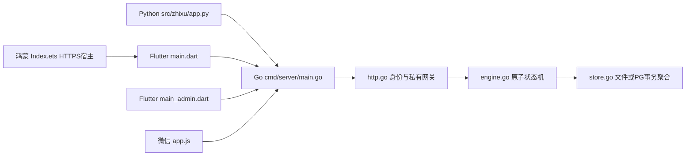
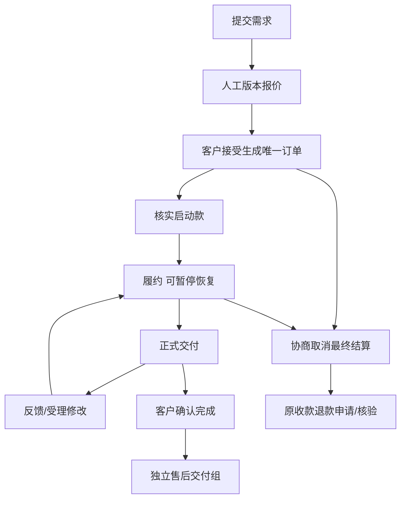
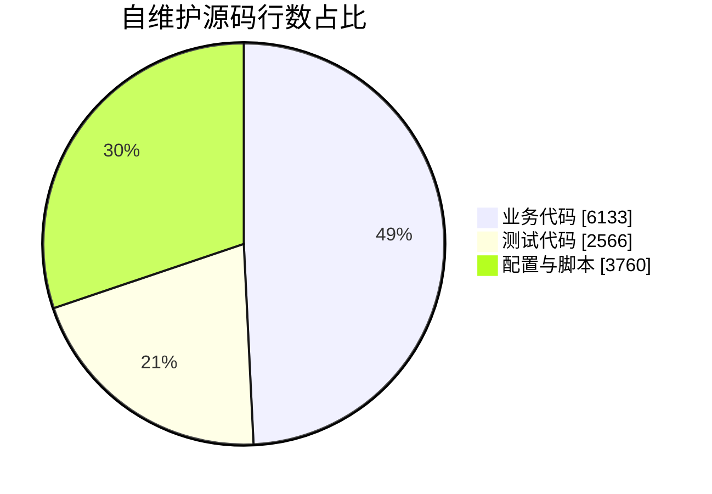

# 知序｜学术服务全端工程


[toc]

---

## 🔥 <span id="前言">前言</span>

“知序”是暂定品牌，为客户和运营人员提供毕业论文、普刊、编译三项服务的统一工作流。维护者Jobs，当前状态为**在研MVP / 可运行联调版**。已落地前后端和主要闭环；当前固定客户/管理员账户，不等于完整生产运营系统。普通操作者先双击[开始使用](./开始使用.html)，或阅读[零基础使用说明](./使用说明.md)。

## <span id="section-1">一、当前功能与交付</span> <a href="#前言" style="font-size:17px; color:green;"><b>🔼</b></a> <a href="#🔚" style="font-size:17px; color:green;"><b>🔽</b></a>

| 部分 | 当前能做什么 | 入口与验证边界 |
| --- | --- | --- |
| Go后端 | 三服务、需求、报价、订单、材料、交付、修改、取消结算、退款台账、售后、私有文件与幂等 | [backend](./backend/README.md)，28组race/PG协议夹具+14项真实HTTP闭环 |
| Python桌面 | 服务化表单、需求/订单、文件、报价/验收/售后、主题与连接设置 | [desktop](./clients/desktop/README.md)，47项回归；Mac APP/DMG实际启动通过 |
| Flutter用户端 | iOS/Android同源码、用户Web预览、宽窄窗口、真实API及隔离演示 | [flutter](./clients/flutter/README.md)，34项；iOS无签名Release构建通过；Android结果见报告 |
| Flutter后台 | 移动/PC共用的报价、资金登记、履约与售后动作 | [admin-web](./backend/admin-web/index.html)，通过Go `/admin/` 访问；不直接双击此index运行 |
| 鸿蒙 | ArkWeb加载同源HTTPS Flutter用户页面 | [harmony](./clients/flutter/harmony/)，宿主源码与生成脚本已交付，HAP/设备验收待完成 |
| 微信小程序 | 保留原需求主体入口，三服务、需求/报价/交付/消息/售后 | [miniprogram](./clients/miniprogram/README.md)，14项仓库保护；开发者工具与真机待验 |
| 分平台部署 | 各系统独立脚本完成配置、SDK准备、构建、前台运行 | [deploy](./backend/deploy/README.md)，Mac实际迁移冒烟；其它平台按报告区分检查/编译/实机 |

资金采用人工核验台账，申请退款不等于退款成功；服务不会向银行或微信自动付款。报价中的真实费用、交期、修改与取消约定由运营填写、客户确认；未预置商业收费。

## <span id="section-2">二、运行、构建与测试</span> <a href="#前言" style="font-size:17px; color:green;"><b>🔼</b></a> <a href="#🔚" style="font-size:17px; color:green;"><b>🔽</b></a>

零基础完整流程见[使用说明](./使用说明.md)。复制整个 `backend` 到服务器，双击其 `deploy` 内对应平台入口；管理员页面和用户Web已随目录带入，服务器不必装Flutter或Node。

开发者在 `backend` 运行：

```shell
go run ./cmd/server
go test -race -count=1 ./...
go vet ./...
```

Flutter在 `clients/flutter` 执行 `flutter pub get`，用户入口 `lib/main.dart`，管理入口 `lib/main_admin.dart`。Web构建、签名、最新SDK矩阵及鸿蒙准备命令见该模块README。桌面APP/DMG在 `clients/desktop/dist`，Windows EXE须在Windows本机生成。

工程根的整合保护：

```shell
GO_BIN=/本机Go目录/bin/go \
  python3 tests/test_http.py

python3 tests/test_deploy.py
node --test tests/test_mini.cjs
```

所有测试使用独立夹具和临时数据。正式数据、真实收付款与对外消息不作为测试输入。[回归报告](./docs/回归测试报告.md)列出各轮结果与未验收项。

## <span id="section-3">三、目录与定位</span> <a href="#前言" style="font-size:17px; color:green;"><b>🔼</b></a> <a href="#🔚" style="font-size:17px; color:green;"><b>🔽</b></a>

```text
学术服务平台（全端工程）/
├── 开始使用.html / 使用说明.md / README.md
├── backend/                 # 单份Go源码、已构建Web、各平台部署入口
├── clients/
│   ├── desktop/             # Python桌面源码、打包脚本、Mac成品
│   ├── flutter/             # Flutter用户端/管理端、iOS/Android、鸿蒙宿主
│   └── miniprogram/         # 微信原生入口
├── contracts/api.json       # 共用接口契约；backend内有单独移植副本
├── requirements/            # 原V0.3需求/数据库/回归文档与阅读资源快照
├── docs/                    # 实现范围、测试证据与统计
└── tests/                   # 整合HTTP、部署与小程序回归
```

[技术方案与39项需求追踪](./docs/技术方案与实现范围.md)说明各项已实现、部分实现与待验边界；[代码地图](./代码地图.md)可定位入口和模块。未初始化CodeGraph索引，不把本地索引当必需依赖。

## <span id="section-4">四、模块与业务路由</span> <a href="#前言" style="font-size:17px; color:green;"><b>🔼</b></a> <a href="#🔚" style="font-size:17px; color:green;"><b>🔽</b></a>





## <span id="section-5">五、源码规模与功能盘点</span> <a href="#前言" style="font-size:17px; color:green;"><b>🔼</b></a> <a href="#🔚" style="font-size:17px; color:green;"><b>🔽</b></a>

统计日期2026-10-30，口径见[源码统计JSON](./docs/源码统计.json)。只统计自维护源码、测试、配置与脚本；排除SDK、依赖、平台自动脚手架、生成物、资源、锁文件和原需求快照，不以文件扩展名数量冒充业务量。

| 类别 | 文件数 | 行数 | 行数占比 |
| --- | --- | --- | --- |
| 业务代码 | 28 | 6133 | 49.2% |
| 测试代码 | 11 | 2566 | 20.6% |
| 配置与脚本 | 37 | 3760 | 30.2% |



前端路由口径：Flutter用户/管理各3个主导航页面，详情属于工作区子视图，弹窗不另计页；Python3个主页面；微信5个独立page；鸿蒙复用Flutter页面、无新增业务页面。不跨实现简单相加成独立产品功能数。后端独立部署单元1个，业务HTTP接口10类，另有健康/管理诊断；RPC/MQ/定时任务/外部支付或通知投递器均0。一个actions接口承载多项状态动作，因此页面/接口比例不适用普通CRUD的机械对比。

| 类目 | 涉及情况与实现 |
| --- | --- |
| 网络/安全 | HTTPS由反代，Bearer内存会话、PBKDF2密码、登录限流；未实现证书绑定/OAuth/微信身份；本地偏好不保存密码或Token |
| 数据 | 文件原子快照或PG单行JSONB事务；客户端隔离演示与真实未知写；未实现29表关系迁移及压力容量验收 |
| 端能力 | 文件选择/授权下载；未接推送、蓝牙、定位、NFC、生物识别或真实支付；鸿蒙文件能力按README边界 |
| 工程 | 中文UI、三态主题、多端源码与分平台脚本；无热更新/埋点/崩溃收集/自动发布流水线 |
| 后端 | 版本锁、幂等收据、事务审计/outbox、退款额度及未知占用；未有真正通知发送、渠道对账或分布式任务队列 |
| 隐私 | 附件私有授权、请求处理授权、日志不记密码；正式隐私清单、数据保留及账号注销流程尚未完整 |

## <span id="section-6">六、依赖与最新稳定基线</span> <a href="#前言" style="font-size:17px; color:green;"><b>🔼</b></a> <a href="#🔚" style="font-size:17px; color:green;"><b>🔽</b></a>

直接运行第三方库5项，均公库、无私库；传递依赖不计入此数量。2026-10-30核对并锁定兼容的最新直接依赖，最新Android工具链按官方资料显式配置；SDK约束中的传递包差异单列于[Flutter依赖状态](./clients/flutter/docs/dependency-status.json)，没有强制覆盖为不兼容版本。

| 直接依赖 | 版本 | 来源/许可证 | 使用模块 |
| --- | --- | --- | --- |
| [pgx](https://github.com/jackc/pgx) | 5.11.0 | 公库MIT | Go可选PG存储 |
| [PySide6](https://pypi.org/project/PySide6/6.12.0/) | 6.12.0 | 公库LGPL-3.0及其它官方许可选项 | Python桌面 |
| [http](https://pub.dev/packages/http) | 1.6.0 | 公库BSD-3-Clause | Flutter HTTP |
| [shared_preferences](https://pub.dev/packages/shared_preferences) | 2.5.6 | 公库BSD-3-Clause | Flutter偏好/待核对记录 |
| [file_picker](https://pub.dev/packages/file_picker) | 13.3.0 | 公库MIT | Flutter原生/网页文件 |

工具链：Go1.27.3、Python3.15.2、Flutter3.47.8/Dart3.13.7、本机Xcode27.2；Android AGP9.4.0/Kotlin2.4.21/Gradle9.8.2/API37/NDKr30。开发/打包工具还包括flutter_lints6.0.0、PyInstaller6.22.3（GPL及打包例外）、setuptools84.2.1（MIT），版本与来源见各模块README。桌面按Qt LGPL条件分发，许可原文随包；尚未完成商店签名公证。没有私库凭据和业务密钥。

## <span id="section-7">七、交付与后续边界</span> <a href="#前言" style="font-size:17px; color:green;"><b>🔼</b></a> <a href="#🔚" style="font-size:17px; color:green;"><b>🔽</b></a>

当前可以联调主要业务，Mac成品和Web可直接体验。正式运营前还需完成真实客户身份、细分员工权限、关系库/对象存储、真实支付与通知、正式HTTPS/运维常驻、品牌协议与各商店签名。Windows、Android、鸿蒙和iPhone Duo具体实机结果以[回归报告](./docs/回归测试报告.md)为准。没有提交或推送远程仓库。

<a id="🔚" href="#前言" style="font-size:17px; color:green; font-weight:bold;">我是有底线的➤点我回到首页</a>
