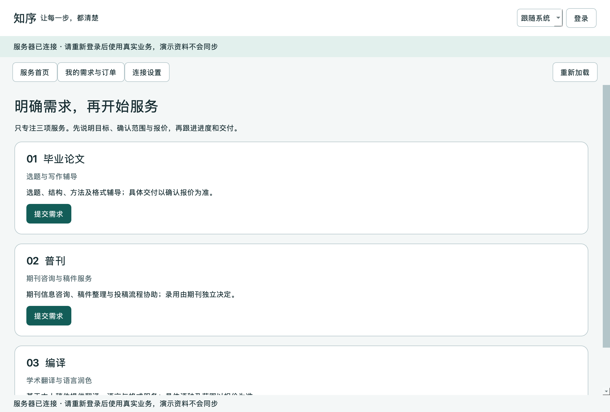

# 知序桌面端测试与验证


[toc]

---

## 🔥 <span id="前言">前言</span>

这里保存 [**Python**](https://www.python.org) 桌面客户端的自动回归与构建证据，统计日期为2026-10-30。当前结论为MacOS Apple Silicon本机验证通过，Windows源码与打包入口已提供，尚未执行Windows原生构建与设备验收。

## 一、<span id="run-tests">运行测试</span> <a href="#前言" style="font-size:17px; color:green;"><b>🔼</b></a> <a href="#🔚" style="font-size:17px; color:green;"><b>🔽</b></a>

在仓库根目录运行以下命令，测试源码位于外层 `测试/前端/PC端/Python/`。GUI测试使用 [**PySide6**](https://pypi.org/project/PySide6/6.12.0/) 6.12.0的离屏平台，测试只操作临时用户目录与本机HTTP夹具。

```shell
python3 './测试/运行测试.py/运行测试.py' \
  --group desktop
```

- `test_repository.py`：HTTP鉴权、重定向阻止、真实空列表、服务失败回退与恢复、私有账户隔离、待核对原键持久化和重试、8MB上传预检、坏响应校验。
- `test_gui.py`：三服务首屏、空态与重载、按服务必填字段、报价／取消／变更按钮、三态主题、系统外观信号、两种窗口尺寸和文字对比。
- `test_bootstrap.py`：用实际PowerShell进程和假uv验证Windows缺运行时安装分支只返回Python路径，日志不会混入返回值；此夹具不等于Windows原生安装。
- `test_packaging.py`：只清理本应用dist、拒绝符号链接dist与无关快捷入口、EOF／非空输入取消、错误平台不得清理产物。

测试根数按 `unittest` 的test方法计数，子场景不重复计数。最终完整回归47项通过、0失败，记录见[完整回归日志](./证据/round-final-followup.log)。历史截图保留；统一入口生成的本轮截图另写入 本目录 `证据/本轮/时间/桌面截图/`。

## 二、<span id="rounds">多轮回归结果</span> <a href="#前言" style="font-size:17px; color:green;"><b>🔼</b></a> <a href="#🔚" style="font-size:17px; color:green;"><b>🔽</b></a>

| 验证 | 结果与范围 | 证据 |
| --- | --- | --- |
| 前轮回归 | 修正客户端数据校验、演示隔离与取消／变更字段；原始日志保留 | [第二轮原始记录](./证据/round2-original.log)、[第三轮记录](./证据/round3.log) |
| 修正前基线 | 34项通过，随后补打包保护与跨层缺口；不能作为最终统计 | [原基线日志](./证据/final.log) |
| 当前完整回归 | 47项通过；包含7项构建保护，以及下载／核对401/403清缓存、畸形描述、8MB预检和按服务表单保护 | [最终日志](./证据/round-final-followup.log) |
| 真实服务闭环 | 独立本机最新Go进程，11个业务检查点全部通过 | [最新联调结果](./证据/live-backend-final.json) |
| 本机构建 | APP实际原生启动并取得有效首屏后才生成DMG与快捷入口 | [冻结应用截图](./证据/frozen-relocated-native.png)、[打包核验清单](./证据/package-validation.json) |
| 可迁移检查 | APP复制改名后从无关工作目录运行，清除Python／Qt开发环境变量，成功；87个Mach-O文件未发现非系统绝对库依赖 | [独立运行日志](./证据/native-relocation.log)、[打包核验清单](./证据/package-validation.json) |

本轮明确修正：直接私有下载或直接核对遇到401/403时统一撤销会话与私有界面；非法 `description` 响应在进入Qt渲染前拒绝；附件上限与后端8MB一致；毕业论文、普刊、编译分别仅呈现相关必填字段。Windows首次准备运行时的工具输出已与返回路径分离；MacOS打包结束显式启动新实例。冻结APP与DMG已从这些源码重新生成。

## 三、<span id="live-flow">真实后端联调</span> <a href="#前言" style="font-size:17px; color:green;"><b>🔼</b></a> <a href="#🔚" style="font-size:17px; color:green;"><b>🔽</b></a>

先由开发者启动独立的本机 [**Go**](https://go.dev/) 开发实例，再运行外层 `测试/前端/PC端/Python/live_smoke.py`。该脚本会创建测试需求、材料与人工资金台账，只允许本机地址，不能连接业务运行数据。

```shell
python3 './测试/前端/PC端/Python/live_smoke.py' \
  --api http://127.0.0.1:18082/api/v1 \
  --output './测试/报告与证据/本轮/桌面联调/live-backend.json'
```

闭环覆盖客户与管理员独立登录、三服务真实创建、私有文件上传下载、报价确认、收款登记与开工、暂停恢复、修改受理、主服务验收、独立售后交付验收、取消最终结算及分阶段退款。退款按申请→批准占用→人工核实成功推进，没有执行真实渠道扣款或退款。

冻结APP可通过 `python3 ./测试/前端/PC端/Python/verify_package.py` 重做本机复制／动态库依赖检查，并保存当前成品摘要。

本轮使用Go1.27.3、本机动态端口、临时业务目录与独立客户设置目录；进程退出后清理临时数据。生产密码与用户真实材料未写入测试证据。

## 四、<span id="native-artifacts">成品与验收边界</span> <a href="#前言" style="font-size:17px; color:green;"><b>🔼</b></a> <a href="#🔚" style="font-size:17px; color:green;"><b>🔽</b></a>

当前成品位于 `代码/前端/PC端/Python/Dist/2026.10.30 16-29-52/`，第一层的 `知序.app` 与 `知序.dmg` 为相对快捷入口。[**PyInstaller**](https://pyinstaller.org/) 将运行时、依赖、图标和许可文本一起打包，普通使用者不需要安装Python；清单中记录成品SHA256及对应源码摘要。

尚未完成：Windows原生EXE生成与运行、Intel Mac本机打包、另一台Mac接收后运行、真实AirDrop与AppTranslocation环境、实际操作系统外观设置切换。Qt系统外观信号夹具只证明客户端订阅和手动主题优先级；独立复制检查只证明本机改名移动可运行，不能替代另一台电脑验收。



<a id="🔚" href="#前言" style="font-size:17px; color:green; font-weight:bold;">我是有底线的➤点我回到首页</a>
