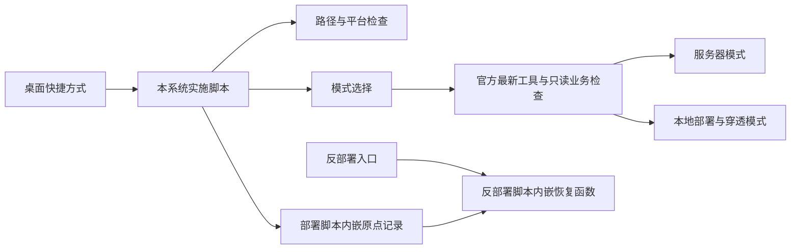

# RockyLinux 部署代码地图

[toc]

---

## 🔥 前言

本图只定位 RockyLinux 部署单元；其它系统入口分别维护，不以本系统结果推定其它系统可用。本图标明平台目录内的快捷入口、脚本包内的唯一部署实现及各自职责；运行行为与验证状态以就近使用说明为准。路径均从当前文档相对指向源码；跨单元内容只通过链接引用。

## 一、入口与模块职责 <a href="#前言" style="font-size:17px; color:green;"><b>🔼</b></a> <a href="#🔚" style="font-size:17px; color:green;"><b>🔽</b></a>

| 本单元路径 | 职责 |
| --- | --- |
| [【Linux】部署.sh/【Linux】部署.sh](../【Linux】部署.sh/【Linux】部署.sh) | 真实 RockyLinux Shell 实施入口。 |
| [双击部署（快捷入口）.desktop](../双击部署（快捷入口）.desktop) | 图形桌面快捷方式，直接调用上面的规范脚本。 |
| [【Linux】反部署.sh](../【Linux】反部署.sh/【Linux】反部署.sh) | 本系统反部署入口，内嵌原点核验、备份、清源与精确恢复函数。 |
| [双击反部署（快捷入口）.desktop](../双击反部署（快捷入口）.desktop) | 反部署专用桌面入口，复用内层自述与危险确认。 |

| 生命周期核心（[部署入口](../【Linux】部署.sh/【Linux】部署.sh)／[反部署入口](../【Linux】反部署.sh/【Linux】反部署.sh)） | 两份脚本各自内嵌原点、互斥与恢复实现；不依赖外部生命周期函数库。 |

当前依赖链：`prepare_latest_dependencies`、`prepare_dependency_resolver`、`resolve_latest_dependency`、`ensure_latest_dependency`、`accept_latest_dependency`；`check_business_dependency_updates`；`build_locked_module`；外置缓存子收据由 `lc_cache_begin`／`lc_cache_seal`／`lc_cache_restore` 管理。静态锁只作Bootstrap，模式确认后核查官方最新稳定Go／fzf及本地模式cloudflared；源码业务锁只读报告，超时不称已检查，按锁构建并复核源文件不变。共享元数据与报告合同见[依赖解析组件](../../公共组件/依赖版本/README.md)，具体缓存目录见[平台说明](../README.md#latest-dependencies)。

## 二、本单元关系 <a href="#前言" style="font-size:17px; color:green;"><b>🔼</b></a> <a href="#🔚" style="font-size:17px; color:green;"><b>🔽</b></a>

## 三、共享源与外部依赖 <a href="#前言" style="font-size:17px; color:green;"><b>🔼</b></a> <a href="#🔚" style="font-size:17px; color:green;"><b>🔽</b></a>

- [Go 后端实现地图](../../../代码/后端/后端代码/代码地图/代码地图.md)：脚本按自身位置解析后端；分发时保持根目录的代码与部署并列，后端留在代码/后端/后端代码
- [部署工具锁清单](../../deploy-tools.lock.tsv)：Bootstrap资产与摘要基线，最终版本由官方元数据决定
- [工具链声明](../../toolchains.json)：保留原核对日期与归档的Bootstrap声明，不代表运行态最新版本
- [部署公共说明](../../README.md)：本系统操作、依赖与验证状态仍以就近说明及现有报告为准

## 四、外置测试与验证边界 <a href="#前言" style="font-size:17px; color:green;"><b>🔼</b></a> <a href="#🔚" style="font-size:17px; color:green;"><b>🔽</b></a>

- [test_deploy.py](../../../测试/部署/test_deploy.py)：分系统入口、平台与安全隔离夹具
- [【测试】部署双模式.py](../../../测试/部署/【测试】部署双模式.py/【测试】部署双模式.py)：本地／服务器模式隔离检查

- [本单元使用说明](../README.md)：运行、构建及当前限制
- [统一测试说明](../../../测试/README.md)：各职责的执行入口与证据位置

地图核对文档与源码位置，不代表完成构建、设备业务或正式发布验收。已有验证状态保留原记录，未执行的目标不写成通过。

<a id="🔚" href="#前言" style="font-size:17px; color:green; font-weight:bold;">我是有底线的➤点我回到首页</a>
