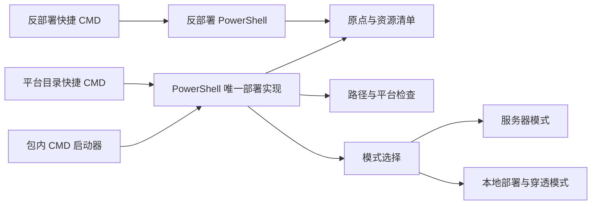

# Windows 部署代码地图

[toc]

---

## 🔥 前言

本图只定位 Windows 部署单元；其它系统入口分别维护，不以本系统结果推定其它系统可用。本图标明平台目录内的快捷入口、脚本包内的唯一部署实现及各自职责；运行行为与验证状态以就近使用说明为准。路径均从当前文档相对指向源码；跨单元内容只通过链接引用。

## 一、入口与模块职责 <a href="#前言" style="font-size:17px; color:green;"><b>🔼</b></a> <a href="#🔚" style="font-size:17px; color:green;"><b>🔽</b></a>

| 本单元路径 | 职责 |
| --- | --- |
| [【Windows】双击部署（快捷入口）.cmd](../【Windows】双击部署（快捷入口）.cmd) | 双击快捷入口，保留参数与退出码并复用内层自述与确认。 |
| [【Windows】部署.cmd/【Windows】部署.cmd](../【Windows】部署.cmd/【Windows】部署.cmd) | 包内 CMD 启动器，调用同一 PowerShell 部署实现。 |
| [【Windows】部署.ps1/【Windows】部署.ps1](../【Windows】部署.ps1/【Windows】部署.ps1) | Windows 唯一 PowerShell 部署实现。 |
| [【Windows】双击反部署（快捷入口）.cmd](../【Windows】双击反部署（快捷入口）.cmd) | 精确转交本系统反部署包，与部署用途分开。 |
| [【Windows】反部署.ps1](../【Windows】反部署.ps1/【Windows】反部署.ps1) | fzf 数据策略、危险确认与按原点反部署。 |

| 生命周期核心（[部署入口](../【Windows】部署.ps1/【Windows】部署.ps1)／[反部署入口](../【Windows】反部署.ps1/【Windows】反部署.ps1)） | 两份脚本各自内嵌原点、互斥与恢复实现；不依赖外部生命周期函数库。 |

## 二、本单元关系 <a href="#前言" style="font-size:17px; color:green;"><b>🔼</b></a> <a href="#🔚" style="font-size:17px; color:green;"><b>🔽</b></a>

## 三、共享源与外部依赖 <a href="#前言" style="font-size:17px; color:green;"><b>🔼</b></a> <a href="#🔚" style="font-size:17px; color:green;"><b>🔽</b></a>

- [Go 后端实现地图](../../../代码/后端/后端代码/代码地图/代码地图.md)：脚本按自身位置解析后端；分发时保持根目录的代码与部署并列，后端留在代码/后端/后端代码
- [部署工具锁清单](../../deploy-tools.lock.tsv)：fzf 与隧道工具的公共唯一清单
- [工具链声明](../../toolchains.json)：按目标系统／架构核对，不能把其它机器环境当作本机已准备
- [部署公共说明](../../README.md)：本系统操作、依赖与验证状态仍以就近说明及现有报告为准

## 四、外置测试与验证边界 <a href="#前言" style="font-size:17px; color:green;"><b>🔼</b></a> <a href="#🔚" style="font-size:17px; color:green;"><b>🔽</b></a>

- [Windows 反部署隔离验证](../../../测试/部署/Windows/【Windows】验证反部署.ps1/README.md)：临时夹具、备份/清零/取消边界与安全保留；原生验收单列。
- [test_deploy.py](../../../测试/部署/test_deploy.py)：分系统入口、平台与安全隔离夹具
- [【测试】部署双模式.py](../../../测试/部署/【测试】部署双模式.py/【测试】部署双模式.py)：本地／服务器模式隔离检查

- [本单元使用说明](../README.md)：运行、构建及当前限制
- [统一测试说明](../../../测试/README.md)：各职责的执行入口与证据位置

地图核对文档与源码位置，不代表完成构建、设备业务或正式发布验收。已有验证状态保留原记录，未执行的目标不写成通过。

<a id="🔚" href="#前言" style="font-size:17px; color:green; font-weight:bold;">我是有底线的➤点我回到首页</a>
