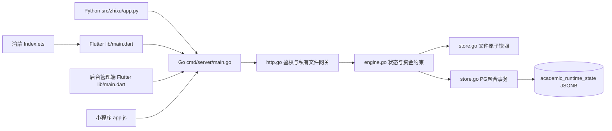
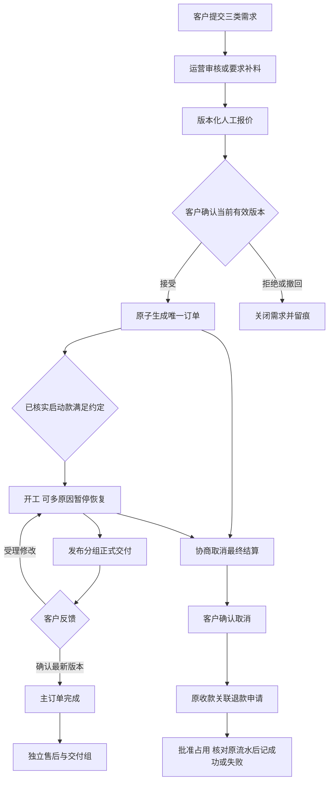

# 技术方案与实现范围

[toc]

---

## 🔥 前言

用户2026-10-30明确要求桌面Python、移动Flutter、Go后端、Flutter响应式后台、分平台部署、零基础说明与多轮回归。本版将既有V0.3需求落实为可运行MVP；原需求文件保存在 `requirements/`，原桌面需求文件夹不改动。未确认的收费、品牌和服务细则使用可编辑报价与暂定文案，不视为商业规则已定稿。

## 一、架构与实现取舍 <a href="#前言" style="font-size:17px; color:green;"><b>🔼</b></a> <a href="#🔚" style="font-size:17px; color:green;"><b>🔽</b></a>

| 层 | 选择 | 当前边界 |
| --- | --- | --- |
| 桌面 | Python / PySide6 | Windows与MacOS共享源码；本机已生成ARM64 APP/DMG，Windows须本机打包与验收 |
| 用户移动端 | Flutter | iOS/Android项目及用户Web同一业务代码，按窗口宽度调整布局 |
| 管理端 | Flutter Web | 独立入口后台 lib/main.dart，共用数据仓库与动作表单，手机/平板/PC可访问 |
| 鸿蒙 | ArkWeb宿主＋Flutter Web | 通过HTTPS加载用户页面；DevEco/HAP/签名设备验收尚未完成，未交付原生Flutter OH引擎 |
| 微信小程序 | 微信官方原生 WXML／WXSS／JavaScript／JSON | 本期必交付的独立前端，沿用 `代码/前端/微信小程序/`，共用业务 API；真实微信身份与平台发布待接入，工具和真机分别验收 |
| 后端 | Go单份源码 | 标准HTTP与事务业务层，人工资金核验，不调用真实收付款渠道 |
| 当前数据库 | 文件原子快照 / 可选PostgreSQL JSONB聚合 | 原29表关系模型仍作为参考，尚未逐表映射，不宣称关系迁移完成 |

[**PostgreSQL**](https://www.postgresql.org/) 聚合事务锁与文件模式业务锁实现同一状态机，业务、幂等、审计和待发送通知一起提交。当前全状态聚合适合联调，历史/附件增长会放大读写成本；未做生产容量验收。后续关系化迁移需保留稳定提交键、资金记录、版本快照与所有权约束。

## 二、模块依赖 <a href="#前言" style="font-size:17px; color:green;"><b>🔼</b></a> <a href="#🔚" style="font-size:17px; color:green;"><b>🔽</b></a>

## 三、核心流程 <a href="#前言" style="font-size:17px; color:green;"><b>🔼</b></a> <a href="#🔚" style="font-size:17px; color:green;"><b>🔽</b></a>

## 四、需求验收口径 <a href="#前言" style="font-size:17px; color:green;"><b>🔼</b></a> <a href="#🔚" style="font-size:17px; color:green;"><b>🔽</b></a>

下表是实现追踪，不把文档原有39项自动改为“全部通过”。“自动化覆盖”仅代表对应软件场景已有可复跑证据；生产渠道、关系数据库、全套原生设备和完整运营组织仍需另验。详见[回归报告](../../测试/回归测试报告/回归测试报告.md)。

| 编号 | 原验收项 | 本版实现/证据范围 |
| --- | --- | --- |
| T01 | 首页范围 | 已实现并有自动化覆盖；完整终端/生产验收待执行 |
| T02 | 简洁与原创表达 | 已实现并有自动化覆盖；完整终端/生产验收待执行 |
| T03 | 游客浏览 | 已实现并有自动化覆盖；完整终端/生产验收待执行 |
| T04 | 三类表单 | 已实现并有自动化覆盖；完整终端/生产验收待执行 |
| T05 | 上传恢复 | 部分：上传/未知保护已实现，逐文件进度与断点恢复未完整实现 |
| T06 | 重复与超时 | 已实现并有自动化覆盖；完整终端/生产验收待执行 |
| T07 | 提交与补充 | 已实现并有自动化覆盖；完整终端/生产验收待执行 |
| T08 | 完整报价 | 部分：完整范围自由文本；结构化条款待产品定稿 |
| T09 | 报价一致性 | 已实现并有自动化覆盖；完整终端/生产验收待执行 |
| T10 | 启动与进度 | 部分：启动款与状态已测，服务周期/下一步规则待细化 |
| T11 | 普刊状态 | 待实现：普刊外部来源/日期独立模型 |
| T12 | 交付与修改 | 已实现并有自动化覆盖；完整终端/生产验收待执行 |
| T13 | 需求变更 | 已实现并有自动化覆盖；完整终端/生产验收待执行 |
| T14 | 取消与售后 | 已实现并有自动化覆盖；完整终端/生产验收待执行 |
| T15 | 资金真实 | 方案A人工核验已测；方案B渠道未接入 |
| T16 | 空态与恢复 | 已实现并有自动化覆盖；完整终端/生产验收待执行 |
| T17 | 演示回退 | 已实现并有自动化覆盖；完整终端/生产验收待执行 |
| T18 | 本人权限 | 已实现并有自动化覆盖；完整终端/生产验收待执行 |
| T19 | 员工权限 | 待实现：细分员工授权与撤派 |
| T20 | 真机与可读性 | 待设备验收：已有窗口/大字/主题测试 |
| T21 | 后台闭环 | MVP闭环可操作；员工分派/内容发布未完整 |
| T22 | 端到端 | 多服务提交及整单联调已测；完整各端三服务验收待执行 |
| T23 | 并发接受与重报价 | 已实现并有自动化覆盖；完整终端/生产验收待执行 |
| T24 | 迟到或重复收款结果 | 部分：人工凭据去重/终态保护已测，渠道回调未接入 |
| T25 | 退款聚合 | 已实现并有自动化覆盖；完整终端/生产验收待执行 |
| T26 | 完成后返修 | 已实现并有自动化覆盖；完整终端/生产验收待执行 |
| T27 | 文件归属及撤派 | 部分：文件归属与版本保护已测，员工撤派未实现 |
| T28 | 演示与账号隔离 | 已实现并有自动化覆盖；完整终端/生产验收待执行 |
| T29 | 业务与通知重试 | 部分：事务outbox已测；真正通知投递器未实现 |
| T30 | 下架与历史条款 | 部分：业务层快照/下架已测，无运营发布入口 |
| T31 | 阶段动作一致 | 部分：阶段动作已测；付款方案B未接入 |
| T32 | 验收与取消冲突 | 已实现并有自动化覆盖；完整终端/生产验收待执行 |
| T33 | 响应缓存过期后的重试 | 已实现并有自动化覆盖；完整终端/生产验收待执行 |
| T34 | 修改中取消 | 已实现并有自动化覆盖；完整终端/生产验收待执行 |
| T35 | 未知资金结果与动作 | 方案A退款未知保护已测；方案B未接入 |
| T36 | 暂停、恢复与交期 | 暂停原因/恢复/交期变更已测；自动时钟策略未实现 |
| T37 | 修改轮次与额度 | 已实现并有自动化覆盖；完整终端/生产验收待执行 |
| T38 | 取消结算 | 已实现并有自动化覆盖；完整终端/生产验收待执行 |
| T39 | 交付分组与草稿 | 已实现并有自动化覆盖；完整终端/生产验收待执行 |

## 五、继续产品化的具体事项 <a href="#前言" style="font-size:17px; color:green;"><b>🔼</b></a> <a href="#🔚" style="font-size:17px; color:green;"><b>🔽</b></a>

- 身份：真实微信登录、客户注册与找回、员工角色、订单分派/撤派、凭据安全存储与账户生命周期。
- 服务运营：品牌/主体/协议定稿、结构化报价条款、服务内容发布与上下架入口、普刊外部反馈来源与日期字段。
- 数据：29表逐表映射、对象存储/扫描、数据保留与删除、文件大规模传输、备份恢复和原生PG容量/故障验收。
- 外部能力：真实支付/退款与对账、通知投递器与送达重试、正式域名HTTPS/运维常驻、商店签名与提审。
- 原生终端：Windows成品、Android最新工具链实际结果、鸿蒙HAP和文件能力、iPhone Duo姿态/窗口/键盘/大字/真机附件验收。

这些是当前实现边界；不得用“源码可编译”代替真实渠道或目标设备验收。

<a id="🔚" href="#前言" style="font-size:17px; color:green; font-weight:bold;">我是有底线的➤点我回到首页</a>
