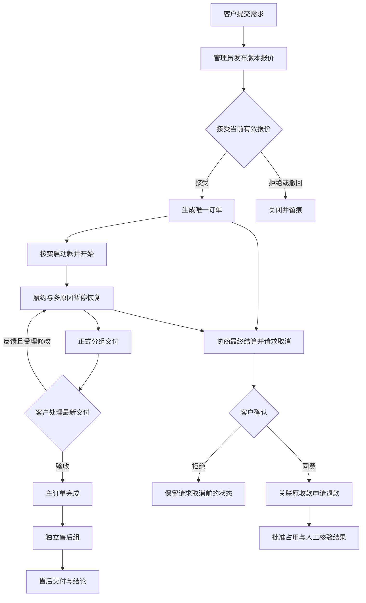
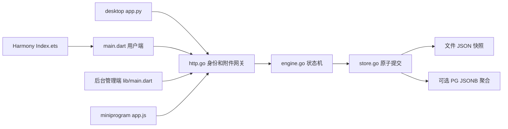

# 学术服务平台｜项目需求与开发评审

[toc]

---

## 🔥 前言

依据 Jobs“软件项目从零到一”Skill 的现行完整开发与交付规范（2026-11-03 核对目录条款），建立当前工程的可补填基线。本文件整理已有需求与实现，原 V0.3 文档及其编号原样保留。源码事实、历史执行证据、用户确认与建议分别记录；本轮完成文档回归及目录分离，迁移验证结果单独登记，不等于正式上线验收。

| 文档信息 | 内容 |
| --- | --- |
| 项目名称／别名 | 学术服务平台／陈泉羽项目 |
| 品牌现状 | 知序为实现暂名，见 Q-001 |
| 文档版本／日期 | V1.0；2026-11-03，Asia/Shanghai |
| 当前工程版本 | 既有交付状态记录 `0.1.0-mvp`；当前工作区有未提交改动，未冻结发布候选 |
| 需求方／业务确认人 |  |
| 开发维护者 | Jobs |
| 测试、部署及验收负责人 |  |
| 本期目标验收等级 |  |
| 原始资料 | [需求 V0.3](../学术服务小程序需求分析/学术服务小程序需求分析.md)、[实现范围](../技术方案与实现范围/技术方案与实现范围.md)、[历史回归](../../测试/回归测试报告/回归测试报告.md) |
| 阅读与分册 | [离线阅读版](./项目需求与开发评审阅读版.html)、[测试与分级验收](../../测试/测试与分级验收/测试与分级验收.md)、[交付与运维清单](../交付与运维清单/交付与运维清单.md) |

空白表示没有足够输入，不代表默认同意。带稳定编号的红字只记录有依据的歧义或冲突。技术版本以现有锁文件和记录为事实来源，本轮未作外部版本或平台生命周期核验。

## 一、需求摸排 <a href="#前言" style="font-size:17px; color:green;"><b>🔼</b></a> <a href="#🔚" style="font-size:17px; color:green;"><b>🔽</b></a>

### 1.1、用户原始需求与来源 <a href="#前言" style="font-size:17px; color:green;"><b>🔼</b></a> <a href="#🔚" style="font-size:17px; color:green;"><b>🔽</b></a>

本轮用户原文：

> 用我“软件项目开发从0～1”的skills去对这个项目进行规范。

目录整理补充原文：

> /Users/jobs/Documents/Github/学术服务平台/学术服务平台（全端工程） 需求和测试要和核心代码分开，放在外面。比如需求已经在外层有了/Users/jobs/Documents/Github/学术服务平台/学术服务小程序需求分析（2026-10-30） 你就没必要里面单独开一个文件夹写，你就在外写就完了。
>
> 整体的项目目录，应该是：一个大的文件夹（git管理），下辖：代码文件夹、测试文件夹、需求文件夹
>
> 同时，代码文件夹里面的各个端的装代码文件夹，需要用中文（目前是英文）命名。

微信小程序范围补充原文（2026-11-03）：

> 那么，陈泉羽项目和李林哲项目，都需要微信小程序

代码分层补充原文：

> 代码总体来讲，分前端和后端。所以在代码文件夹里面，应该是：前端（内含PC端、移动端、后台管理端、）、后端（内含接口契约、后端代码）、部署（内含各个操作系统平台的部署脚本）
>
> artifacts文件夹不应该存在。
> 前端存在跨平台写法，比如在移动端文件夹，如果是选用的跨平台写法，移动端名下就应该有Flutter文件夹、如果选用的是原生写法，那就需要有iOS/Android/鸿蒙文件夹
>
> 这一套文件夹的管理方案，你要写进：从0～1软件开发的Skills里面去
> 同时对这个文件夹进行应用

测试归类补充原文：

> 测试文件夹里面，集成这个文件夹干嘛的？
>
> 而且这里面的也应像代码文件夹一样，进行前后端归类

主目录资料收纳补充原文：

> 测试/代码/需求 文件夹中的一级目录散落着很多md/html，其实都要按照内容/标题并入自己的文件夹。也就是对于主目录，永远只有README.md和一堆文件夹
>
> 以上需要计入0～1软件开发工程规范里面

目录大小写补充原文（保留用户原句）：

> macOS文件夹，名字要写成MacOS，但凡是macOS，以后都要写成MacOS。文件夹都是大写字母开头，这个需要计入0～1软件开发工程规范里面。

此前业务原始聊天全文未包含在仓库资料中，原文栏留空，不将整理过的摘要还原成引号内的用户发言。

此前业务原始需求全文：

| 来源编号 | 资料与日期 | 可支持的结论 | 确认边界 |
| --- | --- | --- | --- |
| SRC-01 | [原需求第一章 C01—C07](../学术服务小程序需求分析/学术服务小程序需求分析.md#confirmed-input)，2026-10-30 | 小程序主体、网站非前提、三服务、简洁且独立视觉、需求回归与数据库设计 | 文档登记的已确认输入；非聊天逐字原文 |
| SRC-02 | [技术方案前言](../技术方案与实现范围/技术方案与实现范围.md#前言)，2026-10-30 | 用户要求 Python 桌面、Flutter 移动／后台、Go 后端、分平台部署与多轮回归 | 已确认技术方向；未证明原建议业务已逐项确认 |
| SRC-03 | [原需求 R01—R23 与 T01—T39](../学术服务小程序需求分析/学术服务小程序需求分析.md#regression)，V0.3 | 建议业务规则、未来软件验收合同 | 建议规则与软件通过结论分开 |
| SRC-04 | [运行接口契约](../../代码/后端/接口契约/api.json)、[存储实现](../../代码/后端/后端代码/internal/platform/store.go) | 当前接口、状态聚合、金额与幂等语义 | 2026-11-03 静态核对；不等于生产验收 |
| SRC-05 | [既有回归报告](../../测试/回归测试报告/回归测试报告.md)及原始日志，2026-10-30 | 已报告的有限自动化、HTTP、构建与平台结果 | 保留原日期与适用版本；迁移后的复跑另行登记 |
| SRC-06 | 用户永久记忆的本项目确认，2026-11-02 | 降低前期云费用、双模式部署、每份部署文档写最低机器配置 | 需求已确认；穿透采购、真实公网和最低硬件实测未确认完成 |
| SRC-07 | 本轮用户原文，2026-11-03 | 按指定 Skill 规范本项目 | 授权本次规范落地；不扩大为发布、采购或重写各端 |
| SRC-08 | 本轮目录整理补充原文，2026-11-03 | 根仓统一管理代码、测试、需求；不在代码内另设重复需求；各端中文命名 | 已明确，按实际目录迁移，工具链内部标准目录保留 |
| SRC-09 | 用户代码分层补充原文，2026-11-03 | 前端／后端／部署与技术目录分层，禁止 artifacts，并写入 Skill | 已明确，应用到当前项目 |
| SRC-10 | 用户测试归类补充原文，2026-11-03 | 测试按前端、后端、部署及产品技术归类 | 已明确，原集成用例按职责迁移保留 |
| SRC-11 | 用户主目录资料收纳补充原文，2026-11-03 | 三个主目录一级只保留 README 与文件夹，资料按内容或标题归档 | 已明确，写入工程规范并同步当前项目 |
| SRC-12 | 微信小程序范围补充原文，2026-11-03 | 陈泉羽项目必须包含独立微信小程序前端，沿用现有官方原生工程 | 已确认该端纳入本期交付；不代替真机、体验版、提审和发布证据，不扩大真实支付及身份能力 |
| SRC-13 | 用户目录大小写补充原文，2026-11-03 | 自定义英文目录首字母大写，MacOS 统一写法，并写入从零到一工程规范 | 已明确；保留实际工具链、语言包及用户指定专名，迁移同步引用并核验 |

案例材料沿用原需求中的 [**氪研学术**](https://www.keyan.asia/) 调研及[两张本地截图](../参考截图)。原文记录的调研时间为 2026-10-30，本轮未重新访问竞品；截图用于内部需求讨论，不能当自有宣传素材。

### 1.2、目标、范围与优先级 <a href="#前言" style="font-size:17px; color:green;"><b>🔼</b></a> <a href="#🔚" style="font-size:17px; color:green;"><b>🔽</b></a>

| 项目 | 当前依据／填写 |
| --- | --- |
| 目标用户 | 三项服务的客户及内部运营人员；具体人群定位沿用原需求建议 |
| 已确认业务方向 | 仅毕业论文、普刊、编译；小程序为主体，对外网站不构成前提 |
| 已确认技术方向 | Python 桌面，Flutter 移动及响应式后台，Go 后端；微信小程序为本期必交付的官方原生独立前端 |
| 当前实现范围 | 服务展示、固定身份、需求、人工报价、订单、人工资金台账、交付修改、取消结算、售后与私有文件 |
| 正式经营服务清单及标准 |  |
| 本期合同交付范围／优先级 | 微信小程序独立前端已确认；其它范围与具体优先级： |
| 后续阶段范围／成功指标 |  |
| 原建议不主动扩展项 | 见[原需求 4.3](../学术服务小程序需求分析/学术服务小程序需求分析.md#excluded)，仍为建议；不自动转成正式排除合同 |

### 1.3、需求、设计、用例与验收追溯 <a href="#前言" style="font-size:17px; color:green;"><b>🔼</b></a> <a href="#🔚" style="font-size:17px; color:green;"><b>🔽</b></a>

原需求 C 为确认摘要，F 为建议功能，R 为建议执行规则，T 为验收项。本轮不重排这些编号。下表连接功能与实现；完整 T01—T39 状态沿用[39 项实现映射](../技术方案与实现范围/技术方案与实现范围.md#section-4)，实际执行记录依[测试计划](../../测试/测试与分级验收/测试与分级验收.md#evidence)关联版本后填写。

| 需求 | 来源／规则 | 当前设计或实现入口 | 用例 | 正式验收证据 |
| --- | --- | --- | --- | --- |
| F01 三服务 | C03、R18；T01—T02、T30 | `前端/移动端/Flutter/lib/main.dart`；`后端/后端代码/internal/platform/engine.go`；尚缺内容运营发布入口 | AC-01 |  |
| F02 本人身份 | C01；T03、T18—T19、T27—T28 | `后端/后端代码/internal/platform/http.go` 固定 admin/customer；真实注册及员工分派未实现 | AC-02、AC-03 |  |
| F03 需求与上传 | R19；T04—T07、T33 | `POST /cases`、`POST /cases/{id}/attachments`；无完整断点恢复 | AC-04、AC-05 |  |
| F04 材料与沟通 | R17；T07、T29 | `need_material`、`supplement`、`message`；outbox 未实际发送通知 | AC-04、AC-13 |  |
| F05 版本报价 | R01、R02、R11；T08—T09、T23 | `quote`、`withdraw_quote`、`accept_quote`；范围为自由文本 | AC-06 |  |
| F06 订单履约 | R04、R05、R20；T10—T11、T31、T36 | `start`、`pause`、`resume`；普刊外部反馈与自动计时未完成 | AC-07 |  |
| F07 交付与修改 | R08、R14、R21、R23；T12、T26、T37、T39 | `deliver`、`revision`、`accept_revision`、`accept_delivery` | AC-08 |  |
| F08 变更、取消、售后 | R03、R06—R07、R09、R12—R13、R22；T13—T15、T24—T25、T32、T34—T35、T38 | `propose_change`、`confirm_cancel`、退款动作、`after_sale`；仅人工资金方案 | AC-09、AC-10 |  |
| F09 主体与规则 | C04—C05；T02、T20 | 暂名与示例文案；正式主体、协议和收费规则未定稿 | AC-01、AC-12 |  |
| F10 内部后台 | T19、T21—T22 | `前端/后台管理端/Flutter/lib/main.dart`；MVP 运营闭环，员工与内容管理不完整 | AC-03、AC-14 |  |
| 统一前端行为 | R16、R19；T16—T17、T28 | 各端仓库 API 优先／隔离演示／未知写保护 | AC-05、AC-11 |  |
| GOV-01 项目基线 | SRC-07 | 本主文档、测试计划、交付清单与根目录导航 | 文档编号、内链、原文保护及阅读版检查 | 本轮文档核对，见各分册的验证范围 |
| GOV-02 双模式与机器配置 | SRC-06 | `部署/` 各系统说明、入口与锁清单 | OP-01—OP-06 |  |
| GOV-03 微信小程序独立前端 | SRC-09；T21—T22 | `代码/前端/微信小程序/` 官方原生 WXML／WXSS／JavaScript／JSON；共用 API，独立交付 | AC-11、AC-14、AC-15 | 仓库校验不代替开发者工具、真机、体验版及发布证据 |

### 1.4、角色与权限矩阵 <a href="#前言" style="font-size:17px; color:green;"><b>🔼</b></a> <a href="#🔚" style="font-size:17px; color:green;"><b>🔽</b></a>

| 角色 | 当前页面与操作 | 数据与敏感字段范围 | 结论 |
| --- | --- | --- | --- |
| 游客 | 服务展示、登录 | 不得读私有工作区、附件与操作回执 | 后端校验；真实权限证据按 AC-02 复验 |
| customer | 提需求、补料、接受／拒绝报价、确认变更／取消、反馈／验收／售后 | 仅所有者数据；材料与联系方式按案件授权 | 当前只有一个固定客户身份，不能据此宣称多客户隔离已运营 |
| admin | 审核、报价、人工资金登记、履约交付、退款核验与售后处理 | 当前可处理全部案件及其附件 | 单一管理员角色，无细分员工或组织隔离 |
| 员工／服务人员 | 原建议角色，源码未实现分派／撤派 |  | F10／T19、T27 未完成 |
| 运维／资产管理员 |  |  | 责任与数据接触权限留白 |

页面隐藏不代替服务端授权。未登录、会话过期、跨案件、同键异用户、附件归属及管理员动作要纳入用例。账号停用、找回、注销、员工权限收回属于尚未完成的账户生命周期范围。

### 1.5、业务流程与异常闭环 <a href="#前言" style="font-size:17px; color:green;"><b>🔼</b></a> <a href="#🔚" style="font-size:17px; color:green;"><b>🔽</b></a>

| 流程 | 前置与成功结果 | 异常、重试及补偿 |
| --- | --- | --- |
| 需求→报价→订单 | 客户同意材料处理并提交，运营出当前有效版本报价，客户接受后形成唯一订单 | 过期／撤回／版本冲突拒绝；网络未知写保留原键原文核对；费用与服务条款见 Q-002 |
| 启动→履约→交付 | 启动款满足约定，管理员启动，按主订单或指定售后组发布交付，客户确认相应最新版本 | 多原因暂停按 hold 逐条解除；草稿附件不能替代正式交付；自动计时规则见 Q-005 |
| 反馈→修改 | 反馈绑定交付，管理员受理轮次后计算使用额度；允许免计轮 | 重复受理和超额拒绝；主订单完成后的新售后使用独立组，不能重开旧组冒充新交付 |
| 变更／取消 | 报价与约定变化由客户确认；取消按最终应收结算而非直接填退款额 | 验收与取消并发以版本校验；拒绝取消回到原流程；已成功退款不重复扣减 |
| 人工退款 | 指向原收款，申请、批准占用额度、人工核实原流水再记结果 | 申请与批准不表示已划款；unknown 保留占用，核实失败后才释放，禁止另键重复退 |
| 附件／消息 | 授权后上传下载；消息、审计、通知意图随聚合事务保存 | 单文件上限 8 MiB；没有实际投递器，outbox 不证明已送达；恢复须包含私有文件 |

下图为当前 MVP 的主流程摘要，规则以源码及上表为准，保留 [**Mermaid**](https://mermaid.js.org) 可编辑源。

取消拒绝后保留请求前的状态，并非跳过启动条件。完整取消、资金、修改与售后规则保留在原 R 编号中。

### 1.6、阶段、风险与变更 <a href="#前言" style="font-size:17px; color:green;"><b>🔼</b></a> <a href="#🔚" style="font-size:17px; color:green;"><b>🔽</b></a>

以下为实施建议，日期与责任未确认，不构成排期或费用承诺。

| 阶段 | 可检查交付物与进入条件 | 负责人 | 计划日期 | 验收人／期限 |
| --- | --- | --- | --- | --- |
| M1 业务与范围基线 | 补填服务条款、品牌、付款方案、本期端与等级；解决 Q-001—Q-003、Q-007 |  |  |  |
| M2 技术闭环 | 确认数据路径、权限与通知范围，完成对应实现及用例 |  |  |  |
| M3 基础级目标环境 | 对约定各端完成构建、安装、核心流程、重启、越权检查 |  |  |  |
| M4 商用准入 | 正式依赖、备份恢复、性能、发布资质及商用阻断项全部满足 |  |  |  |
| M5 工业化 | 在确认目标下完善容量、故障、发布与维护机制 |  |  |  |

| 风险／依赖 | 依据与影响 | 当前处理建议 | 负责人／期限 |
| --- | --- | --- | --- |
| 业务条款与身份不完整 | 原建议未逐项确认，固定账户不能支持真实多客户运营 | 先确认 Q-001—Q-003；完成账号与授权生命周期 |  |
| 全状态快照增长 | 聚合每次读写，附件随状态增长；没有负载证明 | 补容量指标和压测，再决定关系化／文件拆分；不预设分库分表 |  |
| 平台产物与宿主能力 | Android／鸿蒙／Windows 等未完成目标环境验收 | 分端登记设备、工具链、构建与真实文件用例 |  |
| 本地常开和穿透 | 睡眠／断网中断，随机地址与小程序正式域名需求有差异 | 临时合成数据联调，OP 用例验证，正式环境独立评审 |  |
| 版本与分发许可 | 现有锁定值是历史配置，Qt 等分发声明需随包保留 | 发布时核实兼容、许可、来源与安全状态，不自动升级 |  |

变更登记：

| 变更编号 | 来源／原要求 | 调整内容 | 影响需求、接口、数据、测试、费用与工期 | 确认人／结论 |
| --- | --- | --- | --- | --- |
|  |  |  |  |  |

## 二、开发评审与技术方案 <a href="#前言" style="font-size:17px; color:green;"><b>🔼</b></a> <a href="#🔚" style="font-size:17px; color:green;"><b>🔽</b></a>

### 2.1、前端产品包与技术路线 <a href="#前言" style="font-size:17px; color:green;"><b>🔼</b></a> <a href="#🔚" style="font-size:17px; color:green;"><b>🔽</b></a>

采用既有用户指定的按端混合方案，不应用原生默认规则重建现有工程。新增目标端或原生实现须单独确认；当前 iOS 为 Flutter 宿主，不套用 OC／Swift 原生蓝本改造。

| 产品端 | 实际路线与入口 | 产品包／渠道现状 | 完整版本与设备矩阵 |
| --- | --- | --- | --- |
| Windows／MacOS 桌面 | [**Python**](https://www.python.org)＋[**PySide6**](https://doc.qt.io/qtforpython/)，`前端/PC端/Python/Zhixu/src/zhixu/app.py` | 历史报告有 Mac ARM64 APP／DMG；Windows EXE 未验 | [桌面说明](../../代码/前端/PC端/Python/README.md)；本期签收设备： |
| iOS／Android 用户端 | [**Flutter**](https://flutter.dev/)，`lib/main.dart` | 历史 iOS 无签名 Release；Android APK／AAB 未完成 | [Flutter 说明](../../代码/前端/移动端/Flutter/README.md)；本期签收设备： |
| 用户 Web／响应式后台 | Flutter Web，移动端与独立后台工程各自 `lib/main.dart` | 通过 Go 同源 `/client/`、`/admin/`；构建资源不受 Git 跟踪，发布包需另行携带 | 本期浏览器／窗口范围： |
| 鸿蒙 | [**HarmonyOS**](https://developer.huawei.com/consumer/cn/) ArkWeb＋线上同源 HTTPS 页面 | 非 Flutter OH 引擎；宿主源码已在，HAP、签名、设备和附件桥接未验 | 本期系统／设备／SDK： |
| 微信小程序（本期必交付） | [**微信小程序**](https://mp.weixin.qq.com/) 官方原生，`代码/微信小程序/app.js`，与 Web／H5 分开 | 固定账户联调；AppID、真实微信身份、工具编译、真机、体验版及发布分别未验 | 本期基础库／设备／账号： |

前端统一合同：进入、刷新、写操作请求 API；成功替换为真数据，网络／服务异常回退隔离演示；401／403／409／422 保持真实错误反馈。真实写未知保留原键和原文，查询回执再对账，不自动重放演示写入。每个动态列表包含完整空态与重新加载。素材本地随包；若以后增加远程图，必须先本地 Logo、失败保留兜底并登记来源。

当前静态核对仍有差距：Flutter 演示写先刷新／读取服务，再做本地动作，不发送该业务 POST；消息、售后、进度详情的无数据状态仍为单行文字，仅页面级重载；小程序请求超时现可配置为 500—10000ms、默认 2500ms；该并发改动已保留并定向复核。小程序详情各动态列表已补完整空态和重载，并保护迟到响应及新建表单授权；仓库校验见[测试证据](../../测试/测试与分级验收/测试与分级验收.md#evidence)，工具和真机仍待验。分别纳入[交付缺口](../交付与运维清单/交付与运维清单.md#gaps)及 AC-11，不能把上面的统一要求当成全端已验结论。

页面清单和可见功能以[代码地图](../../代码/工程总览/README.md)、各端 README 及[工程统计口径](../../代码/README.md#section-5)为准。主题、大字、键盘、文件选择和宽窄窗口需要目标设备证据，截图不能代替全部交互验收。

### 2.2、后端架构与容量 <a href="#前言" style="font-size:17px; color:green;"><b>🔼</b></a> <a href="#🔚" style="font-size:17px; color:green;"><b>🔽</b></a>

| 项目 | 当前事实／补填 |
| --- | --- |
| 语言与入口 | [**Go**](https://go.dev/)，`后端/后端代码/cmd/server/main.go`，锁定约束见 `后端/后端代码/go.mod` |
| 模块边界 | `http.go` 处理鉴权／网关；`engine.go` 处理状态与授权动作；`model.go` 数据结构；`store.go` 持久化 |
| 拓扑 | 单个服务进程，同源网页／API／私有附件；公网 HTTPS 依赖外部终止 TLS 或隧道 |
| 外部集成 | 无真实支付、通知发送器或对象存储；PG 为可选存储，不要求多数据库并行 |
| 用户量、并发、日增数据与附件规模 |  |
| 分库分表 | 没有容量依据，本轮不引入；若以后评估，记录分片键、事务、跨片查询和迁移成本 |
| 扩容与高可用目标 |  |

### 2.3、数据库与数据字典 <a href="#前言" style="font-size:17px; color:green;"><b>🔼</b></a> <a href="#🔚" style="font-size:17px; color:green;"><b>🔽</b></a>

当前默认文件快照；显式配置 `DATABASE_URL` 时使用 [**PostgreSQL**](https://www.postgresql.org/) 的 `academic_runtime_state` 单行 JSONB 聚合。外层 `需求/` 的 29 表关系设计与当前运行存储是两套模型，不能将参考 SQL 直接当生产迁移执行。

正式主数据库与版本：

正式选型／迁移方案及确认依据：

| 模型或数据组 | 定义与用途 | 关系／数据归属 | 保留与清理 |
| --- | --- | --- | --- |
| `academic_runtime_state` | 运行态聚合存储；实际 DDL 与字段定义见 [store.go](../../代码/后端/后端代码/internal/platform/store.go) | 全局运行状态，不等于独立业务主表 |  |
| `State`／`Case`／`Quote`／`Order` | 完整字段以 [model.go](../../代码/后端/后端代码/internal/platform/model.go) 为当前源码字典 | 案件绑定 owner；报价和订单快照关联案件 |  |
| 附件／交付／反馈／轮次／售后 | 同上，文件内容随当前状态持久化；交付按主单／售后分组 | 必须通过授权网关访问，保留交付版本关系 |  |
| 收款／退款／占用 | 整数分、关联原收款、终态与 unknown 分开 | 人工凭据，不能用客户操作推断实际到账 |  |
| 幂等记录／审计／outbox | 与业务原子提交，回执和响应缓存分开 | 同用户同动作原键核对；outbox 仅通知意图 |  |
| 29 表参考设计 | [表清单与字段字典](../数据库设计/数据库设计.md)、[DDL](../数据库设计/数据库结构.sql) | 原建议数据模型，未逐表接入运行服务 |  |

当前运行 SQL 表的完整字段字典如下，依据 [001_runtime.sql](../../代码/后端/后端代码/Migrations/001_runtime.sql) 与 `store.go`；JSON 内业务字段的完整名称和类型以 `model.go` 为准，不宣称已经有独立关系约束。

| 字段 | 类型 | 可空／默认值 | 约束与用途 |
| --- | --- | --- | --- |
| `id` | SMALLINT | 主键非空，无默认值 | 主键索引且 `CHECK(id = 1)`，仅一行聚合 |
| `schema_version` | INTEGER | NOT NULL，无默认值 | 初始化为 1；业务 payload 另检查 schema |
| `payload` | JSONB | NOT NULL，无默认值 | `CHECK(jsonb_typeof(payload) = 'object')`；包含业务、附件、收据、审计及 outbox |
| `updated_at` | TIMESTAMPTZ | NOT NULL，默认 `now()` | 聚合更新时间 |

运行表没有业务实体独立外键或唯一索引。在关系化前，须建立运行字段→关系表字段→迁移转换→校验／回滚的逐项映射，审核金额、所有权、交付组、提交键与历史资金一致性。该映射尚未形成，不用参考表字典冒充运行库字典。

事务语义：文件模式进程内互斥并原子替换，不能把同一文件交给多进程并发写；PG 模式通过聚合行锁串行提交。金额以 CNY 分存储，接口时间采用 RFC3339／UTC。备份必须覆盖完整状态、必要配置与网页发布资源，恢复后核对附件、订单、资金及操作收据。容量与原生 PG 故障恢复尚未验收。

### 2.4、接口与第三方集成 <a href="#前言" style="font-size:17px; color:green;"><b>🔼</b></a> <a href="#🔚" style="font-size:17px; color:green;"><b>🔽</b></a>

当前契约唯一维护于[后端接口契约](../../代码/后端/接口契约/api.json)，为手写 JSON 说明，不是完整 OpenAPI 定义。接口基址 `/api/v1`，完整请求／响应字段与动作表查契约，不在多份文档复制一套易失配字段。

| 接口组 | 调用与请求／响应 | 鉴权与异常约定 |
| --- | --- | --- |
| `POST /auth/login`、`POST /auth/logout` | 固定账户登录、内存会话注销；返回 token／user 或 ok | 密码配置、限流、会话过期；生产拒用弱默认凭据 |
| `GET /services` | 三类服务列表 | 游客可读；无通用分页 |
| `GET /workspace`、`GET /cases/{id}` | 当前用户可见案件聚合／详情 | Bearer 会话，后端校验角色及所有权 |
| `POST /cases` | 按服务字段创建案件；成功 201 | 稳定 `Idempotency-Key`，合规字段及服务状态校验 |
| `POST /cases/{id}/actions` | action＋`expected_version`＋动作字段，返回更新案件 | 同键不同正文冲突；角色、状态与版本校验 |
| 附件 POST／GET | multipart 文件＋版本／授权二进制；上传成功 201 | 8 MiB；归属、版本、文件与交付关系校验 |
| `GET /operations/{key}` | 已提交操作收据及当前案件 | 只允许对应主体；404 不能证明仍在途写入失败 |
| `/healthz`、`GET /api/v1/health` | 进程健康与版本信息 | 不能替代数据库、持久化和业务恢复检查 |

错误形状为 `error.code`／`error.message`；401／403 清理私有状态或拒绝访问，409 刷新后核对版本／提交键，422 展示业务校验，429 按限流处理。网络／5xx 才按客户端合同处理回退或未知写；不把重定向当最终成功。契约的“除登录外写入需要幂等键”与实际 logout 不要求幂等键存在说明差异，需明确例外或调整契约，见[交付缺口](../交付与运维清单/交付与运维清单.md#gaps)。

| 需落实的接口字段 | 当前填写 |
| --- | --- |
| 正式超时／重试上限 |  |
| 旧客户端兼容区间与退役方式 |  |
| 分页／数据规模上限 | 当前 workspace 全量返回；正式上限： |
| 正式 API 域名与允许来源 |  |

第三方账号、能力、正式／沙箱、配额、费用与责任按[交付清单](../交付与运维清单/交付与运维清单.md#assets)登记。没有真实支付回调、通知发送或对象存储配置，不能声明外部集成完成。

### 2.5、当前评审结论 <a href="#前言" style="font-size:17px; color:green;"><b>🔼</b></a> <a href="#🔚" style="font-size:17px; color:green;"><b>🔽</b></a>

本轮工程文档评审结论：**需重新评审后才能作完整交付或商用放行**。依据为尚未冻结本期范围与验收等级，业务规则、目标端、数据路径存在 Q 项，且原生 PG、部分平台、运维与正式身份等执行证据不足。可以继续在现有 MVP 边界内隔离联调；该意见不是业务方验收签字。

| 评审范围 | 参与人 | 正式结论 | 遗留项 | 负责人／期限 |
| --- | --- | --- | --- | --- |
| 需求与商业规则 |  |  | Q-001—Q-003、Q-005 |  |
| 技术、数据及权限 |  |  | Q-004、Q-006 |  |
| 平台、部署及验收 |  |  | Q-007—Q-009；分册清单 |  |

## 三、三级验收与测试 <a href="#前言" style="font-size:17px; color:green;"><b>🔼</b></a> <a href="#🔚" style="font-size:17px; color:green;"><b>🔽</b></a>

三级按基础可运行→可商用→工业化递进。各级条件、指标留白、可执行用例和证据登记见[测试与分级验收](../../测试/测试与分级验收/测试与分级验收.md)。历史有限测试可以作为复测线索；当前项目未获得本轮正式等级结论。

本期目标等级：

对应需求／候选版本／验收人／期限：

## 四、部署与本地测试 <a href="#前言" style="font-size:17px; color:green;"><b>🔼</b></a> <a href="#🔚" style="font-size:17px; color:green;"><b>🔽</b></a>

现有系统入口、资源预算、双模式、副作用、恢复建议和未完成的生命周期能力见[交付与运维清单](../交付与运维清单/交付与运维清单.md#deployment)。通用规范另要求的 RHEL、CentOS Stream 10 尚无对应本项目独立入口，记录 Q-008；不能以 RockyLinux 入口替代验收或默默缩小规范范围。

## 五、工程、交付与运维责任 <a href="#前言" style="font-size:17px; color:green;"><b>🔼</b></a> <a href="#🔚" style="font-size:17px; color:green;"><b>🔽</b></a>

主目录一级只保留 `README.md` 与子目录，原稿、阅读版及同主题附件一并归入题名或职责文件夹，由 README 提供导航；工具链必须的工程内部配置按其约定保留。

自定义英文目录首字母大写，MacOS 自维护文案及平台目录使用统一写法；`iOS`、语言包身份与工具链固定布局保留实际名称，见[目录命名核验](../../测试/目录命名验证/目录命名验证.md)。

1、Git 根目录统一分为 `代码/`、`测试/`、`需求/`、`部署/`；代码内只分 `前端/` 与 `后端/`，前端按 PC端／移动端／后台管理端／微信小程序归类，采用跨平台时再按 Flutter／Python 分层，原生按 iOS／Android／鸿蒙分层。后端分接口契约和后端代码，部署按操作系统分层；不设 artifacts，产物进入对应工程 Dist。工具链要求的内部标准目录保留；测试同样按前端／后端／部署职责归类，前端镜像产品端及技术；不以顶层集成目录混放。需求与测试不嵌入核心代码。保留用户改动，只修改 Jobs 自有或明确接管文件。第三方、SDK、依赖、脚手架及生成代码不在一般规范整理范围。没有 `.codegraph/` 不主动创建索引，从[独立工程地图导航](../../代码/工程总览/README.md)定位；具体地图分别放在各前端技术工程、Go 后端实现与各系统部署单元内，上层只导航，共享源码只链接唯一维护源。

2、工程路径按入口／项目根解析，保留可迁移性；依赖使用现有锁文件。发布时记录源码版本＋未提交差异摘要、构建环境、目标系统／架构、签名、包哈希与资源清单。当前工作区未冻结，不把 `0.1.0-mvp` 标签当本轮可复现候选。

3、需求变更连接 C／F／R／T、动作契约、运行模型、各端与测试；唯一接口契约同步。只按变更影响复测，保留失败和跳过项；不为了数量重复跑测试。

4、用户补填后先保留当前文档快照，逐项检查范围、权限、状态、接口、数据、用例、里程碑和交接一致性。有依据消除 Q 歧义才解除红字；仍缺输入继续留白。不覆盖原需求，不重编既有编号。

5、正式交付按[资产与运维清单](../交付与运维清单/交付与运维清单.md)登记；部署、升级、迁移、恢复和发布有对应版本与回退证据。凭据只通过受控渠道交接，文档不记秘密。提交、推送、采购及生产发布另按用户授权范围执行。

## 六、不确定项与补填回归 <a href="#前言" style="font-size:17px; color:green;"><b>🔼</b></a> <a href="#🔚" style="font-size:17px; color:green;"><b>🔽</b></a>

### 6.1、有依据的不确定项 <a href="#前言" style="font-size:17px; color:green;"><b>🔼</b></a> <a href="#🔚" style="font-size:17px; color:green;"><b>🔽</b></a>

本轮 Q-001 起的编号属于当前评审；原需求第十五章 D01—D12 与 R／T 原样保留，不覆盖或消除旧项。负责人、期限和用户结论为空白，供实际确认时填写。

| 编号 | 红字歧义／依据 | 需明确的结论 | 负责人／期限 | 用户结论 |
| --- | --- | --- | --- | --- |
| Q-001 | 【不确定 Q-001】原 D03 主体、品牌未定，工程采用“知序”暂名；当前文案能否用于正式对外经营没有确认。 | 主体、品牌、授权内容与对外协议 |  |  |
| Q-002 | 【不确定 Q-002】原 D02／D04／D07 的三项服务细项、定价与交付标准均属分析假设；工程自由文本报价不能替代统一经营规则。 | 服务边界、成果标准、价格构成、交期、修改与取消约定 |  |  |
| Q-003 | 【不确定 Q-003】原 D05／D06 将付款方案 A／B 分列，当前只实现人工台账，尚无用户对本期资金方案的正式收口结论。 | 本期采用人工核验、真实渠道或仅咨询跟进，及对应验收范围 |  |  |
| Q-004 | 【不确定 Q-004】29 表关系设计与文件／PG 单行 JSONB 运行模型并存，关联 D09 的材料保存选择；正式交付的数据路径未确认，不能称关系迁移已完成。 | 是否继续聚合 MVP、何时关系化、迁移校验与恢复边界 |  |  |
| Q-005 | 【不确定 Q-005】D07、R05／R20 的日历和暂停对交期的具体约定未定；当前以暂停／恢复记录和确认变更承载，原需求未强制自动时钟。 | 工作日／自然日、暂停交期规则，以及是否增加自动计时与提醒 |  |  |
| Q-006 | 【不确定 Q-006】原 D08 及建议规则含员工分派／撤派与消息送达，当前只有固定 admin/customer 和通知意图。 | 本期员工角色、材料权限、撤权、通知渠道及送达标准 |  |  |
| Q-007 | 【不确定 Q-007】微信小程序纳入本期交付已由 SRC-09 明确；其基础库、真机矩阵和验收等级，以及其它端的分期签收范围、鸿蒙在线容器认可边界仍未填实。 | 小程序基础库／目标设备与验收等级、其它端分期及鸿蒙宿主认可边界 | 微信小程序必须交付；其余缺失项继续留白，2026-11-03 |  |
| Q-008 | 【不确定 Q-008】通用规范默认部署目标含 RHEL／CentOS Stream 10，项目仅有现列八类系统入口，缺对应实现与证据。 | 补齐目标入口或记录经确认的项目范围例外；版本与能力在实施时核验 |  |  |
| Q-009 | 【不确定 Q-009】通用规范要求预构建优先及全生命周期菜单，现有部署入口以源码编译／前台运行为主，没有统一升级回滚备份恢复入口。 | 本期部署交付模式、可接受例外、补齐范围与运维责任 |  |  |

### 6.2、补填后的二次回归记录 <a href="#前言" style="font-size:17px; color:green;"><b>🔼</b></a> <a href="#🔚" style="font-size:17px; color:green;"><b>🔽</b></a>

| 条目／编号 | 用户补填与来源 | 一致性及受影响设计／用例 | 已解决／仍不确定／仍缺失 | 后续动作／责任人 |
| --- | --- | --- | --- | --- |
|  |  |  |  |  |

当前没有收到本主文档的补填，不填写已解决结论。正式范围、服务条款、付款与目标端阻塞相应产品化承诺；现有源码阅读、隔离联调和不依赖这些输入的文档工作可以继续。

## 七、来源与证据使用规则 <a href="#前言" style="font-size:17px; color:green;"><b>🔼</b></a> <a href="#🔚" style="font-size:17px; color:green;"><b>🔽</b></a>

来源编号详见[1.1](#raw-input)，所有工程链接以当前文件为基准。原外层需求资料合并到本目录，四份需求原稿内容保留，核心代码内不再保存重复需求副本。当前评审负责收口，补填确认后按变更表同步受影响实现。

本轮核对范围为现有文档、契约、关键源码、编号、链接、阅读版及目录迁移。迁移后测试按外层统一入口执行，结果见测试目录本轮证据；原生数据库、安装包构建、真机、真实公网或生产环境仍另验，历史报告保留原日期。

<a id="🔚" href="#前言" style="font-size:17px; color:green; font-weight:bold;">我是有底线的➤点我回到首页</a>
